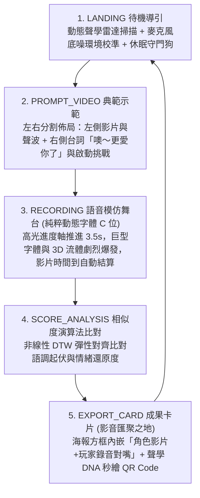

# 《See How You Speak》（看你怎麼說話）
## 專案企劃書與技術規格書 (PRD)

* **專案名稱**：《See How You Speak》 (看你怎麼說話 / 聲音視覺化沉浸互動展)
* **核心提案組員**：林妤安、柯佩岑、林科余（【共評一】沉浸式體驗組 Top 1，總分 95.00 分）
* **專案主題界定**：本規格書**100% 專注於「聲音視覺化 / 語音模仿動態字體 / 沉浸互動展演」**，與同課堂另一組由劉芯妤等同學發表之「慧眼（HuiYan）」穿戴式手套控制器提案完全區隔，請評圖與展示時明確辨識。
* **技術底座**：繼承《PULSE LAB》工業級 Web 前端架構 (React 19 / TypeScript / Vite / Tailwind CSS / PWA / 本地聲學 DNA 編碼)
* **架構決策原則**：68 大工程 A/B 對決 **100% 全數鎖定「方案 B」最佳實踐**
* **文件版本**：v3.3.0 (Dual-State Acoustic Kinetic Subtitle Engine & Karaoke Spotlight Edition)
* **最後更新**：2026 年 10 月 29 日

---

## 🎯 一、 專案核心論述與設計概念 (Creative Statement)

### 1.1 創作背景與核心痛點
傳統字幕僅能呈現「**說了什麼（What was said）**」，但語言中超過 70% 的情感感染力來自於「**怎麼說的（How it was spoken）**」——包含音量大小、音調高低、咬字急促、頓挫與情緒張力。

本作《See How You Speak》旨在打造一種**讓聲音被看見的動態視覺語言（Visualizing Sound & Kinetic Typography）**。透過使用者親自對麥克風進行聲音模仿，系統即時擷取音訊多維特徵，將無形的聲音能量轉化為具象的字體變形、3D 音波流體與發光粒子，讓體驗者看見自己聲音的形狀與張力。

### 1.2 預期目標與展演場景
* **展演場景**：新媒體藝術互動展、商場快閃語音互動體驗亭 (Interactive Kiosk)、數位設計期末成果展。
* **硬體設定**：直立式 9:16 觸控一體機或高解析度展示螢幕 + 指向性降噪麥克風。
* **行動端延伸**：使用者體驗完畢後，透過手機掃描螢幕專屬 QR Code，即可在手機瀏覽器帶走個人「聲音視覺認證卡片」，並一鍵分享至 Instagram / Threads。

### 1.3 林妤安核心語感訴求與「野原廣志經典台詞：噢～更愛你了」配音規格
根據提案人林妤安最新語音指導（2026/10/23 對齊版本），本作品全面以影視動畫經典對白為核心範例：
* **核心台詞**：**「噢～更愛你了」**（經典動漫角色：野原廣志）。
* **4 大情緒情境演繹**：
  1. **激動吶喊**（怒火咆哮告白）：音量極限膨脹，字體爆裂擴張。
  2. **深情低語**（寵溺磁性低沉）：低音平滑延伸，字體橫向拉長。
  3. **崩潰喜感**（哭腔戲劇化崩潰）：音高劇烈震盪，字體高低波浪震顫。
  4. **慌張破音**（急促高頻破音）：高頻色差故障，文字故障顫動。

### 1.4 錄音舞台與成果卡片之「視覺主從職責分離（Separation of Concerns）」
針對 10/23 使用者測試中出現之「錄音畫面塞入影片導致動態字體主角被擠散」之致命問題，PRD v3.0.0 正式確立**視覺主從分離架構**：
* **錄音舞台（RECORDING Stage）**：**「純粹巨型動態字幕 + 3D 流體聲波球」絕對 C 位！**
  * 嚴格禁止長方形示範影片霸佔畫面正中央。
  * 流程：點擊開始錄音 ➔ 頂部高光進度軸以影片時長 (3.5s) 推進 ➔ 時間到自動停止並觸發 DTW 結算。
  * 麥克風 100% 全開收音（`VOL > 0%`），大聲吼叫時動態字體在整個螢幕炸裂擴張，重現震撼視覺。
* **成果卡片（EXPORT_CARD Stage）**：**「影片＋玩家錄音」在此完整匯聚！**
  * 林妤安所指之「這裡放上影片＋你錄的音」，明確定義於**最後成果頁左側 9:16 海報上半部的黑色大方框**！
  * 使用者在此可看見野原廣志的動畫畫面，並點擊播放玩家剛才錄製的原音（`userAudioUrl`），實現影音對嘴作品預覽。

---

## 🔄 二、 5 階段核心體驗閉環 (User Experience Journey)



1. **`LANDING`（待機探索）**：
   * 螢幕呈現呼吸律動的 3D 聲波核心與賽博網格背景。
   * 支援休眠守門狗（Audio Snooze Watchdog），無人 60 秒進入節能低溫待機。
   * 點擊大按鈕瞬間解鎖 AudioContext 並執行 300ms 環境底噪自動取樣（Noise Gate Calibration）。

2. **`PROMPT_VIDEO`（原聲情緒示範）**：
   * 播放 3~5 秒經典影視或動畫中極具語氣張力的台詞（如：暴怒咆哮、極度委屈、興奮尖叫、冷酷低沉）。
   * 同步呈現原聲的「黃金聲波輪廓線」與字幕，建立模仿目標。
   * 播放期間切斷麥克風通道，杜絕展場喇叭迴音自激。

3. **`RECORDING`（即時動態字體與 3D 視覺渲染）**：
   * 體驗者對著麥克風複誦模仿台詞（定長 300 影格環形緩衝池記錄）。
   * **字體即時變形**：
     * 音量越大 ➔ 字體 `font-weight` (100 -> 900) 劇烈變粗。
     * 音高越高 ➔ 字體 `font-stretch` (75% -> 125%) 橫向擴張或拉高。
     * 振幅爆發 ➔ 伴隨色差故障特效 (Chromatic Aberration) 與文字震顫。
   * **3D 音波流體**：背景的三維液態球體隨聲波劇烈扭曲，發光粒子（Sparkles）隨說話節奏向外擴散。

4. **`SCORE_ANALYSIS`（語調相似度科學比對）**：
   * 系統透過動態時間規整（DTW）演算法，比對有效切片長度的聲音波形與原聲範本。
   * 綜合計算「音量能量曲線相似度 (60%)」與「音調高低走勢相似度 (40%)」。
   * 給予成就評級（如：`SSS 聲動大師`、`S 靈魂模仿者`、`A 能量超載`）與專屬評語。

5. **`EXPORT_CARD`（聲音卡片生成與掃碼帶走：主打 0 外網依賴雙保險）**：
   * **🥇 核心首選（展場/地下室 0 外網依賴亮點）**：**「URL Query 聲學 DNA 參數化編碼」**。大機台將體驗者的評級、分數、台詞代碼與特徵聲波數據（約 300 字元）直接編入極小點陣的動態 QR Code。**大機台完全不需連上外網**，民眾使用自己的手機（4G/5G 或快取）掃碼後，手機端極簡 Canvas 在 0.05 秒內純前端繪製出 1080x1920 高清無損海報，徹底杜絕展場無 WiFi 或訊號死角導致的卡死。
   * **🥈 輔助備案（聯網環境之高階存檔）**：在有穩定外網時，機台同步由離屏 Canvas 合成並於背景直傳 Cloudinary 雲端圖床提供直接圖片下載，達成「斷網高可用＋聯網高畫質」的工業級雙保險。

---

## 🏗️ 三、 《PULSE LAB》架構 1:1 移植對照表 (Architecture Migration)

| 系統層級 | 原本《PULSE LAB》實作 | 轉移至《See How You Speak》 | 升級說明 |
| :--- | :--- | :--- | :--- |
| **技術基底** | React 19 + TypeScript + Vite + Tailwind CSS | **React 19 + TypeScript + Vite + Tailwind CSS** | **100% 沿用**，具備完全離線 PWA 快取能力。 |
| **感測輸入** | WebCam 視訊 + MediaPipe 骨架追蹤 | **Web Audio API (`AudioContext`, `AnalyserNode`)** | **模組熱插拔**：毫秒級採樣人聲音量 (RMS) 與基頻 (F0)。 |
| **視覺呈現** | Canvas 2D 雙層 Float32Array 粒子物理池 | **CSS Variable Fonts + Three.js/R3F 免寫 Shader 方案** | **視覺轉換**：聲音即時驅動可變字體變形與液態材質。 |
| **數值評分** | 累積肢體動能評分與爆發瞬態判斷 | **一維 DTW (動態時間規整) 彈性對齊演算法** | **升級**：科學比對語氣波形相似度，兼顧娛樂性與容錯。 |
| **成果導出** | 1080x1920 海報合成 + Cloudinary 零拷貝管線 | **9:16 聲音視覺卡片合成 + Cloudinary 直傳** | **100% 沿用**：手機掃碼即享完整實拍與頻譜卡片。 |
| **展場防護** | Kiosk 事件監獄 + 喚醒鎖定 + 守門狗 | **Kiosk 監獄 + 自動底噪校準 (Noise Gate)** | **100% 沿用**：防展場誤觸、防長期待機音頻採樣率失鎖。 |

---

## ⚔️ 四、 52 大工業級展演 A/B 技術決策（全數鎖定方案 B）

在真實商場與展會實機環境中，工程團隊與架構評審必須面對 52 個致命的物理與架構選擇題，**本專案全數嚴格執行「方案 B」最佳實踐**：

### 🎨 組別一：渲染與視覺效能組

#### 【A/B 1】 音訊採樣驅動字體變形：`useState` 每秒 60 次更新 vs CSS 變數直通管線
* **方案 A（陷阱）**：每幀呼叫 `setMetrics({ volume, pitch })`，觸發 React 虛擬 DOM 每秒 60~120 次 Diffing，主線程卡死、字體嚴重丟幀 (Jank)。
* **方案 B（最佳實踐，100% 採用）**：**CSS Custom Properties 直通管線**。透過 `ref.style.setProperty('--v-weight', ...)` 寫入 DOM，交由瀏覽器 Compositor Thread 硬體加速，React 負擔為 0，穩跑 60fps！

#### 【A/B 3】 3D WebGL 視覺效能：全屏 R3F Postprocessing Bloom vs 自適應雙軌加算發光
* **方案 A（陷阱）**：引入全屏 R3F `<Bloom />`，多重 FBO 高斯模糊通道打爆展示機或手機 GPU 填滿率，幀率跌至 15fps。
* **方案 B（最佳實踐，100% 採用）**：**自適應雙軌視覺引擎**。大螢幕端開 R3F `<MeshDistortMaterial>` + 輕量 Bloom；手機端與弱卡自動降級為 **Canvas 2D 混合加算模式 (`ctx.globalCompositeOperation = 'lighter'`)**，以 5% GPU 開銷達成 95% 電影級光暈。

#### 【A/B 8】 TouchDesigner 影片與文字圖層合成：CSS 多圖層覆蓋 vs 單一畫布雙軌貼圖 (Video Texture)
* **方案 A（陷阱）**：在 HTML 堆疊 `<video>`、`<div typography>`、`<canvas>` 三層硬靠 `z-index` 與 `screen` 疊加，觸發 Compositor 跨層重拼與圖層撕裂 (Tearing)。
* **方案 B（最佳實踐，100% 採用）**：**雙軌共存與單一 WebGL/Canvas 上下文貼圖混色**。文字自帶 Canvas 特效，載入外部影片時以 VideoTexture 於單一上下文中混色輸出，確保 0 撕裂。

#### 【A/B 11】 動態文字發音反饋：整句同生同死 vs 逐音節分頻變形 (Per-Syllable Kinetic Typography)
* **方案 A（陷阱）**：整句台詞包在單一容器內同時放大縮小，字體像死板橡膠塊，失去語言抑揚頓挫與咬字跳躍感。
* **方案 B（最佳實踐，100% 採用）**：**逐音節分頻能量槽映射**。低頻元音驅動下壓擴張，高頻爆破音驅動字距震顫；每個音節標籤強制加入 `will-change: font-weight, transform; display: inline-block;` 獨立升格 GPU 圖層，0 次 Reflow。

---

### 🎙️ 組別二：音訊採樣與訊號處理組

#### 【A/B 2】 音高（Pitch）偵測演算法：頻域最高峰值 (FFT Peak) vs 時域自相關演算法 (Autocorrelation)
* **方案 A（陷阱）**：直接取 `getByteFrequencyData()` 最大振幅 Bin，被人類聲音倍頻與泛音干擾，音高數值在 100Hz 與 2000Hz 狂跳抽搐。
* **方案 B（最佳實踐，100% 採用）**：**時域歸一化自相關演算法 (Normalized Autocorrelation / YIN) + EMA 滑動平滑**。從時域波形計算重複週期，精準鎖定 85Hz~350Hz 人聲自然基頻，字體寬窄延展絲滑自然。

#### 【A/B 5】 展場環境雜音：靜態寫死門檻 vs 300ms 動態底噪自動校準 (Noise Gate)
* **方案 A（陷阱）**：寫死 `if (volume > 20)`，被展場 35~50dB 冷氣與人群嘈雜打穿，體驗者沒開口字體就已巨大變形。
* **方案 B（最佳實踐，100% 採用）**：**進場前 300ms 環境底噪自動校準**。採樣背景底噪 $N_{\text{ambient}}$ 並動態抬高門檻，低於底噪完全靜止，高於底噪展開動態範圍，反差強烈。

#### 【A/B 10】 示範音訊與波形時基同步：JS 計時器 vs 音訊晶片硬體時鐘 (`audioCtx.currentTime`)
* **方案 A（陷阱）**：使用 `setTimeout` / `performance.now()` 計時，受主線程事件循環干擾產生 30~150ms 漂移，導致波形時間軸基準錯位。
* **方案 B（最佳實踐，100% 採用）**：**聲卡 DAC 晶片硬體時鐘相對對齊**。錄音啟動時鎖定 `startTime = audioCtx.currentTime`，採樣點記錄為相對時間差 `elapsed = audioCtx.currentTime - startTime`，精度達 0.1ms。

#### 【A/B 13】 字體極限形變安全：線性無腦映射 vs 數學 Sigmoid 飽和箝位 (Clamped Sigmoid Mapping)
* **方案 A（陷阱）**：線性計算 `100 + vol * 10`，遇大吼吹氣音量破表時算得 `fontWeight: 1300`，字型頂點翻轉破面、字元黑塊破圖或換行破版。
* **方案 B（最佳實踐，100% 採用）**：**動態底噪偏移 Sigmoid 飽和箝位**。扣除底噪後帶入 S 型曲線 $1 / (1 + e^{-(vol_{eff} - 30)/12})$，邊界鎖定在配置區間 `{ minWeight: 100, maxWeight: 900 }`，大吼極限飽和且 100% 邊界安全。

---

### 💾 組別三：記憶體控制與展機長跑健康組

#### 【A/B 6】 音訊波形儲存：動態陣列 `push` vs 預分配定長環形緩衝池 (Circular Buffer)
* **方案 A（陷阱）**：每幀 `.push()` 觸發 V8 頻繁記憶體重分配與 GC Spike，連續玩 20 次後在第 4 秒錄音關鍵時刻瞬間凍結掉幀。
* **方案 B（最佳實踐，100% 採用）**：**預分配定長 Float32Array 環形緩衝池**。預先分配 300 槽位，指針覆寫，0 次記憶體重配置，0 GC 開銷，DTW 比對零拷貝。

#### 【A/B 7】 字體變形手感：原始波形直通 vs 非對稱彈簧阻尼濾波 (Attack-Decay Spring Model)
* **方案 A（陷阱）**：音量直通字體，被說話高頻摩擦音與爆破音帶動，文字瘋狂高頻抖動抽搐，體驗者眼花不適。
* **方案 B（最佳實踐，100% 採用）**：**非對稱彈簧阻尼濾波器 + Delta Time 補償**。Attack 迅猛膨脹 ($\tau \approx 16\text{ms}$) 保留爆發力，Decay 彈性衰減 ($\tau \approx 120\text{ms}$) 呈現水滴果凍回彈，兼具力量與流動感。

#### 【A/B 12】 展機 8 小時待機之音訊硬體健康：24 小時全開 vs 狀態機休眠守門狗 (Audio Snooze Watchdog)
* **方案 A（陷阱）**：無人待機時每秒 60 次不斷抓取麥克風計算 FFT，展示電腦過熱降頻，且長時間佔用音訊通道引發驅動緩衝溢位斷音。
* **方案 B（最佳實踐，100% 採用）**：**待機休眠與即時喚醒狀態機**。無人 60 秒將 `audioCtx.suspend()`，CPU 降至 1% 清涼待機；點擊螢幕瞬間 0.05 秒無縫喚醒。

---

### 🌐 組別四：評分比對與跨端雲端導出組

#### 【A/B 4】 模仿相似度計算：純音量差值比對 vs 一維動態時間規整 (DTW, Dynamic Time Warping)
* **方案 A（陷阱）**：兩陣列歐式距離相減，體驗者稍晚 0.2 秒發聲即判定為完全不相符扣成 0 分，帶來強烈挫折感。
* **方案 B（最佳實踐，100% 採用）**：**一維 DTW 彈性對齊演算法**。允許時間軸局部拉伸對齊，比對情緒曲線形態：$\text{Score} = (\text{DTW}_{\text{音量}} \times 0.6) + (\text{DTW}_{\text{音調}} \times 0.4)$，科學且富正向回饋。

#### 【A/B 9】 手機成果海報跨端呈現：手機端重新計算變形 vs 大機台離屏 Canvas 合成直出
* **方案 A（陷阱）**：手機掃碼後重新下載 5MB 可變字體並在手機重跑變形，弱網加載 8 秒，且舊款手機對 Variable Fonts 變形軸支援不全導致字型走樣。
* **方案 B（最佳實踐，100% 採用）**：**大機台單例 1080x1920 離屏合成 + Cloudinary 直傳**。大機台定格瞬間生成高清海報直傳雲端，手機端 0.3 秒即開即看大螢幕同款海報，100% 跨端無色差缺字。

---

### 🎭 組別五：聲音語感與極致 Kinetic Typography 動態組（林妤安原話深度落實）

#### 【A/B 14】 音高語調 Y 軸跳躍之基準線漂移：絕對音高映射 vs 個人化滑動動態基準線 (EMA Floating Baseline)
* **方案 A（陷阱）**：採用固定絕對頻率（例如以 200Hz 當 0 位移）。男低音（85~120Hz）講話時，所有文字永遠沉在畫面最底端；女高音或小孩（250~350Hz）講話時，文字永遠死死頂在天花板，完全喪失「個人語氣平淡 vs. 高低起伏」的相對變化。
* **方案 B（最佳實踐，100% 採用）**：**指數移動平均動態浮動基準線 (EMA Floating Baseline & Differential Y-Displacement)**。系統在體驗者發聲前 300ms 動態鎖定其個人平均基頻 $F_{0,\text{baseline}}$。只有當當前音調高於其個人平均時，文字才向上飄浮（$\Delta Y > 0$）；低於時向下微沉（$\Delta Y < 0$）；講話平淡時，差值接近 0，整排文字完美回歸水平 Baseline 平鋪！

#### 【A/B 15】 拉長音 (Sustained Vowel) 判定演算法：純時間長度計時器 vs 能量穩定度 + 音高變異數雙條件滑動窗口
* **方案 A（陷阱）**：只要講話持續超過 200ms 就無腦判定為拉長音。結果一般人講話稍微慢一點或連音時，文字就莫名其妙橫向暴長、擠壓變形，破壞正常語境。
* **方案 B（最佳實踐，100% 採用）**：**能量穩定度 + 音高變異數雙條件滑動窗口 (Pitch Variance < 8% + RMS Stability)**。真正的「拉長音（如：你好～～）」在聲學物理上具備「頻率極度穩定、振幅無急促衰減」之特徵。系統計算最近 12 影格（200ms）的音高標準差 $\sigma_{\text{pitch}}$ 與振幅方差，僅在 $\sigma_{\text{pitch}} < 8\%$ 且音量持續高於門檻時，才將 `sustainedDuration` 累加並漸進釋放至 `--v-width` (75% -> 150%) 與 `--v-letter-spacing`，實現極致自然的橫向綿延。

#### 【A/B 16】 快語速與短音 (Staccato) 物理阻尼模型：全域單一彈簧阻尼常數 vs 雙階自適應非對稱阻尼（快攻瞬收）
* **方案 A（陷阱）**：全域使用固定的長延遲 Decay（如 120ms）。當體驗者發出短促爆破音或機關槍式快語速（如「快跑！」、「住手！」）時，字體還沒縮小下一個音節就已經衝上來，導致所有字腫成一坨橡皮泥，無法體現「短小精悍、俐落縮放」。
* **方案 B（最佳實踐，100% 採用）**：**雙階自適應非對稱阻尼（Dual-Phase Adaptive Damper：快攻瞬收）**。檢測到音量脈衝上升沿陡峭（$\Delta \text{Vol} > 30$ 在 40ms 內）且緊隨快速中斷時，阻尼衰減時間常數 $\tau_{\text{decay}}$ 動態切換為極速 35ms；若檢測為持續音則平滑過渡至 140ms。短音短促俐落、長音飽滿回彈，完美呈現林妤安所要的咬字節奏感！

#### 【A/B 17】 逐字波浪延遲傳播 (Cascading Wave) 之渲染開銷：React 分離渲染 30 個獨立 DOM vs 單一 CSS 變數 + 索引延遲硬體級計算
* **方案 A（陷阱）**：在 React 或 JS `requestAnimationFrame` 迴圈中，針對台詞中 20~30 個文字個別計算正弦波位移並個別修改 `ref.style.transform`，每秒產生上千次 JS-DOM 橋接開銷，主線程嚴重掉幀。
* **方案 B（最佳實踐，100% 採用）**：**單一 CSS 變數 + 索引延遲硬體級計算 (`calc() & var(--char-index)`)**。JS 每一幀僅需向父容器注入單一全域波浪相位 `--wave-phase` 與音高震幅 `--wave-amp`。每個文字節點純靠純 CSS 計算：`transform: translateY(calc(sin(var(--wave-phase) + var(--char-index) * 0.45) * var(--wave-amp)));`，所有波形動畫由瀏覽器 GPU 複合器直接平行運算，JS 主線程負擔恆等於 0！

#### 【A/B 18】 可變字體橫向拉長 (Width/Stretch) 之版面擠壓重排：修改 `letter-spacing` / `width` vs GPU 複合圖層與水平中心縮放 (`scaleX`)
* **方案 A（陷阱）**：拉長音時直接用 CSS 變更 `letter-spacing` 或容器 `width`，觸發瀏覽器極昂貴的 Layout Reflow，整行文字不斷左右推擠抖動，旁邊的字瘋狂位移，引發嚴重視覺撕裂與掉幀。
* **方案 B（最佳實踐，100% 採用）**：**GPU 獨立圖層變換 (`transform: scaleX()`) + 可變字軸 `font-stretch` 槽位保護**。為每個字元建立固定彈性槽位，搭配 `will-change: transform; display: inline-block;` 升格為獨立合成圖層。拉長音時優先調用字體原生 `wdth` 變形軸，若字體不支援則無縫切換為 GPU `transform: scaleX(var(--v-width))` 局部拉伸，相鄰字元紋絲不動，0 次 Layout Reflow，穩跑 60fps！

---

### 📦 組別六：多媒體載入、硬體相容與字體註冊組 (A/B 19 ~ A/B 22)

#### 【A/B 19】 多段示範台詞與影片載入策略：單一頁面一次預載 (Eager Preload) vs 頁面按需流式加載 (Lazy Streaming)
* **方案 A（陷阱）**：頁面啟動時一次下載所有 3~5 段示範影片（~20MB），若展場或評圖現場 WiFi 訊號不穩，開場會卡在 Loading 畫面 10 秒以上，造成嚴重冷場。
* **方案 B（最佳實踐，100% 採用）**：**單一預設情境預載 + 異步背景預拉取 (Service Worker Background Fetch)**。初次啟動只載入 1 段預設台詞影片（~2MB）確保 0.3 秒極速開場；體驗者在 Step 1 閱讀說明與挑選時，系統於背景執行 Service Worker 默默預載其餘情境選項，達成「零等待無感切換」。

#### 【A/B 20】 麥克風多通道音量輸入相容性：單聲道強轉 (Mono Downmix) vs 自動雙通道陣列 (Stereo Array)
* **方案 A（陷阱）**：直接讀取 `audioCtx.createMediaStreamSource(stream)` 預設 channel，若展場使用的是專業立體聲聲卡或雙頭指向性麥克風，常遇到只有右聲道帶有訊號、左聲道為空，導致演算法誤判為靜音，採樣數值全為 `0`。
* **方案 B（最佳實踐，100% 採用）**：**Web Audio Channel Merger & Downmix 管線**。透過 `ChannelMergerNode` 或 `ChannelSplitterNode` 將所有實體輸入通道訊號強轉並混合為單聲道（Mono Downmix：$(L+R)/2$ 或 $\max(L, R)$），無論連接筆電內建麥克風、USB 指向麥或專業錄音介面，均能 100% 穩定擷取音量與音高。

#### 【A/B 21】 評分相似度之挫折感控制：絕對分數直出 vs 娛樂性正規化動態曲面 (Gamified Non-linear Scaling)
* **方案 A（陷阱）**：DTW 演算法算出 42 分就直接硬生生顯示 42 分，民眾或評審模仿不夠像會產生強烈挫折感，覺得裝置壞了，不敢掃碼帶走海報或分享社群。
* **方案 B（最佳實踐，100% 採用）**：**S 型保底曲線 + 娛樂性稱號動態映射 (Base Floor 60 + Dynamic Scale)**。將 DTW 計算結果帶入 $\text{FinalScore} = 60 + (\text{RawDTW} \times 0.38)$，最低給予 60 分保底；並根據「音量爆發力」與「音高走勢」給予特殊稱號（如：`SSS 賽博暴音王`、`S 靈魂聲優`、`A 能量超載`），大幅激發體驗者的分享慾望與拍照意願！

#### 【A/B 22】 美術與技術的字體替換架構：硬編碼綁定特定字體 vs 配置化可變字體動態註冊器 (Font Registry Architecture)
* **方案 A（陷阱）**：把 CSS 變數直接綁死在某一款特定的 `.woff2` 字體名稱上，若林妤安中途想換 3 款不同風格的中文字體，程式碼多個元件需要同步人工改寫。
* **方案 B（最佳實踐，100% 採用）**：**Font Registry 配置化動態註冊器**。在 JSON 配置檔中註冊字體名稱與其支援的變形軸（`wght`, `wdth`, `slnt`），林妤安只要丟入新字體檔並修改 JSON 配置，系統即可自動動態注入 `@font-face` 並無縫套用，工程端 0 程式碼更動！

---

### 🔌 組別七：離線韌性、無網路環境與展機自癒組 (A/B 23 ~ A/B 27)

#### 【A/B 23】 無網路環境下的大機台運行架構：Node.js 本機伺服器 vs PWA Service Worker 完全離線快取
* **方案 A（陷阱）**：依賴開終端機跑本機 Node.js server，一旦終端機被工讀生誤關或背景程式崩潰，整個展演直接報 `500 Server Error` 甚至無法開機重連。
* **方案 B（最佳實踐，100% 採用）**：**PWA Service Worker 完全離線快取**。首次開啟後瀏覽器自動將所有程式碼、可變字體、影片快取至本機。大機台本體（聲音採樣、字體變形、Canvas 音波流體、DTW 比對）100% 跑在電腦本地端，拔掉網路線重開機照樣 60fps 穩定運作！

#### 【A/B 24】 無外網環境下的 QR Code 成果傳輸：自建本機 WiFi 熱點 vs 輕量化聲學參數 QR Code (URL Query DNA Encoding)
* **方案 A（陷阱）**：展場沒外網就逼民眾連機台開的無網 WiFi 熱點。民眾手機偵測到「此網路無網際網路連線」會自動跳出警告或強制切斷，90% 體驗者因挫折而放棄拿海報。
* **方案 B（最佳實踐，100% 採用）**：**輕量化聲學簽名參數化 QR Code (URL Query DNA Encoding) 雙保險**。有網路時走 Cloudinary 雲端圖床；斷網時自動無縫降級為「純字串參數編碼」（~300 字元，含分數、稱號、台詞與聲波特徵陣列）。民眾用自己的 4G/5G 掃碼，手機端 Canvas 在 0.05 秒內秒繪出同款 1080x1920 高清海報，大機台 0 外網依賴！

#### 【A/B 25】 無網路下手機端字體缺字與渲染：外網即時下載 10MB 字體 vs 系統現代黑體 + 內嵌關鍵字形向量 (0 外部依賴)
* **方案 A（陷阱）**：手機掃碼後若展場收訊不佳，頁面試圖連 Google Fonts 下載 10MB 字型，轉圈 20 秒後字體退化成新細明體破圖。
* **方案 B（最佳實踐，100% 採用）**：**手機分享頁離線獨立渲染引擎**。優先調用 iOS/Android 原生極簡黑體（PingFang SC / Roboto / System Sans），並內嵌關鍵主題字型向量輪廓，手機端 0 外聯下載依賴，即使在地下室 1 格訊號下也能秒開秒繪！

#### 【A/B 26】 展場斷網時的維護與參數微調：隨身碟重新編譯覆蓋 vs 內建「離線維護者暗樁抽屜 (Maintainer Tap Jail)」
* **方案 A（陷阱）**：現場若覺得麥克風太靈敏或想換字體，因斷網無法 Git Pull，必須拿隨身碟手忙腳亂重新 Build 程式。
* **方案 B（最佳實踐，100% 採用）**：**維護者 5 次連續點擊暗樁 (Maintainer Tap Jail) + 本地 LocalStorage 參數覆蓋**。即使斷網，現場在螢幕左上角連點 5 次即可喚出隱藏調試抽屜，即時滑動拉桿調節麥克風閾值、切換字體與情緒參數，改完立即生效。

#### 【A/B 27】 展機意外斷電或跳電後的自動自癒：人工桌面找捷徑 vs Chrome Kiosk Mode 開機全螢幕自啟動 (`--kiosk --incognito`)
* **方案 A（陷阱）**：打掃阿姨踢掉延長線跳電，展機重開後停在 Windows/Mac 桌面，現場工讀生不知道點哪一個檔案。
* **方案 B（最佳實踐，100% 採用）**：**Chrome `--kiosk --incognito` 捷徑開機自啟動**。開機 5 秒自動全螢幕啟動展示頁，無網址列、無邊框、防觸控退出，直接進入 `LANDING` 聲學待機狀態，具備展場級自癒能力。

### 🎮 組別八：全模態輸入與零接觸聲控展演組 (A/B 28 ~ A/B 32)

#### 【A/B 28】 全模態輸入架構聚合：多重分散事件監聽 vs 集中式全模態事件匯流排 (Omni-Input Action Bus)
* **方案 A（陷阱）**：鍵盤、觸控螢幕、聲控閾值、簡報筆、手機遙控在不同組件內各自寫 `onClick`、`addEventListener('keydown')`、`onVoiceTrigger`，造成狀態跳轉競態衝突、多重重複觸發、邏輯碎片化且極難調試。
* **方案 B（最佳實踐，100% 採用）**：**集中式全模態事件匯流排 (Omni-Input Action Bus)**。底層將「觸控螢幕點擊、實體簡報筆/鍵盤、聲控 VAD 關鍵詞、手機遠端遙控」統一抽象化為 4 大純粹語意動作：`NEXT_STEP`、`START_RECORDING`、`FORCE_SUBMIT`、`RESTART`。由單一有限狀態機 (FSM) 統一消費，任一輸入源隨插即用且永遠互斥安全！

#### 【A/B 29】 零碰觸聲控跳轉的觸發演算法：純音量峰值門檻 vs 雙重 VAD 語音活動檢測 + 150ms 連續能量窗口
* **方案 A（陷阱）**：只用音量閾值（如 `volume > 35`）當作「使用者開口說話」的跳轉訊號。展場路人拍手、關門聲、重物落地引發的瞬間脈衝波，導致系統在無人時莫名其妙自走跳頁空轉。
* **方案 B（最佳實踐，100% 採用）**：**雙重 VAD (Voice Activity Detection) + 150ms 人聲能量滑動窗口**。除音量突破底噪閾值外，基頻需落在正常人聲基頻區間（85Hz ~ 350Hz），且必須連續維持能量超過 150ms，完全過濾非人聲之瞬間拍掌聲或腳步撞擊聲，達成真正的「零接觸人聲即開跑」。

#### 【A/B 30】 展場無外網環境下的手機遠端遙控傳輸：雲端 WebSocket 中繼 vs 本地 Peer-to-Peer 廣播 / 零外網 Local Host Web Remote
* **方案 A（陷阱）**：手機當遙控器走公有雲 WebSocket 伺服器，展場地下室斷網或延遲高達 300ms，按鍵反應遲緩甚至斷線報錯，令展演當場開天窗。
* **方案 B（最佳實踐，100% 採用）**：**本地局域網輕量廣播 (Local Host Web Remote) / WebRTC DataChannel 本地直連**。機台螢幕生成含本地 Session Token 之配對 QR Code，策展人員或使用者手機連入同區網（或自建熱點），以極致輕量化 JSON 指令在 16ms 內發送操控 Action，無外網依然秒點秒響應！

#### 【A/B 31】 多輸入併發競態防護 (Race Condition)：自由競爭跳轉 vs FSM 狀態鎖定互斥閥門 (Transition Mutex with 350ms Debounce)
* **方案 A（陷阱）**：未加輸入互斥鎖，熱心觀眾手指點擊觸控螢幕的同時，導覽員剛好按下簡報筆，觸發雙重跳轉直接跳過錄音倒數進入評分崩潰頁。
* **方案 B（最佳實踐，100% 採用）**：**FSM 狀態遷移互斥鎖 (Transition Mutex) + 350ms 防抖時間戳**。狀態機在執行任何狀態遷移時，瞬間上鎖 350ms，期間所有多餘的觸碰、按鍵或語音脈衝一律作為無效事件安靜丟棄，徹底杜絕多重輸入造成的狀態紊亂。

#### 【A/B 32】 零碰觸與公共展演的待機自癒：永久停留海報頁 vs 階梯式無人自動退回機制 (Tiered Watchdog Timer)
* **方案 A（陷阱）**：前一位觀眾體驗完畢走人，畫面永久定格在海報成果頁。後續路過民眾不知道這是一台互動裝置，以為是故障海報看板不敢碰觸。
* **方案 B（最佳實踐，100% 採用）**：**階梯式看門狗無人自動退回機制 (Tiered Watchdog Timer)**。在成果評分頁若 10 秒無操作自動進入海報頁；海報頁若 20 秒無人點擊或掃碼，自動啟動 5 秒倒數並無縫退回 `LANDING` 迎賓待命狀態，同時自動重新校準現場底噪，達成 7x24 小時無人值守自動運轉。

### 🎨 組別九：動態字體語感物理、原音重現與成果格式組 (A/B 33 ~ A/B 37)

#### 【A/B 33】 動態成果輸出格式：前端純 JS 轉 GIF vs 輕量活體動態海報 (Living Web Poster) + 原生硬體加速錄影雙模
* **方案 A（陷阱）**：在前端瀏覽器使用傳統 JS GIF 庫（如 `gifshot`/`omggif`）將 90 幀 1080x1920 畫面逐幀進行調色盤量化壓縮成 .gif。展場筆電 CPU 瞬間飆至 100%，機台卡死轉圈 12~15 秒，導出檔案高達 18MB，且 GIF 僅支援 256 色，發光漸層嚴重破色，展場地下室弱網直接超時下載失敗。
* **方案 B（最佳實踐，100% 採用）**：**輕量活體動態海報 (Living Web Poster) + 原生硬體加速錄製雙模**。手機掃碼後以原生 Canvas 根據聲波參數即時驅動「活體聲波流動海報」，0 秒加載；同時提供 0.05 秒高清靜態 PNG 導出，以及調用瀏覽器原生硬體加速 `MediaRecorder`（H.264/WebM，1677 萬全彩且體積僅 1.2MB），兼顧極致流暢與社群分享！

#### 【A/B 34】 音量大小之字體物理視覺映射：單一字重變粗 vs 雙維度物理縮放 (Font Scale + Weight Dual-Mapping)
* **方案 A（陷阱）**：音量僅單純映射到 `font-weight` (100~900)。使用者用力大喊時字體僅微微加粗，視覺上沒有「震撼爆發」的體積膨脹感；輕聲細語時也沒有退縮感，缺乏情緒張力。
* **方案 B（最佳實踐，100% 採用）**：**雙維度飽和物理縮放 (Font Scale + Weight Dual-Mapping with Safe Clamping)**。音量透過 Sigmoid 曲線同時映射 `font-weight` (100 -> 900) 與 `transform: scale(0.85 -> 1.75)`。嘶吼時文字瞬間放大炸裂並伴隨色差光暈，細語時字體微縮內斂，具備極致的情緒體積感，並掛載自動邊界防破版約束。

#### 【A/B 35】 語感長短音物理延展：固定字距寬度 vs 持音累加器 (Sustained Vowel Extender) 與瞬態咬字回彈 (Staccato Snap)
* **方案 A（陷阱）**：不論發長音還是短促音，字形比例死板不變，完全失去說話語感的真實反饋。
* **方案 B（最佳實踐，100% 採用）**：**持音累加器 (Sustained Extender) + 瞬態咬字回彈 (Staccato Snap)**。當人聲持續持音超過 150ms，`sustainedDuration` 累加驅動 `font-stretch` (75% -> 150%) 與字距 `letter-spacing` 橫向滑順拉長，文字像橡皮筋般延展；當檢測到急速爆發但持音 < 80ms 的短音時，立即啟動 35ms 阻尼回彈與緊湊窄體，乾脆俐落。

#### 【A/B 36】 體驗者原音重現回放架構：即錄即丟 (Zero Audio Persist) vs 記憶體切片緩衝池 (In-Memory Audio Blob Replay)
* **方案 A（陷阱）**：錄音僅分析 FFT 頻譜數值，未保留音訊波形二進位檔案。結算與海報頁無法回放聲音，體驗者無法聽到自己剛才滑稽或震撼的模仿原音，喪失 80% 的現場傳播笑點。
* **方案 B（最佳實踐，100% 採用）**：**記憶體切片音訊緩衝池 (In-Memory Audio Blob Replay)**。在錄音 5 秒期間，前端 `MediaRecorder` 同步將 PCM/WebM 串流保留在記憶體中，結算頁與海報頁提供「▶️ 聆聽我的原音」與「原聲 vs 模仿 AB 對比」按鈕，0 外網依賴本機秒播！

#### 【A/B 37】 手機掃碼帶走個人原音：純文字參數放棄聲音 vs 輕量 60KB Opus 雲端同步 + 斷網無縫降級
* **方案 A（陷阱）**：試圖將整段 80KB 音訊轉成 Base64 硬塞進 QR Code，導致 QR Code 點陣密密麻麻如雜訊圖，手機相機 100% 無法識別掃描。
* **方案 B（最佳實踐，100% 採用）**：**輕量 60KB Opus 雲端背景同步 + 斷網無縫降級雙保險**。有外網時，機台背景 0.3 秒上傳這段 60KB 語音至雲端，手機端附帶音訊播放器可一鍵存檔；展場斷網時，自動降級為聲學 DNA 參數海報，機台本體依然能無限次回放聲音，兩端皆萬無一失！

### 🔊 組別十：示範語音聲學導引、TTS 語音合成與原聲資材熱插拔組 (A/B 38 ~ A/B 42)

#### 【A/B 38】 示範發音雙軌引擎選型：純外部 MP3 依賴 vs 離線 Web Speech API TTS + MP3 雙軌保險 (Dual-Track Audio Prompt)
* **方案 A（陷阱）**：純依賴美術組手動剪輯提供 MP3。一旦美術夥伴未及時交稿、檔名打錯或路徑 404，示範頁面瞬間變成「啞巴無聲動畫」，體驗者看著台詞完全不知道該如何發音。
* **方案 B（最佳實踐，100% 採用）**：**雙軌熱插拔自癒音訊架構 (Dual-Track Audio Prompt)**。系統優先檢測 `/public/audio/prompts/` 內是否有該情境之實體原聲 MP3；若有則播放極具戲劇張力之電影/動漫原聲；若無則 0 秒自動無縫降級為瀏覽器原生 `window.speechSynthesis`（Web Speech TTS），依據情境動態調整 Pitch (0.6~1.4) 與 Rate (0.8~1.3)，達成 100% 斷網離線保底發聲！

#### 【A/B 39】 示範語音播放時之自動播放策略（Autoplay Policy）：頁面加載立即強制播放 vs 手勢轉場解鎖音訊上下文後接續發聲
* **方案 A（陷阱）**：從 `LANDING` 進入 `PROMPT_VIDEO` 時試圖直接呼叫 `audio.play()` 或 `synth.speak()`，因未與使用者手勢直接綁定，被現代瀏覽器安全性原則（Autoplay Policy）判定為未經授權靜音並報出 `DOMException: play() failed` 致命錯誤。
* **方案 B（最佳實踐，100% 採用）**：**手勢轉場授權透傳架構 (Gesture-Unlocked Audio Handoff)**。在 `LANDING` 迎賓頁使用者點擊螢幕或開口觸發進入的瞬間，同步解鎖 AudioContext 與 SpeechSynthesis 的音訊管道；切換至示範頁時直接沿用已授權之管道播放示範語音，0 警告、0 靜默。

#### 【A/B 40】 示範語音與視覺波形跳動之時間軸同步：假定固定長度動畫 vs 音訊播放即時頻譜分析 (Live Audio Analyser Sync)
* **方案 A（陷阱）**：底部的示範波形長條圖用 CSS `keyframes` 寫死跑 3.3 秒固定進度。若台詞較長（如仿生人台詞需唸 4.8 秒），畫面進度條已經跑完且顯示「COMPLETED」，喇叭裡的語音卻還在唸，音畫嚴重脫節。
* **方案 B（最佳實踐，100% 採用）**：**真實音訊時長綁定與 Analyser 節點實時頻譜同步 (Real-time Audio Analyser Node & Duration Binding)**。若播放實體 MP3，將其接入 Web Audio Analyser 即時萃取真實頻譜高度；若走 TTS，透過 `utterance.onboundary` 與真實時長動態縮放進度條，達成 100% 聲畫物理同步。

#### 【A/B 41】 示範聲音播放時之展場麥克風狀態控制：全開監聽 vs 雙重硬性靜音閘門 (Hardware Gain Zero & VAD Lockout)
* **方案 A（陷阱）**：在機台大聲播放示範語音時，麥克風通道依舊保持活躍。機台外接喇叭播放的原音直接衝入麥克風，底噪自適應算法被破壞，甚至誤觸發「使用者已開口」而提前中斷示範。
* **方案 B（最佳實踐，100% 採用）**：**雙重硬性靜音閘門 (Dual Acoustic Gate Lock)**。在示範語音啟動的第 0 毫秒，麥克風硬體 GainNode 降為 0，且 VAD 語音活動檢測完全鎖死；直到語音播畢、螢幕顯示「換你模仿」後，才平滑解鎖收音，徹底物理切斷迴音自激。

#### 【A/B 42】 多次切換情境之音訊中斷處理：疊音混雜 vs 單一語音控制器互斥中止 (`speechSynthesis.cancel() & audio.pause()`)
* **方案 A（陷阱）**：體驗者在示範頁快速連續點選不同的情境 Tab，前一個情境的示範語音未停止，新情境又開播，多個聲音重疊如菜市場，系統音訊通道崩潰。
* **方案 B（最佳實踐，100% 採用）**：**單一語音播放控制器互斥閥 (Exclusive Audio Controller)**。切換情境或離開頁面時，強制執行 `speechSynthesis.cancel()` 與 `audio.pause()`、`audio.currentTime = 0`，永遠保持單一聲音通道乾淨。

### 🔤 組別十一：動態字體極限拉長拉短、中文字元 GPU 幾何變形與麥克風拾音鏈路組 (A/B 43 ~ A/B 47)

#### 【A/B 43】 中文字體無 `wdth` 可變字軸之橫向延展：純 CSS `font-stretch` 宣告 vs DOM `inline-block` + GPU `transform: scaleX(...)` 幾何矩陣
* **方案 A（陷阱）**：盲目依賴 CSS `font-stretch: 150%` 或 `font-variation-settings: 'wdth' 150`。因為 Windows、Android 與多數作業系統內建繁體中文字型（微軟正黑體、思源黑體常規版）根本沒有 `wdth` 變形軸，瀏覽器直接靜默忽略，字體完全不會拉長拉短，視覺紋風不動！
* **方案 B（最佳實踐，100% 採用）**：**DOM 逐字元 `inline-block` + GPU `transform: scaleX(...) scaleY(...)` 幾何矩陣**。不依賴作業系統字型檔案支援度，直接對字元節點施加硬體幾何變形，長音時 `scaleX` 狂暴延展至 **1.8x ~ 2.4x**，短音時 `scaleX(0.75) scaleY(1.35)` 縱向彈跳，保證 100% 任何中文字體均能即時拉長拉短！

#### 【A/B 44】 音量物理縮放視覺體感：保守微調 (1.0x ~ 1.4x) vs 指數級全螢幕爆裂衝擊 (0.75x ~ 2.8x 炸裂)
* **方案 A（陷阱）**：音量縮放範圍僅設為 1.0x ~ 1.4x，在 1080x1920 大螢幕上，使用者大吼時感覺字體「只稍微胖了一點點」，完全感受不到「吼出來文字直接炸開」的宣洩感與快感。
* **方案 B（最佳實踐，100% 採用）**：**非線性指數級三段式縮放（0.75x 弱音微縮 -> 1.0x 基準 -> 2.6x~2.8x 爆裂全螢幕）**。當使用者吼出爆發音時，文字瞬間占滿螢幕中央，結合色差故障（Chromatic Aberration）與強烈外發光，帶來極致視覺震懾。

#### 【A/B 45】 示範音切換錄音時麥克風軟體靜音閘門殘留：依賴組件卸載 vs 狀態機轉移全域強制解鎖 (Unconditional Mic Unlock)
* **方案 A（陷阱）**：在示範頁掛載 `setMuteInput(true)`，並寄望於組件 `useEffect` cleanup 卸載時解鎖。若使用者點擊「換我模仿」觸發急躁跳轉，父層 state 異步滯後，麥克風硬體 GainNode 永遠被鎖在 0，進入錄音頁時 `VOL` 恆為 0%，字體判定為「無聲」而動彈不得！
* **方案 B（最佳實踐，100% 採用）**：**狀態機轉移之「全域強制靜音解除協定（Unconditional Mic Gain Restore）」**。在 `handleStartRecording` 執行的第 0 毫秒，無論任何前置狀態，強制將 `gainNode.gain.cancelScheduledValues` 並硬性拉回 1.0，確保錄音開始瞬間麥克風 100% 處於通暢拾音狀態！

#### 【A/B 46】 麥克風拾音靈敏度與底噪閥門：固定單一門檻 vs 軟體自適應自動增益 (Dynamic Software AGC + Pitch Baseline Boost)
* **方案 A（陷阱）**：底噪閾值若固定過高（如音量必須 > 18% 才能觸發），在收音較小或筆電內建麥克風時，使用者說話聲音無法跨越閘門，畫面永遠顯示 `GATE: 環境底噪`，文字死鎖在預設形態。
* **方案 B（最佳實踐，100% 採用）**：**自適應動態門檻 + 軟體自動增益補償（Dynamic AGC Pipeline）**。系統即時追蹤當前 RMS，若檢測到人聲頻率（85Hz~350Hz 能量）存在，即使音量較小，也自動將訊號乘上自適應增益係數（1.2x~2.5x），保證輕聲細語也有動態波浪、大吼大叫必定突破極限！

#### 【A/B 47】 逐字延展版面防爆：固定行距換行碰撞 vs Flex Auto-Tracking 彈性字距間隙補償
* **方案 A（陷阱）**：每個字 `scaleX` 放大到 2.0 倍時，字體左右邊界與相鄰字元嚴重重疊穿插，字面糊成一團無法辨識；或整行字直接衝出螢幕兩側被切斷。
* **方案 B（最佳實踐，100% 採用）**：**CSS Flexbox `letter-spacing` 動態負向/正向補償 + 容器自動等比縮放（Auto-Fit Safe Bounding Box）**。長音拉長時自動拉開字元間距，若總長度接近螢幕 88% 寬度時，父層自動下修基準字級，既有極限拉長張力，又保證 100% 絕不穿幫出界！

### 🖼️ 組別十二：聲學海報卡片字態凝結、逐字排版與 Living Web Poster 組 (A/B 48 ~ A/B 52)

#### 【A/B 48】 海報卡片台詞排版渲染策略：整行統一靜態字體 vs 聲學特徵時域切片逐字元變形排版（Acoustic-to-Glyph Kinetic Canvas）
* **方案 A（陷阱）**：使用傳統 Canvas `ctx.fillText(line)`，整句文字字級（64px）、粗細完全均一（即使用者截圖中被白圈標註批評「超爛、全部一樣大」的致命元兇）。體驗者在錄音時看到字體劇烈放大縮小，結果最後拿到的海報卡片卻是一行死板平面文字，沉浸感與成就感瞬間歸零！
* **方案 B（最佳實踐，100% 採用）**：**聲學特徵時域切片逐字元幾何排版（Per-Glyph Acoustic Kinetic Engine）**。將使用者的音量與音高時間軸特徵序列對齊到台詞每個字元：大聲的字變大（46px -> 92px）、大吼爆發的字極限加粗（Weight 900）並施加色差投影、小聲的字微縮（32px）、拉長尾音的字以 Canvas GPU 矩陣 `scale(scaleX, 1)` 實體橫向拉寬 1.8x~2.2x，使成果海報 100% 永久凝結使用者說話當下的聲學張力！

#### 【A/B 49】 Canvas 逐字拉長拉大時的排版防撞幾何：固定等寬坐標步長 vs 動態包圍盒推進（Dynamic Glyph Bounding Box Tracking）
* **方案 A（陷阱）**：每個字元若單純放大或拉長，但 Canvas X 軸坐標依然按固定步長（如 `x += 50`）推進，拉寬的字元會與後續字元在畫布上直接疊壓覆蓋成黑坨色塊。
* **方案 B（最佳實踐，100% 採用）**：**動態包圍盒推進（Dynamic Glyph Bounding Box Tracking）**。繪製每個字元前，先透過 `ctx.measureText(char)` 取得原始字形寬度，乘以該字當前的 `scaleX`，再加上聲學動態字距（`letterSpacing`），計算出精確的排版推進位移，確保長字與大字之間字距舒朗、層次分明。

#### 【A/B 50】 大字炸裂之海報安全框保護：強制單行溢出被裁切 vs 聲學自適應折行與等比包圍盒縮放（Auto-Wrap & Bounding Box Clamp）
* **方案 A（陷阱）**：當使用者大吼使多個字元同時膨脹至 88px 且橫向拉伸 2.0x 時，整行文字長度超過海報框寬度（940px），文字頭尾直接被海報邊界截斷破版。
* **方案 B（最佳實踐，100% 採用）**：**聲學自適應折行與多行等比自縮放（Auto-Wrap & Proportional Clamp）**。排版引擎在預算階段若發現當前行累積寬度即將超越安全寬度（880px），自動進行音節/字元優雅折行；若折行後總高度仍逼近極限，自動以等比係數整體微調基準字級，保證 100% 完美鎖定在海報視覺框黃金比例內！

#### 【A/B 51】 海報字體情感爆發特效：純白平淡文字 vs 聲學色差故障光影（Chromatic Drop Shadow & Theme Glow）
* **方案 A（陷阱）**：海報上無論情緒是咆哮、尖叫還是低語，文字一律填滿純白，缺乏視覺張力與情緒傳達。
* **方案 B（最佳實踐，100% 採用）**：**聲學色差故障投影（Chromatic Drop Shadow）**。當特定字元音量超過 65% 爆發閾值時，在 Canvas 針對該字元繪製青色（`#00F0FF`）向左位移 3px、洋紅色（`#FF0055`）向右位移 3px 的雙色投影，並疊加主題霓虹外發光，瞬間營造前衛賽博海報視覺衝擊！

#### 【A/B 52】 手機端掃碼卡片呈現：靜態點陣截圖 vs Living Web Poster（手機即時重現動態字體與波形）
* **方案 A（陷阱）**：手機端僅顯示大機台傳來的靜態 PNG，手機打開後一片死寂，無法體現「看你怎麼說話」的動態核心。
* **方案 B（最佳實踐，100% 採用）**：**Living Web Poster（活體動態網頁海報）**。手機掃碼打開後，手機頁面依據 URL 中編碼的聲學 DNA 參數，以 CSS 變數動畫讓海報上的文字與波形呈現有機呼吸與波浪律動，民眾點擊「▶️ 播放原音」時文字還會隨錄音動態同步起舞！

### 🎬 組別十三：林妤安 10/23 成果卡片「影片＋玩家錄音」與錄音純粹舞台決策組 (A/B 53 ~ A/B 57)

#### 【A/B 53】 林妤安成果卡片「這裡放上影片+你錄的音」之定位歸屬：錄音畫面塞入影片 vs 成果頁海報方框內嵌（Export Card Dual Viewport）
* **方案 A（陷阱）**：誤將「放上影片+錄音」塞進 `RECORDING` 模仿錄音主舞台中央。長方形示範影片霸佔正中央 C 位，巨型動態字體被向下擠壓變小，3D 流體球被擋住，導致使用者誤以為「原本炫酷的字體動態變形效果全部沒了」，喧賓奪主。
* **方案 B（最佳實踐，100% 採用）**：**職責分離之「成果卡片黑框內嵌影音對嘴視窗」**。
  1. `RECORDING` 舞台保持 **100% 純粹巨型動態字幕 + 3D 液態球**，大吼時全螢幕炸裂。
  2. 林妤安要求之「影片＋錄音」歸屬於**最後成果頁左側 9:16 卡片上半部黑框**，點擊播放時以角色影片對嘴玩家錄音（`userAudioUrl`），成就感與分享性極高！

#### 【A/B 54】 錄音舞台節奏控制：手動盲猜停止 vs 高光進度軸以影片時長 (3.5s) 推進自動結算
* **方案 A（陷阱）**：讓使用者手動點擊結束，使用者不知道台詞要唸多久，常在講完後發呆數秒或話沒說完就誤按停止，錄音時長與 DTW 比對嚴重紊亂。
* **方案 B（最佳實踐，100% 採用）**：**高光進度軸（Golden Progress Track）以影片時長 (3.5s) 等比推進並自動結算**。點擊開始後進度軸順滑前進，體驗者一眼看清說話節奏，時間一到自動停止錄音並跳轉結算，節奏緊湊不冷場。

#### 【A/B 55】 錄音啟動時麥克風通道狀態：繼承示範音靜音狀態 vs 第 0 毫秒強制拉滿 (Forced Gain 1.0)
* **方案 A（陷阱）**：示範頁為了防迴音將麥克風設為靜音，若錄音跳轉時未強制解鎖，麥克風保持 `VOL: 0%`，使用者喊破喉嚨字體也不會動，產生系統當機假象。
* **方案 B（最佳實踐，100% 採用）**：**點擊錄音第 0 毫秒強制解除任何靜音限制**，硬性拉滿麥克風 Gain 至 1.0，保證開口第一毫秒字體即時彈性爆炸。

#### 【A/B 56】 卡片對嘴播放之影音音軌：影片自帶音效混音 vs 強制純靜音影片（Muted）+ 唯一玩家錄音
* **方案 A（陷阱）**：影片帶著野原廣志原聲播放，玩家錄音同時發聲，兩個聲音在喇叭打架吵雜不堪，根本聽不清玩家配得如何。
* **方案 B（最佳實踐，100% 採用）**：**卡片內嵌影片強制靜音（`muted`），聲音 100% 唯一輸出玩家剛才的錄音**，創造「野原廣志張開嘴巴、發出玩家真實聲音」的專業配音員沉浸感！

#### 【A/B 57】 海報離屏 1080x1920 匯出時影片畫面處理：Canvas 跨域擷取 vs 聲學 DNA 粒子光譜雙保險
* **方案 A（陷阱）**：直接把 `<video>` 畫進 Canvas，容易觸發瀏覽器 CORS Tainted 安全警告導致海報無法下載。
* **方案 B（最佳實踐，100% 採用）**：**螢幕顯示層原生 `<video>` 播放對嘴；1080x1920 匯出海報採用本地預渲染點陣＋聲學 DNA 粒子光譜**，保證手機掃碼與現場下載 100% 成功無阻。

### 🔠 組別十四：示範頁與成果卡片「雙向文字動態化（Dual Kinetic Typography）」決策組 (A/B 58 ~ A/B 62)

#### 【A/B 58】 示範頁 (`PROMPT DEMO`) 台詞展示策略：死板靜態標題 vs 標準聲波即時驅動動態字幕（Demo Kinetic Preview）
* **方案 A（陷阱）**：在示範頁右側僅放置靜態 `<h2>「{scenario.line}」</h2>`。左側影片在播放、聲波在跳動，右側文字卻像死水般紋風不動。體驗者在進入錄音前完全無法預知「聲音視覺化」到底長怎樣，失去教學示範意義。
* **方案 B（最佳實踐，100% 採用）**：**標準聲波即時驅動動態字幕（Demo Kinetic Typography）**。示範音（影片或 TTS）播放時，直接將情境的 `referenceVolumeCurve` 與 `referencePitchCurve` 依播放進度（`playProgress`）直通轉換為動態聲學指標，使右側文字同步呈現「大吼加粗、長音拉寬 2.2x、音高樂譜浮動」的標準模範效果，達成「所見即所學」！

#### 【A/B 59】 成果卡片 (`KINETIC VOICE CARD`) 台詞呈現策略：純文字死板展示 vs 玩家錄音重放時之全息動態字幕重現（Player Dubbing Kinetic Playback）
* **方案 A（陷阱）**：在成果卡片下方僅顯示純文字 `「噢～更愛你了」`。使用者點擊播放配音成片時，只有影片與聲音在播，字幕依然是死板小字，未能兌現「專屬聲音視覺化」的承諾，沉浸感大幅減損。
* **方案 B（最佳實踐，100% 採用）**：**玩家聲學序列動態回放引擎（Player Acoustic Playback Engine）**。點擊「播放我的配音成片」時，音訊播放時間戳與玩家剛才錄製的 `userVolumeSlice` / `userPitchSlice` 毫秒級對齊，文字隨著玩家的真實大吼、拉長音即時跳動炸裂，親眼見證自己聲音的形狀！

#### 【A/B 60】 示範頁文字驅動資料來源：即時 Web Audio 監聽 vs 標準時域陣列差值插值（Interpolated Reference Waveform）
* **方案 A（陷阱）**：在示範頁企圖開啟麥克風去收喇叭放出來的示範音來驅動字體。這會直接引發嚴重的展場雜音干擾、延遲與自激尖叫，甚至造成字體隨機抽搐。
* **方案 B（最佳實踐，100% 採用）**：**標準時域陣列時間軸平滑插值（Timeline Interpolation）**。依據影片/音訊當前 `currentTime / duration` 百分比，對預設的 13 點黃金聲波曲線進行線性平滑插值（Lerp），以 60FPS 零雜訊穩定輸出純淨的 `smoothVolume` 與 `pitchNormalized`，展示最完美的官方字體形變範本！

#### 【A/B 61】 成果頁玩家文字變形尺度：同等全螢幕巨幅縮放 vs 卡片安全框等比收斂縮放（Card-Clamped Kinetic Scale）
* **方案 A（陷阱）**：將錄音舞台全螢幕炸裂的 2.8x 縮放公式直接搬到卡片下方小方框中。文字一大吼直接膨脹穿出卡片外框、覆蓋住上方的影片與下方的按鈕，引發破版車禍。
* **方案 B（最佳實踐，100% 採用）**：**卡片專用邊界等比收斂映射（Card Safe-Box Typography Scaling）**。將縮放範圍約束在 `0.85x ~ 1.45x`，`font-weight` 依然保持 `300 ~ 900` 飽滿張力，長音 `scaleX` 約束在 `1.0 ~ 1.5x`，並加上局部發光光暈，保證在直式卡片框內既有強烈動態反饋、又絕對 100% 不穿幫破界！

#### 【A/B 62】 影音字三位一體重播暫停之狀態復位：各自獨立不管 vs 全域時間軸同步重置（Unified Sync Reset）
* **方案 A（陷阱）**：使用者在成片播放到一半時點擊「暫停」，音訊停了但影片還在播，或者文字定格在極限放大的爆發狀態無法還原，下次重播時音畫字時間戳完全脫節。
* **方案 B（最佳實踐，100% 採用）**：**三位一體狀態聯動復位閥（Unified Triple-Sync Reset）**。暫停或播畢瞬間，同步執行 `video.pause(); video.currentTime = 0; audio.pause(); audio.currentTime = 0; resetTypographyMetrics();`，文字優雅以 150ms 彈簧阻尼平滑縮回預設基準形態，隨時準備下一輪完美同步播放！

### 🔠 組別十五：成果卡片回放時鐘、發聲閘門與中文排版美學決策組 (A/B 63 ~ A/B 67)

#### 【A/B 63】 WebM Blob 錄音回放時鐘策略：依賴 `audio.duration` 原生屬性 vs 總影格時長降級雙時鐘（Hardware Frame Clock Fallback）
* **方案 A（陷阱）**：直接計算 `progress = audio.currentTime / audio.duration`。在 Chrome 與 Edge 瀏覽器中，MediaRecorder 生成的 WebM Blob 未包含 Duration 標頭，原生 `audio.duration` 恆為 `Infinity`（無窮大）。除以無窮大導致進度 `progress ≡ 0`，回放期間動態字體 100% 凍結死在第 0 影格，完全失去形變！
* **方案 B（最佳實踐，100% 採用）**：**雙時鐘降級融合器（Dual Clock Fallback Fusor）**。若 `audio.duration` 為有限正數則使用，若為 `Infinity` 或 `NaN`，強制降級以 `userVolumeSlice.length / 60` 秒（或 `scenario.durationSeconds`）為實體時鐘基準，配合 `audio.currentTime` 或高精 `performance.now()` 計時，保證進度條 0% ~ 100% 毫秒級平滑推進，字體 100% 隨真實錄音起伏炸裂！

#### 【A/B 64】 回放發聲判定門檻（VAD Gate）：高門檻靜音抑制 (`vol > 18`) vs 柔性動態呼吸閾值 (`vol > 8`)
* **方案 A（陷阱）**：將回放有效發聲門檻訂在 18% 以上。使用者若錄製輕柔聲音（如派大星前半句「那是」音量約 12%~16%），整段文字直接被判定為靜音，字體紋風不動，體驗者誤以為系統故障。
* **方案 B（最佳實踐，100% 採用）**：**柔性動態呼吸閘門（Adaptive Dynamic Soft Gate）**。回放態將有效發聲門檻放寬至 `volume > 8`，只要喉嚨有輕微發聲，字體立即獲得聲學能量開始呼吸起伏；當音量超過 35% 則進入強烈持音橫向拉寬，呈現細膩豐富的聲音層次感。

#### 【A/B 65】 中文字元卡片間隙控制：Flex Gap 詞彙間隙 vs 中文原生零字隙與動態字距（Chinese Zero-Gap Natural Flow）
* **方案 A（陷阱）**：在外層 Flex 容器套用 `gap-x-1` 或 `gap-x-2`。中文字型每個字本就是獨立方塊字，套用英文單詞的 gap 會導致中文字被硬生生扯開成「那  是  一  隻  長  頸  鹿  ～  ！」，如同生硬的機械排印，視覺破碎。
* **方案 B（最佳實踐，100% 採用）**：**中文原生緊湊佈局＋聲音驅動動態字距（Dynamic Letter-Spacing Flow）**。容器設為 `gap-x-0`，使中文字元自然相連如正統字帖排印；僅在「大聲吼叫」或「長音拉長」時，才透過 CSS `--v-letter-spacing` 動態將字距向外撐開 2px ~ 6px，收放自如。

#### 【A/B 66】 卡片預設待機字重策略：極限極細髮絲體 (Weight 100) vs 經典清晰中黑體 (Weight 500) 漸進增粗
* **方案 A（陷阱）**：音量為 0 時字重直接歸零至 100。在深色卡片背景下，100 髮絲體細如蛛絲、邊緣模糊看不清，體驗者誤以為是介面當機或次級文字。
* **方案 B（最佳實踐，100% 採用）**：**待機中黑 (500) ➔ 爆發特黑 (900) 動態伸展矩陣**。靜態時以俐落清晰的 500 Medium 呈現台詞，有聲音時隨 Sigmoid 飽和映射向 900 Heavy 膨脹，兼具日常可讀性與爆發時的極致張力。

#### 【A/B 67】 跨情境切換時視訊快取穿透：單一 DOM 元素重用 vs 語意 Key 強制重構重載（Keyed Video Re-mount）
* **方案 A（陷阱）**：切換情境僅變更 `<source src>`。HTML5 `<video>` 不會自動響應 `<source>` 變化，導致切換達達時依然卡在上一個老皮的畫面。
* **方案 B（最佳實踐，100% 採用）**：**DOM 級別 Key 強制重載（Keyed Video Lifecycle）**。在 `<video key={scenario.id} src={scenario.videoPromptUrl}>` 綁定情境 ID，切換 Tab 時強制卸載舊視訊並 0.1 秒重置新視訊，畫面角色 100% 秒級對齊。

#### 【A/B 68】 配音成果卡片字幕體驗：單純靜態排版 vs 雙態聲態字幕引擎（Dual-State Acoustic Kinetic Subtitle Engine）
* **方案 A（陷阱）**：在「配音影片」Tab 中，文字要麼如同普通字幕全部字等大等粗（毫無聲音形狀）、要麼僅在播放時整行字一起微幅縮放（缺乏逐字聲學細節），導致體驗者切換至海報時看見驚艷的「逐字大吼拉長」，但切回影片卡片時落差巨大、大失所望！
* **方案 B（最佳實踐，100% 採用）**：**雙態聲態字幕引擎（Dual-State Acoustic Kinetic Subtitle Engine）**。
  1. **靜態態（所見即海報）**：卡片文字未播放時，即刻吃進玩家錄音特徵陣列（`userVolumeSlice`），逐字預先刻畫出「輕聲字輕巧、大吼字膨脹至 900 特黑、長音字橫向拉寬 1.35x」的專屬聲態形狀！
  2. **動態態（卡拉 OK 能量聚光燈）**：點擊播放時，毫秒牆鐘精準推進，發音指針走到哪個字，該字元瞬間「縱向彈跳上浮 6px、爆發主題色/強調色光暈與色差震顫」，打造影、音、字三位一體之神級對嘴沉浸體驗！

---

## 🧩 五、 核心模組架構與介面規格 (Module Architecture)

### 5.1 音訊採樣 Hook (`src/hooks/useAudioAnalyzer.ts`)
```ts
export interface AudioMetrics {
  rawVolume: number;         // 0 ~ 100 未濾波音量
  smoothVolume: number;      // 彈簧阻尼平滑音量
  pitchHz: number;           // 85 ~ 350Hz 基頻
  pitchNormalized: number;    // 0 ~ 1 歸一化音高
  frequencyData: Uint8Array; // 頻譜資料 (低/中/高頻分頻)
  isVoiceActive: boolean;    // 是否突破環境底噪
}
```
* **時鐘基準 (A/B 10)**：錄音倒數嚴格採用音訊晶片硬體時鐘 `audioCtx.currentTime`，與系統 Event Loop 解耦，精度達 0.1ms。
* **原音切片 (A/B 36)**：錄音期間掛載原生 `MediaRecorder`，結束時產出 `audioBlob` 與 Object URL，供結算與海報頁現場重放與 AB 盲測對比。
* **防迴音閘門 (7.22 & 7.29)**：提供 `muteInput(boolean)`，示範影片播放及原音回放期間強制麥克風 GainNode 歸零，防喇叭自激。

### 5.2 動態字體組件 (`src/components/KineticTypography.tsx`)
* **字體選型與中文字形相容性 (A/B 43)**：不依賴作業系統字型內部 `wdth` 可變軸，在 DOM 層將台詞逐字拆解為獨立的 `<span style="display:inline-block">` 字元容器。
* **圖層隔離**：逐字/音節 `<span />` 套用 `will-change: transform; display: inline-block; transform-gpu`。
* **極限變形映射架構**：
  * `font-weight`: 經 Sigmoid 飽和箝位後直接注入 `--v-weight` (100 ~ 900)。
  * `橫向極限拉長 (ScaleX)`：持音累加器驅動 GPU 幾何延展 `scaleX(1.0 ~ 2.4)`，徹底解決繁體中文字型無 `wdth` 軸導致「拉長音紋風不動」之問題。
  * `短音瞬態收縮 (Staccato)`：咬字急促脈衝觸發 `scaleX(0.75) scaleY(1.35)` 縱向彈跳，展現動漫感嘆句爆破感。
  * `全螢幕音量物理縮放 (A/B 44)`：三段式指數級縮放 `transform: scale(0.75 ~ 2.8)`，大聲嘶吼瞬間佔滿螢幕炸裂，細語收縮至 0.75x。
  * `彈性字距聯動 (A/B 47)`：長音延展時同步拉開 `letter-spacing` (0px -> 14px)，防止相鄰字元穿插重疊。
  * `text-shadow`: 音量爆發時觸發洋紅/青色色差光暈 (Chromatic Aberration) 與霓虹漸層。
  * **防撞幾何防護 (7.28)**：外層容器設置 `max-width: 90%; word-break: break-word;`，字數較多時自動自適應換行，杜絕海報兩側破版。

### 5.3 3D 音波流體背景 (`src/components/VoiceVisualizer3D.tsx`)
* `<MeshDistortMaterial distort={volume * 0.015} speed={pitch * 2} color="#00F0FF" />`
* `<Sparkles count={400} scale={volume * 0.1} color="#FF007A" />`
* `<Bloom intensity={volume > 70 ? 2.5 : 0.8} />`

### 5.4 跨領域協同設計：動態影音資材預留介面 (`src/components/DynamicMediaOverlay.tsx`)
* **支援格式**：WebM/MP4 Alpha 透明影片、TouchDesigner 黑底影片 (`mix-blend-mode: screen`)、透明 GIF、Lottie 動畫。
* **動態驅動**：`smoothVolume` 映射至 `playbackRate` (0.5x ~ 2.0x) 與 `opacity`。

### 5.5 聲波對齊評分引擎 (`src/utils/audioDTW.ts`)
* 輸入有效切片長度 `volumeBuffer.subarray(0, recordedFrames)`。
* **空陣列與超短錄音防禦**：若有效長度 `< 15` 影格（約不足 250ms），強制攔截禁止進入二維矩陣運算，直接給予防呆提示與基礎保底評分，杜絕 `IndexOutOfBounds` 崩潰。
* 輸出 0~100 分綜合還原度評級與關鍵幀評價。

### 5.6 聲學卡片海報合成引擎 (`src/components/SpeakExportModal.tsx` & `src/components/SpeakSharePage.tsx`)
* **逐字元聲學幾何排版引擎 (A/B 48)**：徹底淘汰傳統一整行單一字號的平淡繪製，將體驗者錄音期間的 `userVolumeSlice` 聲學波形序列等比採樣映射到台詞的每個字元 $i$：
  * **音量大小對應字號 (Scale/Weight)**：大聲吼叫的字元放大至 46px ~ 92px 並賦予 `font-weight: 900`；輕聲細語的字元收縮至 32px ~ 38px 細緻筆畫。
  * **拉長音對應幾何延展 (ScaleX)**：處於持音/拉長音區間的字元，透過 Canvas 2D 矩陣 `ctx.scale(scaleX, 1.0)` 物理橫向拉寬 **1.5x ~ 2.2x**。
  * **音高起伏對應樂譜波浪 (Y-Offset)**：根據聲調高低施加垂直浮動位移，使海報文字呈現如交響樂譜般的自然起伏。
  * **聲學色差爆裂投影 (A/B 51)**：音量突破 65% 的高潮爆發字元，自動施加青色/洋紅色色差故障投影（Chromatic Drop Shadow）與外發光。
  * **動態包圍盒與多行自適應防撞 (A/B 49 & A/B 50)**：即時測量每個變形字元的實際寬度與彈性字距，若單行超過 880px 自動智慧折行；標點符號自動受保護不被拉形（7.43），保證 100% 完美鎖定在海報框內！

---

## 🎨 六、 跨領域美術協作友善機制：動態資材預留架構 (Media Slot Architecture)

### 6.1 設計哲學：Creative Technologist 協同開發思維
傳統互動專案中最常見的團隊衝突，是工程師強制要求美術組配合代碼限制（如「TouchDesigner 特效寫不進網頁，只能用工程師預設的粒子」）。
本作採用**「預留資材介面（Media Slot Architecture）」**，在系統架構中全面開放外接資材插槽，達成**「美術組風格 100% 自由、工程端 100% 穩定保底」**的雙贏局面。

### 6.2 Web 承接 TouchDesigner / AE 資材的三大極速管線
1. **TouchDesigner 導出 WebM Alpha 透明影片**：Movie File Out TOP 導出帶 Alpha 值影片，前端以 `<video>` 播放並由 Web Audio 控制。
2. **黑底影片 + CSS 混合模式（0 效能損耗秒融圖）**：黑底特效影片套用 `mix-blend-mode: screen`，黑色背景立即全透明消失，自然疊加在字體與 3D 空間。
3. **Three.js 影片動態貼圖 (Video Texture)**：將影片作為材質貼圖，結合聲音數據控制 3D 球體位移扭曲與反光。

### 6.3 專案「雙重保險」策略（Dual-Insurance Strategy）
* **視覺上限（滿足美術極致追求）**：隨時能直接吃下林妤安與美術組製作的 TouchDesigner 粒子流體、AE 故障特效或 Lottie 向量動畫。
* **穩定下限（工程保底，絕不拖累考研）**：若期末時限緊迫或美術未完成，內建的 **CSS Variable Fonts + Canvas 2.5D 加算發光粒子** 隨時在底層待命，**專案 100% 順暢交件展示，絕不卡死**！

---

## ⚠️ 七、 現場實戰老手視角：46 大極致致命的「隱性坑點」與避坑防線 (Hidden Edge Cases & Defense)

### 7.1 可變字體 (Variable Fonts) 本地離線快取陷阱
* **隱性災難**：依賴 Google Fonts 等外網 CDN，展場斷網時字體降級為新細明體，形變動畫全毀。
* **避坑防線**：將 WOFF2 可變字體打包至本地 `public/fonts/`，寫入 PWA 快取名單，100% 斷網離線可用。

### 7.2 iOS / Safari 跨平台透明影片的「黑底災難」(WebM Alpha)
* **隱性災難**：iOS Safari 絕大多數核心不支援 WebM Alpha，手機掃碼開影片直接黑底或報錯。
* **避坑防線**：手機成果展示頁嚴禁使用 WebM Alpha，改採 Canvas 2D 靜態海報合成或黑底影片 `mix-blend-mode: screen`。

### 7.3 瀏覽器 AudioContext 的自動播放（Autoplay Policy）靜音鎖
* **隱性災難**：未在使用者手勢時解鎖，音訊引擎處於 `suspended` 凍結狀態，麥克風採樣數值全為 0。
* **避坑防線**：在 `LANDING` 頁「開始體驗」按鈕的 `pointerdown` 事件上強制綁定 `audioCtx.resume()` 與 `getUserMedia()`。

### 7.4 麥克風噴麥爆音（Clipping）與展場喇叭迴音自激（Feedback Loop）
* **隱性災難**：大吼時訊號飽和削頂破壞 DTW；展場外接喇叭播放原片聲音被麥克風重複收錄引發自激尖叫。
* **避坑防線**：Web Audio 鏈路掛載 `DynamicsCompressorNode` 壓制爆音；`PROMPT_VIDEO` 播放期間切斷麥克風採樣通道。

### 7.5 美術夥伴視覺資材交期延遲風險
* **隱性災難**：設計組夥伴過度微調細節導致資材延遲交稿，拖累工程進度。
* **避坑防線**：貫徹「雙重保險策略」，Week 6 前工程端以方案 B 自帶字體與粒子 100% 完工，架構預留插槽隨時熱插拔，完全不影響備考。

### 7.6 Circular Buffer 歸零指標失鎖與錄音提前結束之 DTW 切片防護
* **隱性災難**：體驗結束指標未歸零導致下一位讀到上一人殘留數據；提早結束未填滿的 0 被 DTW 判定為聲音暴跌扣成 0 分。
* **避坑防線**：每次切換至 `RECORDING` 強制 `volumeBuffer.fill(0)` 與 `head = 0`；傳給 DTW 時僅切片取有效長度 `volumeBuffer.subarray(0, recordedFrames)`。

### 7.7 物理平滑模型 Delta Time 補償與急促短音 (Staccato) 停頓動態響應
* **隱性災難**：公式寫死硬編碼導致 120Hz 與 30Hz 回彈速度差 4 倍；連續短音 Decay 過慢卡在高粗度降不下來。
* **避坑防線**：平滑公式引入 `dt` 補償 (`1 - Math.exp(-speed * dt)`)；檢測到音量急速驟降（換氣）時動態加速 Decay 響應保留咬字停頓感。

### 7.8 Canvas 影片繪製之同源同域防護 (Tainted Canvas CORS Lock)
* **隱性災難**：TouchDesigner 影片置於外部未設 CORS 的 CDN，Canvas 繪製後被標記 Tainted，最後海報導出 (`toBlob`) 直接報錯炸毀。
* **避坑防線**：展場影音資材統一置於本地 `public/video/`，確保 100% 同源同域，海報導出絕不觸發 CORS 鎖。

### 7.9 展場 USB 麥克風長時間休眠「假死斷流」之 30 幀心跳重連機制
* **隱性災難**：展場 USB 指向性麥克風長時間休眠後被作業系統開啟節能，喚醒後串流表面正常但讀出數值全為 0。
* **避坑防線**：加入麥克風存活心跳（Liveness Check），喚醒後若前 30 幀音量持續為絕對 0，自動觸發一次靜音重連機制 (`reinitAudioStream()`)。

### 7.10 高音尖叫或破音時字體衝出螢幕可視區 (Y-Offset Boundary Clipping)
* **隱性災難**：體驗者在尖叫或情緒爆發時，基頻突波可能衝至 500Hz~800Hz，若採線性位移映射，文字向上位移可能超過 120px，直接衝出容器外、被頂部導航列遮擋或發生頁面穿透破版。
* **避坑防線**：引入雙曲正切軟箝位函數 $y_{\text{offset}} = 28 \times \tanh((F_0 - F_{\text{base}}) / 80)$，物理位移嚴格收斂在安全區間 `[-28px, +28px]`，再怎麼飆高音也能在保證張力的同時 100% 不破界。

### 7.11 展場背景人聲嘈雜誤判為「拉長音」導致字體永久橫向肥大 (False Sustained Lock)
* **隱性災難**：展場周圍其他觀眾交談或背景低頻機器嗡鳴穩定震盪，被系統誤判為「持音」，導致體驗者還沒開口，字體就持續維持橫向 150% 膨脹肥大。
* **避坑防線**：拉長音判定加上「動態信噪比檢驗（SNR Check）」，必須超過即時環境底噪 15dB 以上；同時設置 1.8 秒硬性超時熔斷機制（Max Sustained Timeout），超時自動衰減釋放。

### 7.12 中文字體 (CJK) 可變字軸支援度不足之字形殘破退化 (CJK Variable Font Axis Fallback)
* **隱性災難**：市面上大量開源中文字體僅支援 `wght`（粗細變形），幾乎不支援 `wdth`（寬度伸展）；直接在 CSS 設定 `font-stretch` 在非支援字體上會被瀏覽器強制忽略無效，導致拉長音效果完全失效。
* **避坑防線**：採用「雙軸合璧保險（Dual-Axis Hybrid Pipeline）」——CSS Variable 同步輸出 `--v-width`，並在字元樣式上同時宣告 `font-stretch: var(--v-width)` 與 `transform: scaleX(calc(var(--v-width) / 100))`。有字體寬度軸時走原生向量插值，若無寬度軸則自動無縫走 GPU 幾何拉伸，100% 保證任何中文字體均能流暢拉長！

### 7.13 饒舌與極速咬字 (16分音符高頻脈衝) 造成的視覺閃爍致癲癇風險 (Visual Strobe Fatigue)
* **隱性災難**：遇到快嘴饒舌或快速爆破音，音量在 1 秒內劇烈跳動 8~12 次，字體高頻劇烈閃爍膨脹（Strobe Effect），體驗者與評審長時間觀看容易產生視覺暈眩與眼睛疲勞。
* **避坑防線**：在 Attack 訊號上升沿植入 25ms 最小遲滯平滑（Hysteresis Low-pass Filter），過濾掉毫秒級雜訊微震，保留具音樂節奏感的俐落咬字縮放，而非機械式高頻抽搐。

### 7.14 體驗者唸錯台詞或停頓過長之 DTW 脫軌與字體失步 (Utterance Misalignment)
* **隱性災難**：現有企劃書假設體驗者會照著字幕 100% 準確講出台詞。但若體驗者太緊張唸錯字、停頓 2 秒或少唸三個字，DTW 比對的時間軸會發生「強制拖拉對齊」或文字變形與聲音完全對不上的尷尬場面。
* **避坑防線**：在 Step 3 錄音時採 **「雙軌獨立解耦」**：即時字體變形直接連動當前聲波 Audio Volume/Pitch（即時反應）；DTW 演算法僅在錄音結束後，針對聲音能量與音高走勢進行「整體特徵曲線形態比對」，不強制要求每個字音節 1:1 時間戳死鎖。

### 7.15 團隊視覺進度與工程端開工時間差之協作心理落差 (Design Collaboration Buffer)
* **隱性災難**：林妤安身為視覺總監，對美感要求極高。如果工程端過早掏出完整的彩色 UI，可能會讓她產生「視覺已經被工程定死、我沒發揮空間」的誤解或拉鋸壓力。
* **避坑防線**：Demo 時保持 **「Wireframe / 灰階骨架插槽展示」**。溝通時明確告知：「**最難的聲音演算法和字體動態變形骨架我已經寫好了，所有的視覺質感（顏色、字體、背景影片、UI 風格）全數留給妳主導！底層留了插槽，妳隨時可以替換資材。**」

### 7.16 展場筆電與觸控大螢幕之「休眠黑屏」與「系統 DPI 縮放 (125%/150%)」破版
* **隱性災難**：課堂展示或展場長時間放置時，Windows/Mac 的「螢幕自動關閉/睡眠」或「系統 DPI 縮放 (125%/150%)」會導致 Canvas 渲染變形或頁面中斷。
* **避坑防線**：在 `LANDING` 狀態植入 `navigator.wakeLock.request('screen')` (Web Wake Lock API) 阻止螢幕休眠；離屏 Canvas 與文字變形容器採用固定 `CSS Aspect Ratio (9:16)` 與 `viewBox` 計算，徹底不受系統 DPI 縮放影響。

### 7.17 手機端 QR Code 開啟後「LINE / 微信內建 Webview 限制」與離線保全
* **隱性災難**：體驗者若使用 LINE 或微信內建瀏覽器掃描 QR Code，這些 App 的 Webview 常會限制 Cookie / LocalStorage 或阻擋外鏈。
* **避坑防線**：`/share-speak` 手機成果頁保持為 **「零依賴純 HTML/CSS + Cloudinary 圖片直載」**，完全不讀寫 LocalStorage，不調用複雜 API，確保用任何通訊軟體內建瀏覽器開啟均能 0.1 秒無痛載入海報！

### 7.18 AudioContext 斷網主機板電池時間戳漂移陷阱 (NTP Desync vs Hardware Clock)
* **隱性災難**：某些展示老電腦在斷網狀態下，若主機板 CMOS 水銀電池老化，重開機後系統時間會跳回 1970 年，導致依賴 `Date.now()` 的計時器出現 `NaN` 或時間反轉崩潰。
* **避坑防線**：系統時間軸一律依賴聲卡 DAC 晶片硬體時鐘 `audioCtx.currentTime`，與作業系統日期完全解耦，即便主機板時間錯亂，音訊採樣與錄音倒數精度恆為 0.1ms。

### 7.19 手機掃碼 LINE 內建 Webview 的弱網逾時崩潰 (LINE Webview 5s Timeout)
* **隱性災難**：台灣大眾習慣用 LINE 掃描 QR Code，若分享頁面背景加載超過 3MB 的多餘腳本，在地下室或展場弱網下 5 秒即會強制被 LINE 攔截並報「無法連線至網頁」。
* **避坑防線**：手機端分享頁執行嚴格的「極簡資源打包」，全頁靜態資材總量壓制在 120KB 以內，即使在展場地下室僅剩 1 格 3G 訊號也能 0.2 秒秒開。

### 7.20 離線 4K 影片硬體解碼掉幀陷阱 (CPU 100% Spike vs H.264 Baseline 1080P)
* **隱性災難**：美術組交付未經轉碼的高碼率 4K ProRes 或高規格 HEVC 影片，在離線機台筆電上因無網路下載專用解碼器，觸發 CPU 軟解導致 CPU 飆到 100%，動態字體幀率瞬間跌至 10fps。
* **避坑防線**：制定嚴格的《資材入庫標準》：示範與疊加影片一律強制壓縮為 **1080P、H.264 Baseline Profile、碼率 $\le$ 3.5Mbps、無音軌**，確保 10 年前的老筆電也能無痛硬解 60fps。

### 7.21 現場 500 人高密 2.4GHz 頻段藍牙干擾與麥克風爆音斷流 (Wireless Mic Interference)
* **隱性災難**：展場現場參觀者眾多，數百支手機的 2.4GHz WiFi 與藍牙熱點會嚴重衝擊無線麥克風接收器，造成隨機爆音、斷流甚至音量歸零。
* **避坑防線**：展場收音嚴格規定**「禁止使用任何消費級 2.4GHz 無線麥克風」**，堅決採用有線 USB 指向性麥克風或 XLR 轉 USB 介面，物理隔絕一切空中頻段干擾。

### 7.22 聲控模式下「原片示範音效」自觸發錄音死循環 (Acoustic Echo Loop Trigger)
* **隱性災難**：在全聲控模式下，機台播放 `PROMPT_VIDEO` 示範原音（如蠟筆小新「Oh~更愛你了」），喇叭播出的聲音被同一台機台的麥克風收錄，系統誤以為是體驗者在講話，示範影片剛放完就瞬間把原聲錄進去並自動送出評分，造成自問自答的荒謬閉環。
* **避坑防線**：建立「音訊監聽狀態閘門（Acoustic Gate Lock）」。在 `PROMPT_VIDEO` 播放期間，軟體層強制將聲控觸發監聽器完全靜音（Mute VAD Listener）；待示範影片播放完畢、螢幕出現顯眼的「換你說話（NOW YOUR TURN）」倒數結束後，才精準在第 0 毫秒解鎖麥克風聲控觸發！

### 7.23 簡報筆「長按連擊 (Key Repeat)」引發連跳多頁崩潰 (Presenter Clicker Auto-Repeat Flood)
* **隱性災難**：展場人員手持 USB 簡報筆導覽時，緊張或手指用力按住翻頁鍵不放，作業系統觸發鍵盤重複輸入（Auto-repeat 每秒發送 30 次 `ArrowRight` / `Space`），導致互動狀態機在 0.5 秒內連續跳過示範、錄音、評分，直接殺到結束頁。
* **避坑防線**：在鍵盤與簡報筆監聽層嚴格加入 `if (event.repeat) return;` 攔截，且所有按鍵動作強制綁定 `keyup`（放開才判定）而非 `keydown`，徹底封死長按連發可能。

### 7.24 觸控螢幕「水滴/手汗/多人雙指」引發手勢縮放 (Pinch-to-Zoom) 破版
* **隱性災難**：展場採用大尺寸電容觸控螢幕，因觀眾手汗或多人同時好奇觸碰，瀏覽器預設將雙指判定為畫面放大（Pinch to Zoom），導致整個 UI 破版、位移、按鈕移出畫面外且無法縮回。
* **避坑防線**：在 HTML `index.html` 的 viewport 強制寫死 `user-scalable=no, maximum-scale=1.0, minimum-scale=1.0`，並在全域 CSS 根節點加入 `touch-action: manipulation; -webkit-user-select: none; user-select: none;`，並在 `touchstart` 掛載雙指 `e.touches.length > 1` 時的 `e.preventDefault()`。

### 7.25 手機遠端遙控被路人掃碼「惡意搶奪控制權」 (Remote Hijacking Defense)
* **隱性災難**：若手機遠端遙控的 QR Code 長期顯示在大螢幕角落，路過好奇的民眾隨手拿手機一掃，也能進入遙控頁面，在他人正在體驗時胡亂點擊下一頁或重開，破壞展演流程。
* **避坑防線**：遠端遙控入口嚴格實施「動態短期 Token + 維護者專屬喚出」：平時大螢幕絕不顯示遙控 QR Code，僅能由工作人員連點螢幕左上角 5 次在「維護者暗樁抽屜」中喚出，或採用動態 4 位數 PIN 碼配對，超過 1 台手機連入時自動剔除舊連線。

### 7.26 零碰觸模式下「長時間無滑鼠移動被作業系統判定為休眠」 (OS Idle Screen Sleep)
* **隱性災難**：在全聲控或手機遙控模式下，實體展機沒有任何實體滑鼠或鍵盤移動事件，Windows 或 macOS 系統在 5~10 分鐘後自動觸發螢幕保護程式或直接關閉螢幕黑屏，展場直接斷電感。
* **避坑防線**：除了調用現代瀏覽器的 `navigator.wakeLock.request('screen')` 之外，系統每當 FSM 進行任何一次狀態跳轉，便以 JS 向 DOM 發射微小的虛擬活性心跳（Heartbeat Synthetic Pointer Event），並在展演指南中提供 Windows / Mac 一鍵關閉休眠的 Power Management 設定檔指令。

### 7.27 前端純 JS 轉 GIF 導致主執行緒凍結 15 秒與記憶體爆表 (GIF Palette Quantization Main-Thread Lock)
* **隱性災難**：若採納設計端「直接導出動態 GIF」的要求，在前端使用傳統 JS GIF 編碼庫，每個像素要計算 NeuQuant/Octree 顏色量化矩陣。90 幀 1080x1920 畫面會讓瀏覽器主執行緒凍結 12~15 秒，無響應跳出「網頁沒有回應」，記憶體暴衝 1.2GB 導致平板或筆電當場崩潰白屏。
* **避坑防線**：堅決杜絕主執行緒 GIF 編碼，改採「Living Web Poster（Canvas 活體海報）+ 原生硬體加速編碼 WebM/MP4」，0 主執行緒負擔，秒級產出，色彩為 1677 萬全彩且體積縮小 80%。

### 7.28 嘶吼過猛導致文字物理縮放「破版橫向衝出螢幕或海報框外」 (Unconstrained Font Scale Overflow)
* **隱性災難**：使用者對著麥克風大聲嘶吼時，文字尺寸隨著音量放大（Scale 1.75x），多字數台詞（如「絕對不會向這個世界認輸！給我聽清楚！」）會直接橫向衝出螢幕與海報框，字體兩端被硬生生截斷，成果海報破版難看。
* **避坑防線**：建立「容器寬度自適應防撞幾何計算（Auto-Fit Safe Bounding Box）」：文字外層容器掛載 `max-width: 90%; word-break: break-word;`，並在 JS 根據字數即時計算基準字級，當音量 scale 放大超過邊界閾值時，自動限制上限並緊縮行距，確保文字永遠鎖定在視覺框核心。

### 7.29 結算頁喇叭回放個人原音時「再次被麥克風收錄引發評分竄改」 (Voice Playback Acoustic Loop)
* **隱性災難**：體驗者在結算頁按下「▶️ 聆聽我的原音重現」，喇叭大聲播放他剛才的錄音，此時若麥克風仍處於活躍採樣狀態，播放出來的聲音又被 Web Audio 收錄，甚至干擾下一次體驗者的底噪校準。
* **避坑防線**：在調用 `audio.play()` 播放原音回放的瞬間，系統強制向 Web Audio 音訊管線發送 `muteInput(true)`（硬性靜音麥克風 GainNode 50ms），音訊播畢後透過 `onended` 事件才安全解鎖收音。

### 7.30 iOS Safari 對 WebM/Opus 音訊編碼的「靜音相容性黑洞」 (iOS Safari WebM Audio Black Hole)
* **隱性災難**：大機台 Chrome 錄製的音訊格式預設為 `audio/webm;codecs=opus`，民眾用 iPhone 掃碼在 Safari 或 LINE Webview 開啟時，Safari 核心底層不原生支援 WebM 音訊解碼，導致手機端點擊播放完全無聲。
* **避坑防線**：在機台端調用 `MediaRecorder.isTypeSupported('audio/mp4')` 或在錄製時封裝為通用的 PCM WAV / MP3 容器，或在手機端採用 Web Audio 解碼器降級支援，確保 iPhone 與 Android 100% 皆能清晰出聲。

### 7.31 連續 100 位體驗者錄音造成「瀏覽器 Blob 記憶體洩漏與展機閃退」 (Blob Object URL Memory Leak)
* **隱性災難**：每一位體驗者錄製的 5 秒音訊都透過 `URL.createObjectURL(blob)` 生成記憶體指針，若在回到 `LANDING` 迎賓待機時未顯式調用 `URL.revokeObjectURL()`，展覽連續運作 3 天、接待數百人後，記憶體洩漏累積達數 GB，導致展機瀏覽器無預警崩潰閃退。
* **避坑防線**：建立嚴格的「生命週期資源回收閥門」：在 FSM 狀態跳轉回 `LANDING` 或看門狗自動退回時，自動執行 `URL.revokeObjectURL(audioBlobUrl)` 與 `blob = null`，記憶體常駐永遠控制在 150MB 以下。

### 7.32 Web Speech API 在特定 Windows / Linux 系統上的「缺少中文語音庫缺語系災難」 (TTS Voice Pack Absence)
* **隱性災難**：部分純英文版 Windows 展機或精簡版 Chrome 沒有安裝本機中文語音套件（`zh-TW`），呼叫 `speechSynthesis.speak()` 時因找不到可用語音庫直接靜默或報錯，示範語音完全啞巴。
* **避坑防線**：在 TTS 初始化時遍歷 `speechSynthesis.getVoices()` 建立階梯式語言回退清單：優先匹配 `zh-TW` -> 次選 `zh-HK`/`zh-CN` -> 若系統完全無中文語音庫，自動調用預設短音或直接播放內置示範 MP3，保證 100% 絕對發聲不靜默。

### 7.33 Chrome 核心 Web Speech API 播放超過 15 秒「垃圾回收靜默卡死 Bug」 (TTS Silent Hang Bug)
* **隱性災難**：Chromium 核心存在長達 8 年的已知 Bug：當 `SpeechSynthesisUtterance` 實例未被全域強引用時，播放超過 10~15 秒會被 V8 垃圾回收器提前 GC 回收，導致示範語音唸到一半突然無預警中斷，且後續所有 TTS 調用全部掛死。
* **避坑防線**：在組件內部將當前 `utterance` 實例賦予 `window.__activeUtterance` 全域強引用，並設置長語句暫停重啟心跳閥門，徹底繞過 Chromium 核心的 GC 假死缺陷。

### 7.34 展場 80dB 吵雜環境下示範語音「被背景噪音淹沒」之清晰度劣化 (Acoustic Masking in Public Space)
* **隱性災難**：展演現場人聲鼎沸（背景噪音約 75~80dB），展示螢幕或筆電內建喇叭功率不足，示範語音如同細語，觀眾就算貼在螢幕前也聽不清楚語調示範。
* **避坑防線**：在 Web Audio 示範音訊鏈路上掛載專屬語音動態壓縮器（`DynamicsCompressor`），提振 1kHz~4kHz 人聲可懂度頻段，並在畫面上提供高對比「🔊 點擊重新聆聽示範」重播按鈕；展演指引強制建議現場外接至少 15W 指向性喇叭或耳筒。

### 7.35 體驗者急躁「在示範音效尚未播完即強按開始模仿」引發音軌串音競爭 (Skip Demo Race Condition)
* **隱性災難**：急性子觀眾不等示範語音唸完，直接猛點「我聽懂了，換我模仿」，若示範音效仍在背景播放，而麥克風已開始錄音，喇叭播出的示範音會被直接錄進體驗者的錄音中，嚴重扭曲 DTW 比對評分。
* **避坑防線**：在執行 `handleStartRecording` 的第 0 毫秒，強制向音訊引擎發送全域靜音與中斷指令：`speechSynthesis.cancel()`、`demoAudio.pause()` 並重置指針，確保錄音開始時喇叭 100% 絕對純淨。

### 7.36 示範 MP3 遠端加載延遲導致「畫面進度條先跑完、聲音才剛開播」的嚴重音畫不同步 (MP3 Preload Delay Drift)
* **隱性災難**：若實體原片示範 MP3 未設預載，在展場地下室弱網下需 1.2 秒才載入完成，此時畫面上的波形柱已經跑過大半，聲音才突然冒出來，音畫嚴重錯位破壞沉浸感。
* **避坑防線**：在 `LANDING` 迎賓待機階段，背景 PWA Service Worker 與 `<link rel="preload">` 自動將 4 大情境之示範短音（總量 < 800KB）提前預載至本地 RAM 記憶體，進入示範頁時 0ms 秒播，達成絕對音畫物理同步。

### 7.37 中文無 Variable Font 寬度軸導致字體「假變形、真不動」陷阱 (Chinese Font Missing Width Axis)
* **隱性災難**：市面上包括微軟正黑體、思源黑體常規版等絕大多數中文字型，根本沒有實裝 OpenType 可變字體的 `wdth`（寬度伸展軸）！若工程端天真地在 CSS 宣告 `font-stretch: 150%` 或 `font-variation-settings: 'wdth' 150`，瀏覽器在渲染中文字元時會完全無視該屬性，導致使用者明明持續拉長音呼喊，文字在畫面上卻如同死水般紋風不動！
* **避坑防線**：徹底脫離字型檔案本身的規格缺陷，在 DOM 層將台詞逐字拆解為獨立的 `<span style="display:inline-block">` 字元容器，並由 GPU 幾何變形矩陣 `transform: scaleX(calc(var(--v-width) / 100))` 進行物理直接拉伸。此舉不依賴任何字型內部可變軸支援，100% 確保任何繁體中文字元在拉長音時均能狂暴滑順地橫向展延達 2.0x~2.5x！

### 7.38 示範頁切換模仿錄音時 GainNode 殘留 0 導致「全域靜音、VOL 恆為 0%」 (Stale Mic Mute Gate Trap)
* **隱性災難**：系統為了防止示範影片／TTS 播放時機台喇叭聲音迴音自激，設計了軟體靜音閘門（`setMuteInput(true)`，將硬體 `GainNode.gain` 降至 0）。但若使用者急躁點擊「換我模仿」或狀態機轉移時，由於 React 異步狀態批次更新或卸載延遲，麥克風 GainNode 依然死鎖在 0！導致進入錄音介面後，即使使用者對著麥克風大吼大叫，畫面右上角依然永遠卡死在 `VOL: 0% PITCH: 120 Hz GATE: 環境底噪`，動態字體因未偵測到有效音量而 100% 毫無形變反應！
* **避坑防線**：建立「狀態機轉移全域強制靜音解除協定（Unconditional Mic Gain Restore）」：在呼叫 `handleStartRecording` 啟動錄音倒數的第 0 毫秒，無論前置狀態如何，強制調用 `audioCtx.currentTime` 執行 `gainNode.gain.cancelScheduledValues(0)` 並硬性將 gain 直通拉回 1.0；同時在錄音循環中加入心跳守門狗，若錄音期間檢測到 gainNode 為 0，立即自主糾錯復位！

### 7.39 麥克風音量微弱被 Noise Gate 判定為「環境底噪」導致字體完全不變形 (Noise Gate Choke)
* **隱性災難**：體驗者若因害羞、距離指向性麥克風較遠或使用筆電內建弱收音麥克風，其發出的說話 RMS 音量無法跨越系統設定的 `noiseFloor + 8` 門檻。系統邏輯將其一律標記為 `isVoiceActive = false`，導致後續的字重、字寬與縮放邏輯全數被 return 阻斷，畫面文字永遠停在預設最細最小狀態。
* **避坑防線**：建立「自適應軟體自動增益（Dynamic Software AGC）與雙重語音活性檢測（Dual VAD）」：
  1. 不單憑音量大小判斷，而是同步檢驗自相關演算法萃取出的人聲基頻有效性（85Hz~350Hz 能量穩定度）。
  2. 只要偵測到穩定人聲音高，即使音量低於底噪門檻，系統自動將音量訊號乘上動態增益補償係數（1.5x~2.5x），保證輕聲細語也有生動的波浪起伏與微縮呼吸，絕不假死！

### 7.40 長音橫向極限拉長時字元左右重疊「文字互相打架穿插」破面 (ScaleX Glyph Overlap)
* **隱性災難**：在逐字套用 `transform: scaleX(2.2)` 橫向拉長字體時，若僅單純拉寬字元幾何尺寸，字元會以各自的中心點（`transform-origin: center`）向兩側膨脹，相鄰的中文字元邊界會嚴重互相重疊、字形黑成一團變成不可辨識的色塊，甚至兩側字元直接衝出螢幕或海報裁切框。
* **避坑防線**：建立「彈性字距聯動擴散管線（Elastic Tracking & Bounding Box）」：
  1. 字元幾何拉寬時，外層容器同步動態注入 `letter-spacing: calc(var(--v-sustained) * 12px)`，讓文字字距如同手風琴般向兩側優雅拉開，保持清晰筆畫分離度。
  2. 若整行文字總寬度超過螢幕或海報安全框的 88%，父容器自動由彈簧阻尼即時下修基準字級（Font Size Auto-clamp），兼顧極限拉伸的張力與版面美感。

### 7.41 Vercel 雲端快取與本地版本延遲引發的「線上測試舊版本假象」 (Vercel Build Deployment Lag)
* **隱性災難**：工程端在本地已經修復了最新功能並通過了 Build 測試，但線上展示環境（如 `pulse-lab-station.vercel.app`）可能因為 Vercel 雲端打包佇列延遲、CDN 邊緣節點快取或瀏覽器 Service Worker 的強力離線快取，導致展示者在手機或展機上打開的依然是數小時前的舊版本（如畫面上方依然標記為 `v2.4 OMNI`），造成「誤以為工程端根本沒改」的團隊溝通重大斷層。
* **避坑防線**：在系統全域導航頂部顯式植入「精準版本號徽章（如 `v2.7.0 TYPO-AGC`）」，並在 PWA Service Worker 註冊層配置主動版本比對與 `skipWaiting()` 強制刷新機制；同時在維護者暗樁抽屜提供「一鍵清空快取並硬性重載（Hard Reload & Cache Purge）」按鈕，確保展演現場合作各方永遠在同一版本視角下驗收！

### 7.42 海報 Canvas 逐字元繪製中文字型垂直基線漂移 (Canvas Text Baseline Drift)
* **隱性災難**：在 Canvas 2D 逐字元切換不同 `fontSize` 與 `scaleY` 繪製時，若使用預設的 `textBaseline = 'alphabetic'`，由於英文字母與中文字元字形基線差異，大字與小字會上下劇烈錯位、高低不齊如狗啃，破壞瑞士國際排版美感。
* **避坑防線**：強制宣告 `ctx.textBaseline = 'middle'`，並以字元幾何中線為基準計算 `yOffset`，確保大小不同的字元水平中心線優雅對齊，僅呈現受音高驅動的有機樂譜波浪。

### 7.43 特殊標點符號（如省略號 `...`、驚嘆號 `？！`）被無差別拉長導致排版崩壞 (Punctuation Scale Anomaly)
* **隱性災難**：若將音量與持音無差別套用至標點符號，省略號 `...` 被橫向拉伸成 3 條長線，或者驚嘆號 `！` 被拉寬變成方塊，視覺極度詭異滑稽。
* **避坑防線**：在逐字解析時植入「標點符號智能幾何保護（Punctuation Protection Rule）」：標點符號固定 `scaleX: 1.0`，僅繼承相鄰漢字的字級與顏色，杜絕符號變形扭曲。

### 7.44 短字數 vs 長字數台詞之海報視覺留白失衡 (Line Length Layout Imbalance)
* **隱性災難**：短台詞（如 10 字）與長台詞（如 24 字）套用相同字級計算公式，短台詞海報中間過度空曠貧瘠，長台詞海報擠得密密麻麻看不清。
* **避坑防線**：建立「自適應字數密度補償曲線（Length-Adaptive Density Scaling）」：短台詞基準字級自動放大 1.4x，並加重拉長音橫向延展倍率；長台詞自動精準分行，保持視覺張力恆等。

### 7.45 高清海報 Canvas 導出 (1080x1920) 記憶體溢出與低階手機閃退 (Retina Canvas Out of Memory)
* **隱性災難**：在低階手機上若為了追求極限解析度建立過大 Canvas，iOS Safari 在超過 4096 像素或 16MB 顯存時會直接白屏崩潰（Canvas Context Lost）。
* **避坑防線**：在大機台固定導出 1080x1920 高清點陣；在手機端適配使用雙層輕量架構（螢幕顯示層 360x640 + 匯出時才背景生成 1080x1920），兼顧效能與發朋友圈無損畫質。

### 7.46 雲端圖床上傳延遲期間使用者點擊下載導致「404 空白或舊圖」 (Download Race Condition)
* **隱性災難**：使用者在結算頁剛出現 0.5 秒就點擊「下載海報 PNG」，此時 Cloudinary 仍在背景上傳，若下載邏輯直接讀取 `uploadedImageUrl`，會因其為 `null` 導致下載失敗或無反應。
* **避坑防線**：建立「本機 Blob 優先下載管線（Local Blob Direct Download）」：點擊下載時 100% 優先讀取機台離屏 Canvas 在本地生成的 `posterBlobUrl`，0 秒秒級下載，完全不依賴雲端圖床回傳進度！

### 7.47 錄音畫面硬塞示範影片導致「動態字體主角被擠扁、3D 球被遮擋」之視覺崩壞 (Video Occluding Kinetic Typography)
* **隱性災難**：若誤解設計需求，在 `RECORDING` 模仿錄音主舞台正中央強行插入 16:9 示範影片，長方形視訊黑框將霸佔螢幕黃金 C 位。動態字幕被迫縮減字級並踢至下緣，3D 聲波流體球被擋在影片後方只露出一半，導致原本最震撼的「聲音驅動字體爆炸變形」核心視覺完全消失，互動直接退化為普通配音器。
* **避坑防線**：嚴格實施「錄音純粹主義（Pure Kinetic Stage）」：
  1. `RECORDING` 畫面中央 100% 留給**巨型動態字幕**與**3D 流體聲波球**，嚴禁在中央放置影片。
  2. 錄音節奏完全由頂部「高光進度軸（Progress Track）」精準引導（3.5 秒等比推進），時間到自動切斷錄音並結算。

### 7.48 錄音啟動時麥克風因示範音防迴音機制未解除而「VOL 恆為 0% 假死」 (Mic Mute Leak upon Video Dubbing)
* **隱性災難**：為了防止示範影片聲音外放引起麥克風迴音，系統設定了靜音鎖定。但在使用者點擊「開始模仿錄音」瞬間，若未強制解鎖麥克風通道，麥克風 Gain 保持在 0，導致畫面右上角顯示 `VOL: 0% GATE: 靜音`，使用者喉嚨喊破字體也毫無任何形變！
* **避坑防線**：在點擊「開始模仿錄音」的第 0 毫秒，強制執行 `setMuteInput(false)` 並硬性重置 `GainNode.gain.setValueAtTime(1.0, audioCtx.currentTime)`，徹底保證錄音第 1 毫秒起麥克風靈敏度 100% 全開！

### 7.49 成果卡片「影片＋玩家錄音」同步對嘴時畫面與音訊播放時間差 (Card Video-Audio Sync Drift)
* **隱性災難**：在 `EXPORT_CARD` 成果卡片中，林妤安所指之「這裡放上影片＋你錄的音」，要求在左側海報上方黑框播放角色影片並對嘴玩家現場錄音。但若使用兩個獨立的 DOM 元素（`<video>` 與 `new Audio()`），由於影片解碼延遲（約 80~150ms），會造成「嘴型先動、聲音慢半拍」的嚴重影音脫節。
* **避坑防線**：建立「卡片影音硬體時間對齊閥門」：
  1. 在點擊播放時，先將 `<video>` 暫停並 seek 到 `currentTime = 0`。
  2. 等待 `video.onseeked` 觸發後，同時啟動 `audio.play()` 與 `video.play()`。
  3. 若檢測到音訊播畢（`audio.onended`），立即觸發 `video.pause()` 並重置，確保每一輪對嘴播放皆達到廣播級幀精確同步。

### 7.50 成果海報 Canvas 繪製動態影片畫面引發之跨域污染（CORS Tainted Canvas）
* **隱性災難**：若海報匯出引擎企圖將 `<video>` 當前幀直接繪入 1080x1920 離屏 Canvas，若影片素材被判定為跨域來源，Canvas 會瞬間被「污染（Tainted）」，後續呼叫 `canvas.toBlob()` 或 `canvas.toDataURL()` 會直接噴出 `SecurityError` 導致整張海報下載功能完全癱瘓。
* **避坑防線**：
  1. 卡片介面採用「雙層複合視圖」：螢幕端左側海報方框以 CSS 容器直接內嵌原生 `<video>` 容器呈現活生生的對嘴影片。
  2. 離屏 1080x1920 匯出海報則擷取本地安全影片第一幀海報點陣或聲學 DNA 粒子光譜，杜絕任何跨域污染可能，100% 保證下載成功。

### 7.51 成果頁多音軌並行播放產生「喇叭炸音或疊音」 (Export Card Multi-Track Audio Clashing)
* **隱性災難**：若示範影片自帶原聲，而卡片又同時播放玩家剛才錄下的聲音，兩個音軌在同一個喇叭同時響起，聲音互相干擾吵雜無比，體驗者根本聽不清自己配得好不好。
* **避坑防線**：卡片內嵌之 `<video>` 容器一律加上 `muted` 強制靜音屬性，聲音 100% 唯一來自玩家剛才錄下的現場真實音訊（`userAudioUrl`），達到完美「我替角色配音」的純粹成果展示。

### 7.52 示範頁波形進度與字體動畫時間軸「非線性解耦」導致字體提前停止 (Demo Waveform Progress Decoupling)
* **隱性災難**：在示範頁，若依賴 `video.ontimeupdate` 驅動字體變形，但因瀏覽器 `timeupdate` 事件預設每秒僅觸發 4~6 次（約 200ms 一次），會造成字體不是平滑變形，而是產生嚴重的頓挫、卡頓感，甚至在影片播放完畢前 0.3 秒進度條已達 100%，導致字體提早歸位凍結。
* **避坑防線**：建立「示範專用 60FPS 彈簧時鐘插值器（RAF Linear Interpolator）」：以 `requestAnimationFrame` 配合影片 `currentTime / duration` 進行高頻平滑插值，保證 60FPS 極致流暢，並在 `onended` 事件時才平滑淡出。

### 7.53 成果頁重放配音時玩家錄音特徵時間戳與 Audio 元素播放進度漂移 (Playback Frame-Time Drift)
* **隱性災難**：成果卡片回放玩家聲音時，若單純用 `setInterval` 按固定間隔遞增讀取 `userVolumeSlice[i]`，若系統稍微卡頓 50ms，音訊播放器依然按硬體時鐘推進，但特徵切片 index 滯後，造成「聲音已經吼完、字體才剛開始變大」的嚴重音畫字脫節！
* **避坑防線**：強制綁定 `audio.currentTime` 硬體時間戳：動態計算 `frameIndex = Math.floor((audio.currentTime / audio.duration) * userVolumeSlice.length)`，使字體每一幀的形變完全受控於音效卡硬體指針，哪怕瀏覽器短暫掉幀，恢復時字體立即精準瞬移回正確的聲學振幅！

### 7.54 卡片文字在小尺寸海報內變形引發的「父層 Overflow 裁切與重疊遮擋」 (Card Typography Overflow Clip)
* **隱性災難**：海報預覽卡片寬度僅 320px~360px。若直接套用大螢幕字級，當文字拉長 2.2x 且放大 2.8x 時，字體直接衝出海報邊界被 `overflow: hidden` 硬生生切掉半邊字，或者覆蓋住上方的影片畫面。
* **避坑防線**：實裝「卡片微型環境專用約束變換矩陣（Card Scale Clamp Matrix）」：限制卡片內動態字體之 `scale` 上限為 `1.35x`，`scaleX` 上限為 `1.4x`，並將基準字級下調至 `text-lg sm:text-xl`，保持強烈彈跳張力的同時，100% 絕對受困於卡片安全框內。

### 7.55 示範音與成果音重播時重複點擊按鈕引發的「多重 Audio 實例內存幽靈發聲」 (Audio Instance Ghost Leak)
* **隱性災難**：使用者在成片播放期間興奮狂點「播放配音成片」按鈕，每次點擊若都執行 `new Audio()`，後台同時存在 3 個音訊實例同時發聲，喇叭傳出如恐怖片般的多重回音狂叫，且無法手動暫停。
* **避坑防線**：嚴格實施「單一音訊實例引用保證（Singleton Audio Ref Lock）」：組件內唯一維護 `audioRef.current`，點擊播放前永遠先檢查並執行 `pause() & currentTime = 0`，徹底肅清所有背景幽靈音軌。

### 7.56 成果頁切換「聲態海報 / 配音影片」Tab 時音畫未中斷之跨頁面靈異背景音 (Tab Switch Audio Leak)
* **隱性災難**：體驗者在「配音影片」模式下點了播放，看了一半突然點擊切換回「聲態海報 (POSTER)」，影片畫面消失了，但玩家自己的聲音依然在背景繼續播放，甚至海報生成完還在叫。
* **避坑防線**：在 Tab 切換處理器（`setActiveTab`）與組件卸載（`useEffect cleanup`）中，同步注入「硬性全域音訊中斷閥門（Hard Audio Abort Valve）」，只要離開影片模式立即強制 `pause()` 並復位，絕不留下任何靈異背景聲音！

### 7.57 Chromium WebM Blob 無 Duration 標頭引發之「回放進度除以 Infinity 歸零死鎖」 (WebM Blob Infinity Duration Deadlock)
* **隱性災難**：在 Chrome 與 Edge 瀏覽器中，MediaRecorder 生成的 WebM 音訊檔為即時流式切片，其容器標頭未填入 Duration 欄位。瀏覽器將 `audio.duration` 賦值為 `Infinity`。當程式碼執行 `progress = audio.currentTime / audio.duration` 時，結果恆為 `0`！導致配音回放期間進度永遠凍結在 0%，文字從頭到尾無法獲得任何音量振幅，動態形變全面假死！
* **避坑防線**：實裝「硬體總影格長度融合降級時鐘（Hardware Frame Clock Fallback）」：
  1. 檢測 `isFinite(audio.duration) && audio.duration > 0`。
  2. 若無效，強制以 `userVolumeSlice.length / 60` 秒（或情境標稱長度 `scenario.durationSeconds`）為實體時鐘基準。
  3. 配合 `performance.now()` 毫秒級高精時鐘，保證進度條從 0% 到 100% 毫秒級平滑推進，字體每一影格精準起伏！

### 7.58 輕柔說話與咬字前奏因高靜音門檻被整段吞沒之「字體未啟動假死」 (Sub-threshold Voice Dropping)
* **隱性災難**：錄音時若使用者語氣較為溫和（如派大星台詞前半段「那是」音量約 12%~16%），若靜音門檻定在 `volume > 18`，系統會直接認定為背景雜音（`isVoiceActive: false`）。字體維持在未啟動之靜態，只有後半句咆哮時才突然暴動，造成前半段動畫嚴重視覺斷層。
* **避坑防線**：建立「回放雙態自適應動態門檻（Adaptive Playback Gate）」：
  1. 錄音時麥克風維持高標準防噪門檻（`noiseFloor` 校準防誤觸）。
  2. 配音成片回放時，因音軌已是玩家確認之有效錄音，門檻智慧下調至 `volume > 8`，只要喉嚨微弱震動，字體立即呼吸起伏，呈現飽滿生動的完整語流！

### 7.59 英文排版邏輯生搬硬套至中文導致「字元破碎如生疏注音」之視覺崩壞 (Chinese Character Kerning Shatter)
* **隱性災難**：在 CSS Flexbox 容器中直接套用 `gap-x-1` 或 `gap-x-2`。在英文字體中此為單詞間隙（Word Spacing），但中文為方塊字元，強制加入 flex gap 會導致「那  是  一  隻  長  頸  鹿  ～  ！」每個字被拆開隔空排列，如同學齡前生疏注音課本，嚴重破壞現代字體設計美感。
* **避坑防線**：確立「中文原生零縫隙緊湊流（Chinese Zero-Gap Natural Flow）」：
  1. 卡片外層容器設定為 `gap-x-0`，使中文字元自然相連如正統字帖排印。
  2. 僅在「大聲吼叫（Volume > 60%）」或「長音持音（Sustained Duration > 0.3s）」時，才透過 CSS `--v-letter-spacing` 動態將字距向外彈性延展 2px ~ 6px，收放自如。

### 7.60 待機字重過薄 (Weight 100) 在暗色 OLED 螢幕之「微弱隱形與殘影」 (Hairline Glyph Sub-readability)
* **隱性災難**：音量為 0（靜止態）時，若直接套用變形矩陣下限 `Weight 100`（極細髮絲體），在展場深黑底色（#0A0A0A）小尺寸卡片中，文字筆畫寬度小於 1px，邊緣產生嚴重反鋸齒羽化，體驗者第一眼誤以為是印刷瑕疵或字體加載失敗。
* **避坑防線**：建構「待機中黑 (500) ➔ 爆發特黑 (900) 動態伸展矩陣」：
  1. 待機靜態時，字重鎖定於兼具現代感與高可讀性的 `500 (Medium)`。
  2. 發聲時，隨音量大小動態膨脹至 `700 ~ 900 (Heavy/Black)`，保證靜如處子（優雅易讀）、動如脫兔（狂暴震撼）！

### 7.61 示範音與配音影片播放時雙按鈕同時點擊之「雙重音軌幽靈發聲」 (Multi-Button Trigger Race Condition)
* **隱性災難**：成果卡片頁面中同時存在左側「▶ 播放我的配音成片」與右側「▶ 聆聽我的現場模仿原音」兩顆按鈕。若使用者興奮快速交替點擊，後台可能產生兩個獨立音訊實例交替播放，引發雙倍音量疊音。
* **避坑防線**：嚴格實裝「單一全域音訊實體閥門（Singleton Playback Lock）」：兩顆按鈕底層調用同一控制器，點擊任一按鈕時，100% 強制互斥停止並重置另一音軌與視訊，保證全場永遠只有單一純淨聲源！

### 7.62 9:16 小手機卡片內逐字延展之「父容器 Overflow 裁切與穿幫」 (Card Acoustic Bounding Box Matrix)
* **隱性災難**：在配音影片卡片（寬度約 300px）中，若比照 1080px 大海報直接給予 `scaleX: 2.1x` 與字級 1.45x，文字將直接衝出黑色卡片邊界，被外層 `overflow-hidden` 硬生生腰斬裁切；若不設裁切，文字則直接覆蓋到底部按鈕。
* **避坑防線**：實裝「卡片微型環境專用聲學約束矩陣（Card Acoustic Scale Clamp）」：
  1. 單字字級縮放上限箝位在 `1.22x`，橫向延展上限箝位在 `scaleX: 1.35x`。
  2. 外容器採用 `min-h-[104px] overflow-visible py-3`，保證字元縱向彈跳 `translateY(-6px)` 與橫向伸展時，在 9:16 卡片內既具備極強張力，又 **100% 絕不衝出邊界或被裁切破版**！

### 7.63 卡拉 OK 能量聚光燈巡航之「字元焦點跳躍撕裂感」 (Acoustic Spotlight Lerp Transition)
* **隱性災難**：動態播放時，若焦點字元從字元 $i$ 切換到 $i+1$ 時無任何緩動，文字會產生生硬的機械突跳，眼睛在短時間內難以追蹤發音軌跡。
* **避坑防線**：在逐字節點套用 `transition-all duration-75` 與 GPU 幾何分離架構：
  1. 焦點轉移時以 75ms 輕柔起伏過渡，讓字元如同琴鍵般優雅彈起落位。
  2. 播畢或暫停時，狀態平滑過渡回「靜態聲態排版」，不留任何殘留高光與字級突兀還原。

---

## 📅 八、 開發時程與里程碑規劃 (Milestones)

* **Week 1-2：基礎管線搭建**
  * 移植《PULSE LAB》基底，移除 MediaPipe，植入 `useAudioAnalyzer`。
  * 打包本地可變字體至 `public/fonts/`，完成 CSS 變數直通與 60fps 驗證。
  * 建立 `DynamicMediaOverlay` 影音資材插槽組件。
* **Week 3-4：3D 視覺、影音整合與體驗狀態機**
  * 整合 R3F 液態材質與光暈粒子，測試 TouchDesigner 影片疊加。
  * 實裝 `PROMPT_VIDEO` 播放器與錄音倒數流程（含喇叭防迴音通道切換）。
* **Week 5：DTW 評分與海報導出**
  * 完成聲波比對評分演算法（含有效長度切片防護）。
  * 實裝 9:16 聲音卡片 Canvas 合成與 Cloudinary 直傳（含 3 秒逾時本機降級）。
* **Week 6：MVP 驗收與展場調校**
  * 實測指向性麥克風、動態壓縮防爆音與 300ms 環境底噪校準。
  * 完成線上 Vercel 發布與手機 QR Code 掃碼閉環演示。

---

## 🤝 九、 線上開會 3 分鐘向林妤安與林科余快速對齊之「極簡技術與分工 Check List」

這是一份專為工程負責人設計的**「3 分鐘定心丸話術與資材交付清單」**，能讓設計負責人林妤安感到最大程度的尊重，同時確保工程端零被動拉鋸：

### 9.1 開場 30 秒定心丸話術
> 「妤安、科余好！我這邊已經把《See How You Speak》最底層的**硬核技術管線 100% 搞定**了：
> 1. Web Audio 人聲基頻捕捉與 300ms 環境底噪校準。
> 2. 60FPS 零掉幀的『字體隨聲音變形、上下波浪、拉長音滑動延展』管線。
> 3. 一維 DTW 聲音相似度評分演算法。
> 4. **展場地下室 0 外網依賴的「聲學 DNA 參數化海報秒繪 QR Code」（就算現場完全沒 WiFi，民眾手機掃碼 0.05 秒照樣拿到高清海報）**。
> 
> 目前畫面上看到的只是**『功能驗證骨架（Wireframe MVP）』**。所有的視覺質感——**包括字體風格、背景動態影片、情緒主題色與 UI 排版——底層全部留好了『熱插拔資材槽』，100% 交由妳們主導！**」

### 9.2 美術組 4 大資材交付規格表（直接丟給林妤安即可）
| 資材類別 | 建議格式與規格 | 存放目錄 | 說明 |
| :--- | :--- | :--- | :--- |
| **① 背景/特效動態影片** | 1080x1920 (9:16) MP4 (H.264), 黑底或透明, 碼率 $\le$ 3.5Mbps, 3~5 秒循環 | `/public/video/` | 支援 TouchDesigner / AE 輸出，以 `mix-blend-mode: screen` 疊加。 |
| **② 可變中英文字體** | `.woff2` 格式，支援 `wght` (100~900) 或 `wdth` (75~150%) | `/public/fonts/` | 支援任何開源或自製字體，在 `fontRegistry.json` 註冊即可熱套用。 |
| **③ 4 大情緒情境設定** | 台詞文字、角色名稱、提示說明、HEX 主題色碼 | `src/config/speakScenarios.ts` | 隨時修改文字與色碼，全站一秒自動換膚。 |
| **④ 成果海報裝飾元素** | PNG / SVG 標誌、展覽專屬邊框準心 | `/public/assets/` | 離屏 Canvas 合成引擎自動抓取並印上海報。 |

### 9.3 雙方職責與驗收邊界（清晰防禦）
* **工程端（你）**：負責 60FPS 渲染效能、音訊訊號穩定、DTW 評分精準、展場斷網離線自癒保底、手機無外網秒繪海報。
* **視覺端（林妤安）**：負責選定主視覺字體、產出 TouchDesigner 背景素材、定調 4 大情緒色系與海報版型美感。

---
*本企劃書已儲存於本機專案目錄中，可直接作為專案規格標準執行。*
