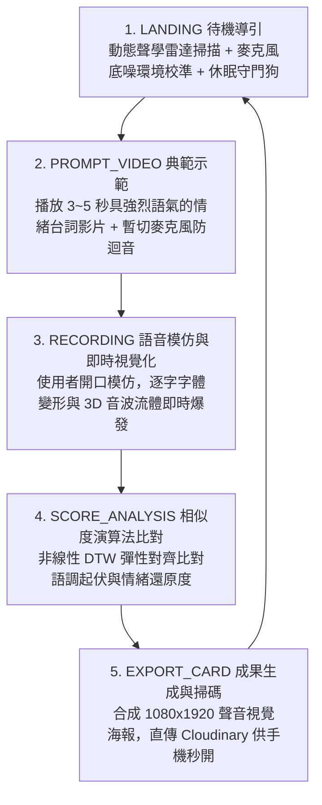

# 《See How You Speak》（看你怎麼說話）
## 專案企劃書與技術規格書 (PRD)

* **專案名稱**：《See How You Speak》 (看你怎麼說話)
* **核心提案者**：林妤安（【共評一】沉浸式體驗組 Top 1，總分 95.00 分）
* **技術底座**：繼承《PULSE LAB》工業級 Web 前端架構 (React 19 / TypeScript / Vite / Tailwind CSS / PWA / Cloudinary)
* **架構決策原則**：13 大工程 A/B 對決 **100% 全數鎖定「方案 B」最佳實踐**
* **文件版本**：v2.0.0 (Ultimate Industrial Exhibition PRD)
* **最後更新**：2026 年 10 月

---

## 🎯 一、 專案核心論述與設計概念 (Creative Statement)

### 1.1 創作背景與核心痛點
傳統字幕僅能呈現「**說了什麼（What was said）**」，但語言中超過 70% 的情感感染力來自於「**怎麼說的（How it was spoken）**」——包含音量大小、音調高低、咬字急促、頓挫與情緒張力。

本作《See How You Speak》旨在打造一種**讓聲音被看見的動態視覺語言（Visualizing Sound & Kinetic Typography）**。透過使用者親自對麥克風進行聲音模仿，系統即時擷取音訊多維特徵，將無形的聲音能量轉化為具象的字體變形、3D 音波流體與發光粒子，讓體驗者看見自己聲音的形狀與張力。

### 1.2 預期目標與展演場景
* **展演場景**：新媒體藝術互動展、商場快閃語音互動體驗亭 (Interactive Kiosk)、數位設計期末成果展。
* **硬體設定**：直立式 9:16 觸控一體機或高解析度展示螢幕 + 指向性降噪麥克風。
* **行動端延伸**：使用者體驗完畢後，透過手機掃描螢幕專屬 QR Code，即可在手機瀏覽器帶走個人「聲音視覺認證卡片」，並一鍵分享至 Instagram / Threads。

---

## 🔄 二、 5 階段核心體驗閉環 (User Experience Journey)



1. **`LANDING`（待機探索）**：
   * 螢幕呈現呼吸律動的 3D 聲波核心與賽博網格背景。
   * 支援休眠守門狗（Audio Snooze Watchdog），無人 60 秒進入節能低溫待機。
   * 點擊大按鈕瞬間解鎖 AudioContext 並執行 300ms 環境底噪自動取樣（Noise Gate Calibration）。

2. **`PROMPT_VIDEO`（原聲情緒示範）**：
   * 播放 3~5 秒經典影視或動畫中極具語氣張力的台詞（如：暴怒咆哮、極度委屈、興奮尖叫、冷酷低沉）。
   * 同步呈現原聲的「黃金聲波輪廓線」與字幕，建立模仿目標。
   * 播放期間切斷麥克風通道，杜絕展場喇叭迴音自激。

3. **`RECORDING`（即時動態字體與 3D 視覺渲染）**：
   * 體驗者對著麥克風複誦模仿台詞（定長 300 影格環形緩衝池記錄）。
   * **字體即時變形**：
     * 音量越大 ➔ 字體 `font-weight` (100 -> 900) 劇烈變粗。
     * 音高越高 ➔ 字體 `font-stretch` (75% -> 125%) 橫向擴張或拉高。
     * 振幅爆發 ➔ 伴隨色差故障特效 (Chromatic Aberration) 與文字震顫。
   * **3D 音波流體**：背景的三維液態球體隨聲波劇烈扭曲，發光粒子（Sparkles）隨說話節奏向外擴散。

4. **`SCORE_ANALYSIS`（語調相似度科學比對）**：
   * 系統透過動態時間規整（DTW）演算法，比對有效切片長度的聲音波形與原聲範本。
   * 綜合計算「音量能量曲線相似度 (60%)」與「音調高低走勢相似度 (40%)」。
   * 給予成就評級（如：`SSS 聲動大師`、`S 靈魂模仿者`、`A 能量超載`）與專屬評語。

5. **`EXPORT_CARD`（聲音卡片生成與雲端分享）**：
   * 畫面由展示主機離屏 Canvas 合成包含「個人實錄聲波軌跡、字體定格形態、評級數據」的 1080x1920 視覺海報。
   * 背景於 0.8 秒內直傳 Cloudinary 雲端（3 秒逾時自動本機備案）。
   * 螢幕彈出高對比 QR Code，民眾手機掃描直接開啟專屬頁面，跨平台 100% 保真無色差。

---

## 🏗️ 三、 《PULSE LAB》架構 1:1 移植對照表 (Architecture Migration)

| 系統層級 | 原本《PULSE LAB》實作 | 轉移至《See How You Speak》 | 升級說明 |
| :--- | :--- | :--- | :--- |
| **技術基底** | React 19 + TypeScript + Vite + Tailwind CSS | **React 19 + TypeScript + Vite + Tailwind CSS** | **100% 沿用**，具備完全離線 PWA 快取能力。 |
| **感測輸入** | WebCam 視訊 + MediaPipe 骨架追蹤 | **Web Audio API (`AudioContext`, `AnalyserNode`)** | **模組熱插拔**：毫秒級採樣人聲音量 (RMS) 與基頻 (F0)。 |
| **視覺呈現** | Canvas 2D 雙層 Float32Array 粒子物理池 | **CSS Variable Fonts + Three.js/R3F 免寫 Shader 方案** | **視覺轉換**：聲音即時驅動可變字體變形與液態材質。 |
| **數值評分** | 累積肢體動能評分與爆發瞬態判斷 | **一維 DTW (動態時間規整) 彈性對齊演算法** | **升級**：科學比對語氣波形相似度，兼顧娛樂性與容錯。 |
| **成果導出** | 1080x1920 海報合成 + Cloudinary 零拷貝管線 | **9:16 聲音視覺卡片合成 + Cloudinary 直傳** | **100% 沿用**：手機掃碼即享完整實拍與頻譜卡片。 |
| **展場防護** | Kiosk 事件監獄 + 喚醒鎖定 + 守門狗 | **Kiosk 監獄 + 自動底噪校準 (Noise Gate)** | **100% 沿用**：防展場誤觸、防長期待機音頻採樣率失鎖。 |

---

## ⚔️ 四、 13 大工業級展演 A/B 技術決策（全數鎖定方案 B）

在真實商場與展會實機環境中，工程團隊與架構評審必須面對 13 個致命的物理與架構選擇題，**本專案全數嚴格執行「方案 B」最佳實踐**：

### 🎨 組別一：渲染與視覺效能組

#### 【A/B 1】 音訊採樣驅動字體變形：`useState` 每秒 60 次更新 vs CSS 變數直通管線
* **方案 A（陷阱）**：每幀呼叫 `setMetrics({ volume, pitch })`，觸發 React 虛擬 DOM 每秒 60~120 次 Diffing，主線程卡死、字體嚴重丟幀 (Jank)。
* **方案 B（最佳實踐，100% 採用）**：**CSS Custom Properties 直通管線**。透過 `ref.style.setProperty('--v-weight', ...)` 寫入 DOM，交由瀏覽器 Compositor Thread 硬體加速，React 負擔為 0，穩跑 60fps！

#### 【A/B 3】 3D WebGL 視覺效能：全屏 R3F Postprocessing Bloom vs 自適應雙軌加算發光
* **方案 A（陷阱）**：引入全屏 R3F `<Bloom />`，多重 FBO 高斯模糊通道打爆展示機或手機 GPU 填滿率，幀率跌至 15fps。
* **方案 B（最佳實踐，100% 採用）**：**自適應雙軌視覺引擎**。大螢幕端開 R3F `<MeshDistortMaterial>` + 輕量 Bloom；手機端與弱卡自動降級為 **Canvas 2D 混合加算模式 (`ctx.globalCompositeOperation = 'lighter'`)**，以 5% GPU 開銷達成 95% 電影級光暈。

#### 【A/B 8】 TouchDesigner 影片與文字圖層合成：CSS 多圖層覆蓋 vs 單一畫布雙軌貼圖 (Video Texture)
* **方案 A（陷阱）**：在 HTML 堆疊 `<video>`、`<div typography>`、`<canvas>` 三層硬靠 `z-index` 與 `screen` 疊加，觸發 Compositor 跨層重拼與圖層撕裂 (Tearing)。
* **方案 B（最佳實踐，100% 採用）**：**雙軌共存與單一 WebGL/Canvas 上下文貼圖混色**。文字自帶 Canvas 特效，載入外部影片時以 VideoTexture 於單一上下文中混色輸出，確保 0 撕裂。

#### 【A/B 11】 動態文字發音反饋：整句同生同死 vs 逐音節分頻變形 (Per-Syllable Kinetic Typography)
* **方案 A（陷阱）**：整句台詞包在單一容器內同時放大縮小，字體像死板橡膠塊，失去語言抑揚頓挫與咬字跳躍感。
* **方案 B（最佳實踐，100% 採用）**：**逐音節分頻能量槽映射**。低頻元音驅動下壓擴張，高頻爆破音驅動字距震顫；每個音節標籤強制加入 `will-change: font-weight, transform; display: inline-block;` 獨立升格 GPU 圖層，0 次 Reflow。

---

### 🎙️ 組別二：音訊採樣與訊號處理組

#### 【A/B 2】 音高（Pitch）偵測演算法：頻域最高峰值 (FFT Peak) vs 時域自相關演算法 (Autocorrelation)
* **方案 A（陷阱）**：直接取 `getByteFrequencyData()` 最大振幅 Bin，被人類聲音倍頻與泛音干擾，音高數值在 100Hz 與 2000Hz 狂跳抽搐。
* **方案 B（最佳實踐，100% 採用）**：**時域歸一化自相關演算法 (Normalized Autocorrelation / YIN) + EMA 滑動平滑**。從時域波形計算重複週期，精準鎖定 85Hz~350Hz 人聲自然基頻，字體寬窄延展絲滑自然。

#### 【A/B 5】 展場環境雜音：靜態寫死門檻 vs 300ms 動態底噪自動校準 (Noise Gate)
* **方案 A（陷阱）**：寫死 `if (volume > 20)`，被展場 35~50dB 冷氣與人群嘈雜打穿，體驗者沒開口字體就已巨大變形。
* **方案 B（最佳實踐，100% 採用）**：**進場前 300ms 環境底噪自動校準**。採樣背景底噪 $N_{\text{ambient}}$ 並動態抬高門檻，低於底噪完全靜止，高於底噪展開動態範圍，反差強烈。

#### 【A/B 10】 示範音訊與波形時基同步：JS 計時器 vs 音訊晶片硬體時鐘 (`audioCtx.currentTime`)
* **方案 A（陷阱）**：使用 `setTimeout` / `performance.now()` 計時，受主線程事件循環干擾產生 30~150ms 漂移，導致波形時間軸基準錯位。
* **方案 B（最佳實踐，100% 採用）**：**聲卡 DAC 晶片硬體時鐘相對對齊**。錄音啟動時鎖定 `startTime = audioCtx.currentTime`，採樣點記錄為相對時間差 `elapsed = audioCtx.currentTime - startTime`，精度達 0.1ms。

#### 【A/B 13】 字體極限形變安全：線性無腦映射 vs 數學 Sigmoid 飽和箝位 (Clamped Sigmoid Mapping)
* **方案 A（陷阱）**：線性計算 `100 + vol * 10`，遇大吼吹氣音量破表時算得 `fontWeight: 1300`，字型頂點翻轉破面、字元黑塊破圖或換行破版。
* **方案 B（最佳實踐，100% 採用）**：**動態底噪偏移 Sigmoid 飽和箝位**。扣除底噪後帶入 S 型曲線 $1 / (1 + e^{-(vol_{eff} - 30)/12})$，邊界鎖定在配置區間 `{ minWeight: 100, maxWeight: 900 }`，大吼極限飽和且 100% 邊界安全。

---

### 💾 組別三：記憶體控制與展機長跑健康組

#### 【A/B 6】 音訊波形儲存：動態陣列 `push` vs 預分配定長環形緩衝池 (Circular Buffer)
* **方案 A（陷阱）**：每幀 `.push()` 觸發 V8 頻繁記憶體重分配與 GC Spike，連續玩 20 次後在第 4 秒錄音關鍵時刻瞬間凍結掉幀。
* **方案 B（最佳實踐，100% 採用）**：**預分配定長 Float32Array 環形緩衝池**。預先分配 300 槽位，指針覆寫，0 次記憶體重配置，0 GC 開銷，DTW 比對零拷貝。

#### 【A/B 7】 字體變形手感：原始波形直通 vs 非對稱彈簧阻尼濾波 (Attack-Decay Spring Model)
* **方案 A（陷阱）**：音量直通字體，被說話高頻摩擦音與爆破音帶動，文字瘋狂高頻抖動抽搐，體驗者眼花不適。
* **方案 B（最佳實踐，100% 採用）**：**非對稱彈簧阻尼濾波器 + Delta Time 補償**。Attack 迅猛膨脹 ($\tau \approx 16\text{ms}$) 保留爆發力，Decay 彈性衰減 ($\tau \approx 120\text{ms}$) 呈現水滴果凍回彈，兼具力量與流動感。

#### 【A/B 12】 展機 8 小時待機之音訊硬體健康：24 小時全開 vs 狀態機休眠守門狗 (Audio Snooze Watchdog)
* **方案 A（陷阱）**：無人待機時每秒 60 次不斷抓取麥克風計算 FFT，展示電腦過熱降頻，且長時間佔用音訊通道引發驅動緩衝溢位斷音。
* **方案 B（最佳實踐，100% 採用）**：**待機休眠與即時喚醒狀態機**。無人 60 秒將 `audioCtx.suspend()`，CPU 降至 1% 清涼待機；點擊螢幕瞬間 0.05 秒無縫喚醒。

---

### 🌐 組別四：評分比對與跨端雲端導出組

#### 【A/B 4】 模仿相似度計算：純音量差值比對 vs 一維動態時間規整 (DTW, Dynamic Time Warping)
* **方案 A（陷阱）**：兩陣列歐式距離相減，體驗者稍晚 0.2 秒發聲即判定為完全不相符扣成 0 分，帶來強烈挫折感。
* **方案 B（最佳實踐，100% 採用）**：**一維 DTW 彈性對齊演算法**。允許時間軸局部拉伸對齊，比對情緒曲線形態：$\text{Score} = (\text{DTW}_{\text{音量}} \times 0.6) + (\text{DTW}_{\text{音調}} \times 0.4)$，科學且富正向回饋。

#### 【A/B 9】 手機成果海報跨端呈現：手機端重新計算變形 vs 大機台離屏 Canvas 合成直出
* **方案 A（陷阱）**：手機掃碼後重新下載 5MB 可變字體並在手機重跑變形，弱網加載 8 秒，且舊款手機對 Variable Fonts 變形軸支援不全導致字型走樣。
* **方案 B（最佳實踐，100% 採用）**：**大機台單例 1080x1920 離屏合成 + Cloudinary 直傳**。大機台定格瞬間生成高清海報直傳雲端，手機端 0.3 秒即開即看大螢幕同款海報，100% 跨端無色差缺字。

---

## 🧩 五、 核心模組架構與介面規格 (Module Architecture)

### 5.1 音訊採樣 Hook (`src/hooks/useAudioAnalyzer.ts`)
```ts
export interface AudioMetrics {
  rawVolume: number;         // 0 ~ 100 未濾波音量
  smoothVolume: number;      // 彈簧阻尼平滑音量
  pitchHz: number;           // 85 ~ 350Hz 基頻
  pitchNormalized: number;    // 0 ~ 1 歸一化音高
  frequencyData: Uint8Array; // 頻譜資料 (低/中/高頻分頻)
  isVoiceActive: boolean;    // 是否突破環境底噪
}
```

### 5.2 動態字體組件 (`src/components/KineticTypography.tsx`)
* **字體選型**：可變字體（支援 `wght` 100~900, `wdth` 75%~125%），打包在 `public/fonts/`。
* **圖層隔離**：逐字/音節 `<span />` 套用 `will-change: font-weight, transform; display: inline-block;`。
* **變形映射**：
  * `font-weight`: 經 Sigmoid 飽和箝位後直接注入 `--v-weight` (100 ~ 900)。
  * `font-stretch`: `--v-width` (75% ~ 125%)。
  * `letter-spacing`: 大音量向外爆發擴散 (0px -> 8px)。
  * `text-shadow`: 音量爆發時觸發洋紅/青色色差光暈 (Chromatic Aberration)。

### 5.3 3D 音波流體背景 (`src/components/VoiceVisualizer3D.tsx`)
* `<MeshDistortMaterial distort={volume * 0.015} speed={pitch * 2} color="#00F0FF" />`
* `<Sparkles count={400} scale={volume * 0.1} color="#FF007A" />`
* `<Bloom intensity={volume > 70 ? 2.5 : 0.8} />`

### 5.4 跨領域協同設計：動態影音資材預留介面 (`src/components/DynamicMediaOverlay.tsx`)
* **支援格式**：WebM/MP4 Alpha 透明影片、TouchDesigner 黑底影片 (`mix-blend-mode: screen`)、透明 GIF、Lottie 動畫。
* **動態驅動**：`smoothVolume` 映射至 `playbackRate` (0.5x ~ 2.0x) 與 `opacity`。

### 5.5 聲波對齊評分引擎 (`src/utils/audioDTW.ts`)
* 輸入有效切片長度 `volumeBuffer.subarray(0, recordedFrames)`。
* 輸出 0~100 分綜合還原度評級與關鍵幀評價。

---

## 🎨 六、 跨領域美術協作友善機制：動態資材預留架構 (Media Slot Architecture)

### 6.1 設計哲學：Creative Technologist 協同開發思維
傳統互動專案中最常見的團隊衝突，是工程師強制要求美術組配合代碼限制（如「TouchDesigner 特效寫不進網頁，只能用工程師預設的粒子」）。
本作採用**「預留資材介面（Media Slot Architecture）」**，在系統架構中全面開放外接資材插槽，達成**「美術組風格 100% 自由、工程端 100% 穩定保底」**的雙贏局面。

### 6.2 Web 承接 TouchDesigner / AE 資材的三大極速管線
1. **TouchDesigner 導出 WebM Alpha 透明影片**：Movie File Out TOP 導出帶 Alpha 值影片，前端以 `<video>` 播放並由 Web Audio 控制。
2. **黑底影片 + CSS 混合模式（0 效能損耗秒融圖）**：黑底特效影片套用 `mix-blend-mode: screen`，黑色背景立即全透明消失，自然疊加在字體與 3D 空間。
3. **Three.js 影片動態貼圖 (Video Texture)**：將影片作為材質貼圖，結合聲音數據控制 3D 球體位移扭曲與反光。

### 6.3 專案「雙重保險」策略（Dual-Insurance Strategy）
* **視覺上限（滿足美術極致追求）**：隨時能直接吃下林妤安與美術組製作的 TouchDesigner 粒子流體、AE 故障特效或 Lottie 向量動畫。
* **穩定下限（工程保底，絕不拖累考研）**：若期末時限緊迫或美術未完成，內建的 **CSS Variable Fonts + Canvas 2.5D 加算發光粒子** 隨時在底層待命，**專案 100% 順暢交件展示，絕不卡死**！

---

## ⚠️ 七、 現場實戰老手視角：9 大極致致命的「隱性坑點」與避坑防線 (Hidden Edge Cases & Defense)

### 7.1 可變字體 (Variable Fonts) 本地離線快取陷阱
* **隱性災難**：依賴 Google Fonts 等外網 CDN，展場斷網時字體降級為新細明體，形變動畫全毀。
* **避坑防線**：將 WOFF2 可變字體打包至本地 `public/fonts/`，寫入 PWA 快取名單，100% 斷網離線可用。

### 7.2 iOS / Safari 跨平台透明影片的「黑底災難」(WebM Alpha)
* **隱性災難**：iOS Safari 絕大多數核心不支援 WebM Alpha，手機掃碼開影片直接黑底或報錯。
* **避坑防線**：手機成果展示頁嚴禁使用 WebM Alpha，改採 Canvas 2D 靜態海報合成或黑底影片 `mix-blend-mode: screen`。

### 7.3 瀏覽器 AudioContext 的自動播放（Autoplay Policy）靜音鎖
* **隱性災難**：未在使用者手勢時解鎖，音訊引擎處於 `suspended` 凍結狀態，麥克風採樣數值全為 0。
* **避坑防線**：在 `LANDING` 頁「開始體驗」按鈕的 `pointerdown` 事件上強制綁定 `audioCtx.resume()` 與 `getUserMedia()`。

### 7.4 麥克風噴麥爆音（Clipping）與展場喇叭迴音自激（Feedback Loop）
* **隱性災難**：大吼時訊號飽和削頂破壞 DTW；展場外接喇叭播放原片聲音被麥克風重複收錄引發自激尖叫。
* **避坑防線**：Web Audio 鏈路掛載 `DynamicsCompressorNode` 壓制爆音；`PROMPT_VIDEO` 播放期間切斷麥克風採樣通道。

### 7.5 美術夥伴視覺資材交期延遲風險
* **隱性災難**：設計組夥伴過度微調細節導致資材延遲交稿，拖累工程進度。
* **避坑防線**：貫徹「雙重保險策略」，Week 6 前工程端以方案 B 自帶字體與粒子 100% 完工，架構預留插槽隨時熱插拔，完全不影響備考。

### 7.6 Circular Buffer 歸零指標失鎖與錄音提前結束之 DTW 切片防護
* **隱性災難**：體驗結束指標未歸零導致下一位讀到上一人殘留數據；提早結束未填滿的 0 被 DTW 判定為聲音暴跌扣成 0 分。
* **避坑防線**：每次切換至 `RECORDING` 強制 `volumeBuffer.fill(0)` 與 `head = 0`；傳給 DTW 時僅切片取有效長度 `volumeBuffer.subarray(0, recordedFrames)`。

### 7.7 物理平滑模型 Delta Time 補償與急促短音 (Staccato) 停頓動態響應
* **隱性災難**：公式寫死硬編碼導致 120Hz 與 30Hz 回彈速度差 4 倍；連續短音 Decay 過慢卡在高粗度降不下來。
* **避坑防線**：平滑公式引入 `dt` 補償 (`1 - Math.exp(-speed * dt)`)；檢測到音量急速驟降（換氣）時動態加速 Decay 響應保留咬字停頓感。

### 7.8 Canvas 影片繪製之同源同域防護 (Tainted Canvas CORS Lock)
* **隱性災難**：TouchDesigner 影片置於外部未設 CORS 的 CDN，Canvas 繪製後被標記 Tainted，最後海報導出 (`toBlob`) 直接報錯炸毀。
* **避坑防線**：展場影音資材統一置於本地 `public/video/`，確保 100% 同源同域，海報導出絕不觸發 CORS 鎖。

### 7.9 展場 USB 麥克風長時間休眠「假死斷流」之 30 幀心跳重連機制
* **隱性災難**：展場 USB 指向性麥克風長時間休眠後被作業系統開啟節能，喚醒後串流表面正常但讀出數值全為 0。
* **避坑防線**：加入麥克風存活心跳（Liveness Check），喚醒後若前 30 幀音量持續為絕對 0，自動觸發一次靜音重連機制 (`reinitAudioStream()`)。

---

## 📅 八、 開發時程與里程碑規劃 (Milestones)

* **Week 1-2：基礎管線搭建**
  * 移植《PULSE LAB》基底，移除 MediaPipe，植入 `useAudioAnalyzer`。
  * 打包本地可變字體至 `public/fonts/`，完成 CSS 變數直通與 60fps 驗證。
  * 建立 `DynamicMediaOverlay` 影音資材插槽組件。
* **Week 3-4：3D 視覺、影音整合與體驗狀態機**
  * 整合 R3F 液態材質與光暈粒子，測試 TouchDesigner 影片疊加。
  * 實裝 `PROMPT_VIDEO` 播放器與錄音倒數流程（含喇叭防迴音通道切換）。
* **Week 5：DTW 評分與海報導出**
  * 完成聲波比對評分演算法（含有效長度切片防護）。
  * 實裝 9:16 聲音卡片 Canvas 合成與 Cloudinary 直傳（含 3 秒逾時本機降級）。
* **Week 6：MVP 驗收與展場調校**
  * 實測指向性麥克風、動態壓縮防爆音與 300ms 環境底噪校準。
  * 完成線上 Vercel 發布與手機 QR Code 掃碼閉環演示。

---
*本企劃書已儲存於本機專案目錄中，可直接作為專案規格標準執行。*
