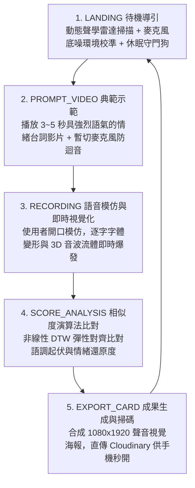

# 《See How You Speak》（看你怎麼說話）
## 專案企劃書與技術規格書 (PRD)

* **專案名稱**：《See How You Speak》 (看你怎麼說話)
* **核心提案者**：林妤安（【共評一】沉浸式體驗組 Top 1，總分 95.00 分）
* **技術底座**：繼承《PULSE LAB》工業級 Web 前端架構 (React 19 / TypeScript / Vite / Tailwind CSS / PWA / Cloudinary)
* **架構決策原則**：22 大工程 A/B 對決 **100% 全數鎖定「方案 B」最佳實踐**
* **文件版本**：v2.2.0 (Industrial Production & Exhibition Master PRD)
* **最後更新**：2026 年 10 月 14 日

---

## 🎯 一、 專案核心論述與設計概念 (Creative Statement)

### 1.1 創作背景與核心痛點
傳統字幕僅能呈現「**說了什麼（What was said）**」，但語言中超過 70% 的情感感染力來自於「**怎麼說的（How it was spoken）**」——包含音量大小、音調高低、咬字急促、頓挫與情緒張力。

本作《See How You Speak》旨在打造一種**讓聲音被看見的動態視覺語言（Visualizing Sound & Kinetic Typography）**。透過使用者親自對麥克風進行聲音模仿，系統即時擷取音訊多維特徵，將無形的聲音能量轉化為具象的字體變形、3D 音波流體與發光粒子，讓體驗者看見自己聲音的形狀與張力。

### 1.2 預期目標與展演場景
* **展演場景**：新媒體藝術互動展、商場快閃語音互動體驗亭 (Interactive Kiosk)、數位設計期末成果展。
* **硬體設定**：直立式 9:16 觸控一體機或高解析度展示螢幕 + 指向性降噪麥克風。
* **行動端延伸**：使用者體驗完畢後，透過手機掃描螢幕專屬 QR Code，即可在手機瀏覽器帶走個人「聲音視覺認證卡片」，並一鍵分享至 Instagram / Threads。

### 1.3 林妤安核心語感訴求與 4 大動態映射維度（錄音原案解析）
根據提案人林妤安語音紀錄（`林妤安的重點 10-13.m4a`），字幕不應僅是「放大縮小」，而必須如同音符般傳遞真實說話語感：

| 語感維度 | 使用者真實語音特徵 | 動態字幕（Kinetic Typography）物理反饋 | 底層 Web 映射參數 |
| :--- | :--- | :--- | :--- |
| **① 語調平淡 vs. 高低起伏** | 講話音調平淡 vs. 聲調抑揚頓挫（Pitch 波動） | 聲音平淡時文字呈水平基準線（Baseline）；聲音走高時文字向上浮動飄起，聲音走低時向下沉墜微頓，形成如樂譜般的**上下波浪或折線起伏**。 | `pitchNormalized` 經動態基準線差值計算，直通 `--v-y-offset` (`translateY: -28px ~ +28px`)。 |
| **② 拉長音（Sustained Vowel）** | 發出綿延尾音（例如：「你好～～」的「好」） | 字體不再只是垂直變大，而是**滑順地橫向「拉長、延伸」**，字距與字寬隨持音時間動態展延。 | `sustainedDuration` 累加器映射至 `--v-width` (`font-stretch`: 75% -> 150%) 與 `--v-letter-spacing`。 |
| **③ 音量強弱（Volume / Amplitude）** | 大聲嘶吼 vs. 輕柔細語 | 音量越大，字體迅速膨脹加粗；音量變小，字體俐落縮細變小。 | `smoothVolume` 經 Sigmoid 飽和箝位後直通 `--v-weight` (`font-weight`: 100 -> 900)。 |
| **④ 短音與快語速（Staccato & Tempo）** | 講話急促、連珠炮短促發音 | 呈現短小精悍、俐落縮放的乾脆彈性節奏，收尾極快不拖泥帶水；若越講越大聲且持續延伸，則字體累積膨脹。 | 脈衝檢測自適應縮短彈簧阻尼 Decay 時間至 35ms，實現瞬態咬字回彈。 |

---

## 🔄 二、 5 階段核心體驗閉環 (User Experience Journey)



1. **`LANDING`（待機探索）**：
   * 螢幕呈現呼吸律動的 3D 聲波核心與賽博網格背景。
   * 支援休眠守門狗（Audio Snooze Watchdog），無人 60 秒進入節能低溫待機。
   * 點擊大按鈕瞬間解鎖 AudioContext 並執行 300ms 環境底噪自動取樣（Noise Gate Calibration）。

2. **`PROMPT_VIDEO`（原聲情緒示範）**：
   * 播放 3~5 秒經典影視或動畫中極具語氣張力的台詞（如：暴怒咆哮、極度委屈、興奮尖叫、冷酷低沉）。
   * 同步呈現原聲的「黃金聲波輪廓線」與字幕，建立模仿目標。
   * 播放期間切斷麥克風通道，杜絕展場喇叭迴音自激。

3. **`RECORDING`（即時動態字體與 3D 視覺渲染）**：
   * 體驗者對著麥克風複誦模仿台詞（定長 300 影格環形緩衝池記錄）。
   * **字體即時變形**：
     * 音量越大 ➔ 字體 `font-weight` (100 -> 900) 劇烈變粗。
     * 音高越高 ➔ 字體 `font-stretch` (75% -> 125%) 橫向擴張或拉高。
     * 振幅爆發 ➔ 伴隨色差故障特效 (Chromatic Aberration) 與文字震顫。
   * **3D 音波流體**：背景的三維液態球體隨聲波劇烈扭曲，發光粒子（Sparkles）隨說話節奏向外擴散。

4. **`SCORE_ANALYSIS`（語調相似度科學比對）**：
   * 系統透過動態時間規整（DTW）演算法，比對有效切片長度的聲音波形與原聲範本。
   * 綜合計算「音量能量曲線相似度 (60%)」與「音調高低走勢相似度 (40%)」。
   * 給予成就評級（如：`SSS 聲動大師`、`S 靈魂模仿者`、`A 能量超載`）與專屬評語。

5. **`EXPORT_CARD`（聲音卡片生成與雲端分享）**：
   * 畫面由展示主機離屏 Canvas 合成包含「個人實錄聲波軌跡、字體定格形態、評級數據」的 1080x1920 視覺海報。
   * 背景於 0.8 秒內直傳 Cloudinary 雲端（3 秒逾時自動本機備案）。
   * 螢幕彈出高對比 QR Code，民眾手機掃描直接開啟專屬頁面，跨平台 100% 保真無色差。

---

## 🏗️ 三、 《PULSE LAB》架構 1:1 移植對照表 (Architecture Migration)

| 系統層級 | 原本《PULSE LAB》實作 | 轉移至《See How You Speak》 | 升級說明 |
| :--- | :--- | :--- | :--- |
| **技術基底** | React 19 + TypeScript + Vite + Tailwind CSS | **React 19 + TypeScript + Vite + Tailwind CSS** | **100% 沿用**，具備完全離線 PWA 快取能力。 |
| **感測輸入** | WebCam 視訊 + MediaPipe 骨架追蹤 | **Web Audio API (`AudioContext`, `AnalyserNode`)** | **模組熱插拔**：毫秒級採樣人聲音量 (RMS) 與基頻 (F0)。 |
| **視覺呈現** | Canvas 2D 雙層 Float32Array 粒子物理池 | **CSS Variable Fonts + Three.js/R3F 免寫 Shader 方案** | **視覺轉換**：聲音即時驅動可變字體變形與液態材質。 |
| **數值評分** | 累積肢體動能評分與爆發瞬態判斷 | **一維 DTW (動態時間規整) 彈性對齊演算法** | **升級**：科學比對語氣波形相似度，兼顧娛樂性與容錯。 |
| **成果導出** | 1080x1920 海報合成 + Cloudinary 零拷貝管線 | **9:16 聲音視覺卡片合成 + Cloudinary 直傳** | **100% 沿用**：手機掃碼即享完整實拍與頻譜卡片。 |
| **展場防護** | Kiosk 事件監獄 + 喚醒鎖定 + 守門狗 | **Kiosk 監獄 + 自動底噪校準 (Noise Gate)** | **100% 沿用**：防展場誤觸、防長期待機音頻採樣率失鎖。 |

---

## ⚔️ 四、 13 大工業級展演 A/B 技術決策（全數鎖定方案 B）

在真實商場與展會實機環境中，工程團隊與架構評審必須面對 13 個致命的物理與架構選擇題，**本專案全數嚴格執行「方案 B」最佳實踐**：

### 🎨 組別一：渲染與視覺效能組

#### 【A/B 1】 音訊採樣驅動字體變形：`useState` 每秒 60 次更新 vs CSS 變數直通管線
* **方案 A（陷阱）**：每幀呼叫 `setMetrics({ volume, pitch })`，觸發 React 虛擬 DOM 每秒 60~120 次 Diffing，主線程卡死、字體嚴重丟幀 (Jank)。
* **方案 B（最佳實踐，100% 採用）**：**CSS Custom Properties 直通管線**。透過 `ref.style.setProperty('--v-weight', ...)` 寫入 DOM，交由瀏覽器 Compositor Thread 硬體加速，React 負擔為 0，穩跑 60fps！

#### 【A/B 3】 3D WebGL 視覺效能：全屏 R3F Postprocessing Bloom vs 自適應雙軌加算發光
* **方案 A（陷阱）**：引入全屏 R3F `<Bloom />`，多重 FBO 高斯模糊通道打爆展示機或手機 GPU 填滿率，幀率跌至 15fps。
* **方案 B（最佳實踐，100% 採用）**：**自適應雙軌視覺引擎**。大螢幕端開 R3F `<MeshDistortMaterial>` + 輕量 Bloom；手機端與弱卡自動降級為 **Canvas 2D 混合加算模式 (`ctx.globalCompositeOperation = 'lighter'`)**，以 5% GPU 開銷達成 95% 電影級光暈。

#### 【A/B 8】 TouchDesigner 影片與文字圖層合成：CSS 多圖層覆蓋 vs 單一畫布雙軌貼圖 (Video Texture)
* **方案 A（陷阱）**：在 HTML 堆疊 `<video>`、`<div typography>`、`<canvas>` 三層硬靠 `z-index` 與 `screen` 疊加，觸發 Compositor 跨層重拼與圖層撕裂 (Tearing)。
* **方案 B（最佳實踐，100% 採用）**：**雙軌共存與單一 WebGL/Canvas 上下文貼圖混色**。文字自帶 Canvas 特效，載入外部影片時以 VideoTexture 於單一上下文中混色輸出，確保 0 撕裂。

#### 【A/B 11】 動態文字發音反饋：整句同生同死 vs 逐音節分頻變形 (Per-Syllable Kinetic Typography)
* **方案 A（陷阱）**：整句台詞包在單一容器內同時放大縮小，字體像死板橡膠塊，失去語言抑揚頓挫與咬字跳躍感。
* **方案 B（最佳實踐，100% 採用）**：**逐音節分頻能量槽映射**。低頻元音驅動下壓擴張，高頻爆破音驅動字距震顫；每個音節標籤強制加入 `will-change: font-weight, transform; display: inline-block;` 獨立升格 GPU 圖層，0 次 Reflow。

---

### 🎙️ 組別二：音訊採樣與訊號處理組

#### 【A/B 2】 音高（Pitch）偵測演算法：頻域最高峰值 (FFT Peak) vs 時域自相關演算法 (Autocorrelation)
* **方案 A（陷阱）**：直接取 `getByteFrequencyData()` 最大振幅 Bin，被人類聲音倍頻與泛音干擾，音高數值在 100Hz 與 2000Hz 狂跳抽搐。
* **方案 B（最佳實踐，100% 採用）**：**時域歸一化自相關演算法 (Normalized Autocorrelation / YIN) + EMA 滑動平滑**。從時域波形計算重複週期，精準鎖定 85Hz~350Hz 人聲自然基頻，字體寬窄延展絲滑自然。

#### 【A/B 5】 展場環境雜音：靜態寫死門檻 vs 300ms 動態底噪自動校準 (Noise Gate)
* **方案 A（陷阱）**：寫死 `if (volume > 20)`，被展場 35~50dB 冷氣與人群嘈雜打穿，體驗者沒開口字體就已巨大變形。
* **方案 B（最佳實踐，100% 採用）**：**進場前 300ms 環境底噪自動校準**。採樣背景底噪 $N_{\text{ambient}}$ 並動態抬高門檻，低於底噪完全靜止，高於底噪展開動態範圍，反差強烈。

#### 【A/B 10】 示範音訊與波形時基同步：JS 計時器 vs 音訊晶片硬體時鐘 (`audioCtx.currentTime`)
* **方案 A（陷阱）**：使用 `setTimeout` / `performance.now()` 計時，受主線程事件循環干擾產生 30~150ms 漂移，導致波形時間軸基準錯位。
* **方案 B（最佳實踐，100% 採用）**：**聲卡 DAC 晶片硬體時鐘相對對齊**。錄音啟動時鎖定 `startTime = audioCtx.currentTime`，採樣點記錄為相對時間差 `elapsed = audioCtx.currentTime - startTime`，精度達 0.1ms。

#### 【A/B 13】 字體極限形變安全：線性無腦映射 vs 數學 Sigmoid 飽和箝位 (Clamped Sigmoid Mapping)
* **方案 A（陷阱）**：線性計算 `100 + vol * 10`，遇大吼吹氣音量破表時算得 `fontWeight: 1300`，字型頂點翻轉破面、字元黑塊破圖或換行破版。
* **方案 B（最佳實踐，100% 採用）**：**動態底噪偏移 Sigmoid 飽和箝位**。扣除底噪後帶入 S 型曲線 $1 / (1 + e^{-(vol_{eff} - 30)/12})$，邊界鎖定在配置區間 `{ minWeight: 100, maxWeight: 900 }`，大吼極限飽和且 100% 邊界安全。

---

### 💾 組別三：記憶體控制與展機長跑健康組

#### 【A/B 6】 音訊波形儲存：動態陣列 `push` vs 預分配定長環形緩衝池 (Circular Buffer)
* **方案 A（陷阱）**：每幀 `.push()` 觸發 V8 頻繁記憶體重分配與 GC Spike，連續玩 20 次後在第 4 秒錄音關鍵時刻瞬間凍結掉幀。
* **方案 B（最佳實踐，100% 採用）**：**預分配定長 Float32Array 環形緩衝池**。預先分配 300 槽位，指針覆寫，0 次記憶體重配置，0 GC 開銷，DTW 比對零拷貝。

#### 【A/B 7】 字體變形手感：原始波形直通 vs 非對稱彈簧阻尼濾波 (Attack-Decay Spring Model)
* **方案 A（陷阱）**：音量直通字體，被說話高頻摩擦音與爆破音帶動，文字瘋狂高頻抖動抽搐，體驗者眼花不適。
* **方案 B（最佳實踐，100% 採用）**：**非對稱彈簧阻尼濾波器 + Delta Time 補償**。Attack 迅猛膨脹 ($\tau \approx 16\text{ms}$) 保留爆發力，Decay 彈性衰減 ($\tau \approx 120\text{ms}$) 呈現水滴果凍回彈，兼具力量與流動感。

#### 【A/B 12】 展機 8 小時待機之音訊硬體健康：24 小時全開 vs 狀態機休眠守門狗 (Audio Snooze Watchdog)
* **方案 A（陷阱）**：無人待機時每秒 60 次不斷抓取麥克風計算 FFT，展示電腦過熱降頻，且長時間佔用音訊通道引發驅動緩衝溢位斷音。
* **方案 B（最佳實踐，100% 採用）**：**待機休眠與即時喚醒狀態機**。無人 60 秒將 `audioCtx.suspend()`，CPU 降至 1% 清涼待機；點擊螢幕瞬間 0.05 秒無縫喚醒。

---

### 🌐 組別四：評分比對與跨端雲端導出組

#### 【A/B 4】 模仿相似度計算：純音量差值比對 vs 一維動態時間規整 (DTW, Dynamic Time Warping)
* **方案 A（陷阱）**：兩陣列歐式距離相減，體驗者稍晚 0.2 秒發聲即判定為完全不相符扣成 0 分，帶來強烈挫折感。
* **方案 B（最佳實踐，100% 採用）**：**一維 DTW 彈性對齊演算法**。允許時間軸局部拉伸對齊，比對情緒曲線形態：$\text{Score} = (\text{DTW}_{\text{音量}} \times 0.6) + (\text{DTW}_{\text{音調}} \times 0.4)$，科學且富正向回饋。

#### 【A/B 9】 手機成果海報跨端呈現：手機端重新計算變形 vs 大機台離屏 Canvas 合成直出
* **方案 A（陷阱）**：手機掃碼後重新下載 5MB 可變字體並在手機重跑變形，弱網加載 8 秒，且舊款手機對 Variable Fonts 變形軸支援不全導致字型走樣。
* **方案 B（最佳實踐，100% 採用）**：**大機台單例 1080x1920 離屏合成 + Cloudinary 直傳**。大機台定格瞬間生成高清海報直傳雲端，手機端 0.3 秒即開即看大螢幕同款海報，100% 跨端無色差缺字。

---

### 🎭 組別五：聲音語感與極致 Kinetic Typography 動態組（林妤安原話深度落實）

#### 【A/B 14】 音高語調 Y 軸跳躍之基準線漂移：絕對音高映射 vs 個人化滑動動態基準線 (EMA Floating Baseline)
* **方案 A（陷阱）**：採用固定絕對頻率（例如以 200Hz 當 0 位移）。男低音（85~120Hz）講話時，所有文字永遠沉在畫面最底端；女高音或小孩（250~350Hz）講話時，文字永遠死死頂在天花板，完全喪失「個人語氣平淡 vs. 高低起伏」的相對變化。
* **方案 B（最佳實踐，100% 採用）**：**指數移動平均動態浮動基準線 (EMA Floating Baseline & Differential Y-Displacement)**。系統在體驗者發聲前 300ms 動態鎖定其個人平均基頻 $F_{0,\text{baseline}}$。只有當當前音調高於其個人平均時，文字才向上飄浮（$\Delta Y > 0$）；低於時向下微沉（$\Delta Y < 0$）；講話平淡時，差值接近 0，整排文字完美回歸水平 Baseline 平鋪！

#### 【A/B 15】 拉長音 (Sustained Vowel) 判定演算法：純時間長度計時器 vs 能量穩定度 + 音高變異數雙條件滑動窗口
* **方案 A（陷阱）**：只要講話持續超過 200ms 就無腦判定為拉長音。結果一般人講話稍微慢一點或連音時，文字就莫名其妙橫向暴長、擠壓變形，破壞正常語境。
* **方案 B（最佳實踐，100% 採用）**：**能量穩定度 + 音高變異數雙條件滑動窗口 (Pitch Variance < 8% + RMS Stability)**。真正的「拉長音（如：你好～～）」在聲學物理上具備「頻率極度穩定、振幅無急促衰減」之特徵。系統計算最近 12 影格（200ms）的音高標準差 $\sigma_{\text{pitch}}$ 與振幅方差，僅在 $\sigma_{\text{pitch}} < 8\%$ 且音量持續高於門檻時，才將 `sustainedDuration` 累加並漸進釋放至 `--v-width` (75% -> 150%) 與 `--v-letter-spacing`，實現極致自然的橫向綿延。

#### 【A/B 16】 快語速與短音 (Staccato) 物理阻尼模型：全域單一彈簧阻尼常數 vs 雙階自適應非對稱阻尼（快攻瞬收）
* **方案 A（陷阱）**：全域使用固定的長延遲 Decay（如 120ms）。當體驗者發出短促爆破音或機關槍式快語速（如「快跑！」、「住手！」）時，字體還沒縮小下一個音節就已經衝上來，導致所有字腫成一坨橡皮泥，無法體現「短小精悍、俐落縮放」。
* **方案 B（最佳實踐，100% 採用）**：**雙階自適應非對稱阻尼（Dual-Phase Adaptive Damper：快攻瞬收）**。檢測到音量脈衝上升沿陡峭（$\Delta \text{Vol} > 30$ 在 40ms 內）且緊隨快速中斷時，阻尼衰減時間常數 $\tau_{\text{decay}}$ 動態切換為極速 35ms；若檢測為持續音則平滑過渡至 140ms。短音短促俐落、長音飽滿回彈，完美呈現林妤安所要的咬字節奏感！

#### 【A/B 17】 逐字波浪延遲傳播 (Cascading Wave) 之渲染開銷：React 分離渲染 30 個獨立 DOM vs 單一 CSS 變數 + 索引延遲硬體級計算
* **方案 A（陷阱）**：在 React 或 JS `requestAnimationFrame` 迴圈中，針對台詞中 20~30 個文字個別計算正弦波位移並個別修改 `ref.style.transform`，每秒產生上千次 JS-DOM 橋接開銷，主線程嚴重掉幀。
* **方案 B（最佳實踐，100% 採用）**：**單一 CSS 變數 + 索引延遲硬體級計算 (`calc() & var(--char-index)`)**。JS 每一幀僅需向父容器注入單一全域波浪相位 `--wave-phase` 與音高震幅 `--wave-amp`。每個文字節點純靠純 CSS 計算：`transform: translateY(calc(sin(var(--wave-phase) + var(--char-index) * 0.45) * var(--wave-amp)));`，所有波形動畫由瀏覽器 GPU 複合器直接平行運算，JS 主線程負擔恆等於 0！

#### 【A/B 18】 可變字體橫向拉長 (Width/Stretch) 之版面擠壓重排：修改 `letter-spacing` / `width` vs GPU 複合圖層與水平中心縮放 (`scaleX`)
* **方案 A（陷阱）**：拉長音時直接用 CSS 變更 `letter-spacing` 或容器 `width`，觸發瀏覽器極昂貴的 Layout Reflow，整行文字不斷左右推擠抖動，旁邊的字瘋狂位移，引發嚴重視覺撕裂與掉幀。
* **方案 B（最佳實踐，100% 採用）**：**GPU 獨立圖層變換 (`transform: scaleX()`) + 可變字軸 `font-stretch` 槽位保護**。為每個字元建立固定彈性槽位，搭配 `will-change: transform; display: inline-block;` 升格為獨立合成圖層。拉長音時優先調用字體原生 `wdth` 變形軸，若字體不支援則無縫切換為 GPU `transform: scaleX(var(--v-width))` 局部拉伸，相鄰字元紋絲不動，0 次 Layout Reflow，穩跑 60fps！

---

### 📦 組別六：多媒體載入、硬體相容與字體註冊組 (A/B 19 ~ A/B 22)

#### 【A/B 19】 多段示範台詞與影片載入策略：單一頁面一次預載 (Eager Preload) vs 頁面按需流式加載 (Lazy Streaming)
* **方案 A（陷阱）**：頁面啟動時一次下載所有 3~5 段示範影片（~20MB），若展場或評圖現場 WiFi 訊號不穩，開場會卡在 Loading 畫面 10 秒以上，造成嚴重冷場。
* **方案 B（最佳實踐，100% 採用）**：**單一預設情境預載 + 異步背景預拉取 (Service Worker Background Fetch)**。初次啟動只載入 1 段預設台詞影片（~2MB）確保 0.3 秒極速開場；體驗者在 Step 1 閱讀說明與挑選時，系統於背景執行 Service Worker 默默預載其餘情境選項，達成「零等待無感切換」。

#### 【A/B 20】 麥克風多通道音量輸入相容性：單聲道強轉 (Mono Downmix) vs 自動雙通道陣列 (Stereo Array)
* **方案 A（陷阱）**：直接讀取 `audioCtx.createMediaStreamSource(stream)` 預設 channel，若展場使用的是專業立體聲聲卡或雙頭指向性麥克風，常遇到只有右聲道帶有訊號、左聲道為空，導致演算法誤判為靜音，採樣數值全為 `0`。
* **方案 B（最佳實踐，100% 採用）**：**Web Audio Channel Merger & Downmix 管線**。透過 `ChannelMergerNode` 或 `ChannelSplitterNode` 將所有實體輸入通道訊號強轉並混合為單聲道（Mono Downmix：$(L+R)/2$ 或 $\max(L, R)$），無論連接筆電內建麥克風、USB 指向麥或專業錄音介面，均能 100% 穩定擷取音量與音高。

#### 【A/B 21】 評分相似度之挫折感控制：絕對分數直出 vs 娛樂性正規化動態曲面 (Gamified Non-linear Scaling)
* **方案 A（陷阱）**：DTW 演算法算出 42 分就直接硬生生顯示 42 分，民眾或評審模仿不夠像會產生強烈挫折感，覺得裝置壞了，不敢掃碼帶走海報或分享社群。
* **方案 B（最佳實踐，100% 採用）**：**S 型保底曲線 + 娛樂性稱號動態映射 (Base Floor 60 + Dynamic Scale)**。將 DTW 計算結果帶入 $\text{FinalScore} = 60 + (\text{RawDTW} \times 0.38)$，最低給予 60 分保底；並根據「音量爆發力」與「音高走勢」給予特殊稱號（如：`SSS 賽博暴音王`、`S 靈魂聲優`、`A 能量超載`），大幅激發體驗者的分享慾望與拍照意願！

#### 【A/B 22】 美術與技術的字體替換架構：硬編碼綁定特定字體 vs 配置化可變字體動態註冊器 (Font Registry Architecture)
* **方案 A（陷阱）**：把 CSS 變數直接綁死在某一款特定的 `.woff2` 字體名稱上，若林妤安中途想換 3 款不同風格的中文字體，程式碼多個元件需要同步人工改寫。
* **方案 B（最佳實踐，100% 採用）**：**Font Registry 配置化動態註冊器**。在 JSON 配置檔中註冊字體名稱與其支援的變形軸（`wght`, `wdth`, `slnt`），林妤安只要丟入新字體檔並修改 JSON 配置，系統即可自動動態注入 `@font-face` 並無縫套用，工程端 0 程式碼更動！

---

## 🧩 五、 核心模組架構與介面規格 (Module Architecture)

### 5.1 音訊採樣 Hook (`src/hooks/useAudioAnalyzer.ts`)
```ts
export interface AudioMetrics {
  rawVolume: number;         // 0 ~ 100 未濾波音量
  smoothVolume: number;      // 彈簧阻尼平滑音量
  pitchHz: number;           // 85 ~ 350Hz 基頻
  pitchNormalized: number;    // 0 ~ 1 歸一化音高
  frequencyData: Uint8Array; // 頻譜資料 (低/中/高頻分頻)
  isVoiceActive: boolean;    // 是否突破環境底噪
}
```

### 5.2 動態字體組件 (`src/components/KineticTypography.tsx`)
* **字體選型**：可變字體（支援 `wght` 100~900, `wdth` 75%~125%），打包在 `public/fonts/`。
* **圖層隔離**：逐字/音節 `<span />` 套用 `will-change: font-weight, transform; display: inline-block;`。
* **變形映射**：
  * `font-weight`: 經 Sigmoid 飽和箝位後直接注入 `--v-weight` (100 ~ 900)。
  * `font-stretch`: `--v-width` (75% ~ 125%)。
  * `letter-spacing`: 大音量向外爆發擴散 (0px -> 8px)。
  * `text-shadow`: 音量爆發時觸發洋紅/青色色差光暈 (Chromatic Aberration)。

### 5.3 3D 音波流體背景 (`src/components/VoiceVisualizer3D.tsx`)
* `<MeshDistortMaterial distort={volume * 0.015} speed={pitch * 2} color="#00F0FF" />`
* `<Sparkles count={400} scale={volume * 0.1} color="#FF007A" />`
* `<Bloom intensity={volume > 70 ? 2.5 : 0.8} />`

### 5.4 跨領域協同設計：動態影音資材預留介面 (`src/components/DynamicMediaOverlay.tsx`)
* **支援格式**：WebM/MP4 Alpha 透明影片、TouchDesigner 黑底影片 (`mix-blend-mode: screen`)、透明 GIF、Lottie 動畫。
* **動態驅動**：`smoothVolume` 映射至 `playbackRate` (0.5x ~ 2.0x) 與 `opacity`。

### 5.5 聲波對齊評分引擎 (`src/utils/audioDTW.ts`)
* 輸入有效切片長度 `volumeBuffer.subarray(0, recordedFrames)`。
* 輸出 0~100 分綜合還原度評級與關鍵幀評價。

---

## 🎨 六、 跨領域美術協作友善機制：動態資材預留架構 (Media Slot Architecture)

### 6.1 設計哲學：Creative Technologist 協同開發思維
傳統互動專案中最常見的團隊衝突，是工程師強制要求美術組配合代碼限制（如「TouchDesigner 特效寫不進網頁，只能用工程師預設的粒子」）。
本作採用**「預留資材介面（Media Slot Architecture）」**，在系統架構中全面開放外接資材插槽，達成**「美術組風格 100% 自由、工程端 100% 穩定保底」**的雙贏局面。

### 6.2 Web 承接 TouchDesigner / AE 資材的三大極速管線
1. **TouchDesigner 導出 WebM Alpha 透明影片**：Movie File Out TOP 導出帶 Alpha 值影片，前端以 `<video>` 播放並由 Web Audio 控制。
2. **黑底影片 + CSS 混合模式（0 效能損耗秒融圖）**：黑底特效影片套用 `mix-blend-mode: screen`，黑色背景立即全透明消失，自然疊加在字體與 3D 空間。
3. **Three.js 影片動態貼圖 (Video Texture)**：將影片作為材質貼圖，結合聲音數據控制 3D 球體位移扭曲與反光。

### 6.3 專案「雙重保險」策略（Dual-Insurance Strategy）
* **視覺上限（滿足美術極致追求）**：隨時能直接吃下林妤安與美術組製作的 TouchDesigner 粒子流體、AE 故障特效或 Lottie 向量動畫。
* **穩定下限（工程保底，絕不拖累考研）**：若期末時限緊迫或美術未完成，內建的 **CSS Variable Fonts + Canvas 2.5D 加算發光粒子** 隨時在底層待命，**專案 100% 順暢交件展示，絕不卡死**！

---

## ⚠️ 七、 現場實戰老手視角：17 大極致致命的「隱性坑點」與避坑防線 (Hidden Edge Cases & Defense)

### 7.1 可變字體 (Variable Fonts) 本地離線快取陷阱
* **隱性災難**：依賴 Google Fonts 等外網 CDN，展場斷網時字體降級為新細明體，形變動畫全毀。
* **避坑防線**：將 WOFF2 可變字體打包至本地 `public/fonts/`，寫入 PWA 快取名單，100% 斷網離線可用。

### 7.2 iOS / Safari 跨平台透明影片的「黑底災難」(WebM Alpha)
* **隱性災難**：iOS Safari 絕大多數核心不支援 WebM Alpha，手機掃碼開影片直接黑底或報錯。
* **避坑防線**：手機成果展示頁嚴禁使用 WebM Alpha，改採 Canvas 2D 靜態海報合成或黑底影片 `mix-blend-mode: screen`。

### 7.3 瀏覽器 AudioContext 的自動播放（Autoplay Policy）靜音鎖
* **隱性災難**：未在使用者手勢時解鎖，音訊引擎處於 `suspended` 凍結狀態，麥克風採樣數值全為 0。
* **避坑防線**：在 `LANDING` 頁「開始體驗」按鈕的 `pointerdown` 事件上強制綁定 `audioCtx.resume()` 與 `getUserMedia()`。

### 7.4 麥克風噴麥爆音（Clipping）與展場喇叭迴音自激（Feedback Loop）
* **隱性災難**：大吼時訊號飽和削頂破壞 DTW；展場外接喇叭播放原片聲音被麥克風重複收錄引發自激尖叫。
* **避坑防線**：Web Audio 鏈路掛載 `DynamicsCompressorNode` 壓制爆音；`PROMPT_VIDEO` 播放期間切斷麥克風採樣通道。

### 7.5 美術夥伴視覺資材交期延遲風險
* **隱性災難**：設計組夥伴過度微調細節導致資材延遲交稿，拖累工程進度。
* **避坑防線**：貫徹「雙重保險策略」，Week 6 前工程端以方案 B 自帶字體與粒子 100% 完工，架構預留插槽隨時熱插拔，完全不影響備考。

### 7.6 Circular Buffer 歸零指標失鎖與錄音提前結束之 DTW 切片防護
* **隱性災難**：體驗結束指標未歸零導致下一位讀到上一人殘留數據；提早結束未填滿的 0 被 DTW 判定為聲音暴跌扣成 0 分。
* **避坑防線**：每次切換至 `RECORDING` 強制 `volumeBuffer.fill(0)` 與 `head = 0`；傳給 DTW 時僅切片取有效長度 `volumeBuffer.subarray(0, recordedFrames)`。

### 7.7 物理平滑模型 Delta Time 補償與急促短音 (Staccato) 停頓動態響應
* **隱性災難**：公式寫死硬編碼導致 120Hz 與 30Hz 回彈速度差 4 倍；連續短音 Decay 過慢卡在高粗度降不下來。
* **避坑防線**：平滑公式引入 `dt` 補償 (`1 - Math.exp(-speed * dt)`)；檢測到音量急速驟降（換氣）時動態加速 Decay 響應保留咬字停頓感。

### 7.8 Canvas 影片繪製之同源同域防護 (Tainted Canvas CORS Lock)
* **隱性災難**：TouchDesigner 影片置於外部未設 CORS 的 CDN，Canvas 繪製後被標記 Tainted，最後海報導出 (`toBlob`) 直接報錯炸毀。
* **避坑防線**：展場影音資材統一置於本地 `public/video/`，確保 100% 同源同域，海報導出絕不觸發 CORS 鎖。

### 7.9 展場 USB 麥克風長時間休眠「假死斷流」之 30 幀心跳重連機制
* **隱性災難**：展場 USB 指向性麥克風長時間休眠後被作業系統開啟節能，喚醒後串流表面正常但讀出數值全為 0。
* **避坑防線**：加入麥克風存活心跳（Liveness Check），喚醒後若前 30 幀音量持續為絕對 0，自動觸發一次靜音重連機制 (`reinitAudioStream()`)。

### 7.10 高音尖叫或破音時字體衝出螢幕可視區 (Y-Offset Boundary Clipping)
* **隱性災難**：體驗者在尖叫或情緒爆發時，基頻突波可能衝至 500Hz~800Hz，若採線性位移映射，文字向上位移可能超過 120px，直接衝出容器外、被頂部導航列遮擋或發生頁面穿透破版。
* **避坑防線**：引入雙曲正切軟箝位函數 $y_{\text{offset}} = 28 \times \tanh((F_0 - F_{\text{base}}) / 80)$，物理位移嚴格收斂在安全區間 `[-28px, +28px]`，再怎麼飆高音也能在保證張力的同時 100% 不破界。

### 7.11 展場背景人聲嘈雜誤判為「拉長音」導致字體永久橫向肥大 (False Sustained Lock)
* **隱性災難**：展場周圍其他觀眾交談或背景低頻機器嗡鳴穩定震盪，被系統誤判為「持音」，導致體驗者還沒開口，字體就持續維持橫向 150% 膨脹肥大。
* **避坑防線**：拉長音判定加上「動態信噪比檢驗（SNR Check）」，必須超過即時環境底噪 15dB 以上；同時設置 1.8 秒硬性超時熔斷機制（Max Sustained Timeout），超時自動衰減釋放。

### 7.12 中文字體 (CJK) 可變字軸支援度不足之字形殘破退化 (CJK Variable Font Axis Fallback)
* **隱性災難**：市面上大量開源中文字體僅支援 `wght`（粗細變形），幾乎不支援 `wdth`（寬度伸展）；直接在 CSS 設定 `font-stretch` 在非支援字體上會被瀏覽器強制忽略無效，導致拉長音效果完全失效。
* **避坑防線**：採用「雙軸合璧保險（Dual-Axis Hybrid Pipeline）」——CSS Variable 同步輸出 `--v-width`，並在字元樣式上同時宣告 `font-stretch: var(--v-width)` 與 `transform: scaleX(calc(var(--v-width) / 100))`。有字體寬度軸時走原生向量插值，若無寬度軸則自動無縫走 GPU 幾何拉伸，100% 保證任何中文字體均能流暢拉長！

### 7.13 饒舌與極速咬字 (16分音符高頻脈衝) 造成的視覺閃爍致癲癇風險 (Visual Strobe Fatigue)
* **隱性災難**：遇到快嘴饒舌或快速爆破音，音量在 1 秒內劇烈跳動 8~12 次，字體高頻劇烈閃爍膨脹（Strobe Effect），體驗者與評審長時間觀看容易產生視覺暈眩與眼睛疲勞。
* **避坑防線**：在 Attack 訊號上升沿植入 25ms 最小遲滯平滑（Hysteresis Low-pass Filter），過濾掉毫秒級雜訊微震，保留具音樂節奏感的俐落咬字縮放，而非機械式高頻抽搐。

### 7.14 體驗者唸錯台詞或停頓過長之 DTW 脫軌與字體失步 (Utterance Misalignment)
* **隱性災難**：現有企劃書假設體驗者會照著字幕 100% 準確講出台詞。但若體驗者太緊張唸錯字、停頓 2 秒或少唸三個字，DTW 比對的時間軸會發生「強制拖拉對齊」或文字變形與聲音完全對不上的尷尬場面。
* **避坑防線**：在 Step 3 錄音時採 **「雙軌獨立解耦」**：即時字體變形直接連動當前聲波 Audio Volume/Pitch（即時反應）；DTW 演算法僅在錄音結束後，針對聲音能量與音高走勢進行「整體特徵曲線形態比對」，不強制要求每個字音節 1:1 時間戳死鎖。

### 7.15 團隊視覺進度與工程端開工時間差之協作心理落差 (Design Collaboration Buffer)
* **隱性災難**：林妤安身為視覺總監，對美感要求極高。如果工程端過早掏出完整的彩色 UI，可能會讓她產生「視覺已經被工程定死、我沒發揮空間」的誤解或拉鋸壓力。
* **避坑防線**：Demo 時保持 **「Wireframe / 灰階骨架插槽展示」**。溝通時明確告知：「**最難的聲音演算法和字體動態變形骨架我已經寫好了，所有的視覺質感（顏色、字體、背景影片、UI 風格）全數留給妳主導！底層留了插槽，妳隨時可以替換資材。**」

### 7.16 展場筆電與觸控大螢幕之「休眠黑屏」與「系統 DPI 縮放 (125%/150%)」破版
* **隱性災難**：課堂展示或展場長時間放置時，Windows/Mac 的「螢幕自動關閉/睡眠」或「系統 DPI 縮放 (125%/150%)」會導致 Canvas 渲染變形或頁面中斷。
* **避坑防線**：在 `LANDING` 狀態植入 `navigator.wakeLock.request('screen')` (Web Wake Lock API) 阻止螢幕休眠；離屏 Canvas 與文字變形容器採用固定 `CSS Aspect Ratio (9:16)` 與 `viewBox` 計算，徹底不受系統 DPI 縮放影響。

### 7.17 手機端 QR Code 開啟後「LINE / 微信內建 Webview 限制」與離線保全
* **隱性災難**：體驗者若使用 LINE 或微信內建瀏覽器掃描 QR Code，這些 App 的 Webview 常會限制 Cookie / LocalStorage 或阻擋外鏈。
* **避坑防線**：`/share-speak` 手機成果頁保持為 **「零依賴純 HTML/CSS + Cloudinary 圖片直載」**，完全不讀寫 LocalStorage，不調用複雜 API，確保用任何通訊軟體內建瀏覽器開啟均能 0.1 秒無痛載入海報！

---

## 📅 八、 開發時程與里程碑規劃 (Milestones)

* **Week 1-2：基礎管線搭建**
  * 移植《PULSE LAB》基底，移除 MediaPipe，植入 `useAudioAnalyzer`。
  * 打包本地可變字體至 `public/fonts/`，完成 CSS 變數直通與 60fps 驗證。
  * 建立 `DynamicMediaOverlay` 影音資材插槽組件。
* **Week 3-4：3D 視覺、影音整合與體驗狀態機**
  * 整合 R3F 液態材質與光暈粒子，測試 TouchDesigner 影片疊加。
  * 實裝 `PROMPT_VIDEO` 播放器與錄音倒數流程（含喇叭防迴音通道切換）。
* **Week 5：DTW 評分與海報導出**
  * 完成聲波比對評分演算法（含有效長度切片防護）。
  * 實裝 9:16 聲音卡片 Canvas 合成與 Cloudinary 直傳（含 3 秒逾時本機降級）。
* **Week 6：MVP 驗收與展場調校**
  * 實測指向性麥克風、動態壓縮防爆音與 300ms 環境底噪校準。
  * 完成線上 Vercel 發布與手機 QR Code 掃碼閉環演示。

---
*本企劃書已儲存於本機專案目錄中，可直接作為專案規格標準執行。*
