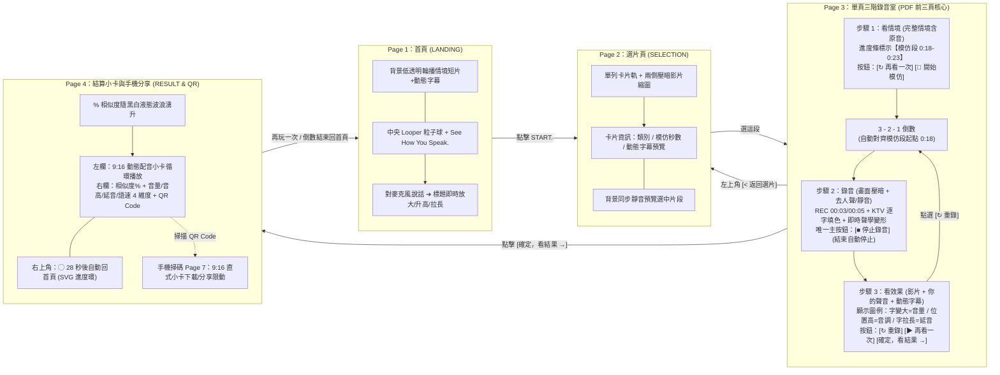

# 《看見你說話的樣子 See How You Speak》V2.0 專題企劃書
## —— 三階單頁錄音室、KTV 聲學動態字幕與展場互動系統規格書（保留極簡黑白粒子流體美學 × 植入 PDF 前三頁核心功能）

---

## 一、架構確認與設計對齊總覽（Canva 白板 × 7 頁 PDF × 現有黑白美學）

本企劃書整合團隊最新 **Canva 白板（`SHYS 網頁`）便利貼共識**、**7 頁互動規格 PDF** 以及 **四人工作分配**。
> **核心原則**：**視覺風格與色彩維持現有「極簡黑白銀灰 + Looper 線框粒子球 + 流體波浪」美學不變**；**功能與互動流程則 100% 採用 PDF 前三頁的「單一畫面三階段錄音室（1 看情境 → 2 錄音 → 3 看效果）」與展場閉環機制**。

### 1. 四大頁面升級對照表

| 頁面階段 | 視覺風格（維持現有黑白極簡美學） | 核心升級功能（採用 PDF + Canva 白板規格） |
| :--- | :--- | :--- |
| **Page 1：首頁**<br>`LANDING` | 純白至銀灰漸層、中央 68 圈 `LooperGroup` 線框粒子球、水面波浪鏡像倒影 | 1. **背景動態示範層**：背景低透明度輪播精選情境短片與動態字幕彈幕，一眼看懂系統主題。<br>2. **標題即時聲控變形**：中央 `See How You Speak.` 隨現場麥克風收音**即時變大（音量）、上下位移（音高）、水平拉長（延音）、微幅抖動（Jitter）**，兼具破冰與麥克風收音確認。<br>3. 提示膠囊：「對麥克風說聲『哈囉』，上面的標題會跟著你的聲音動」＋ 主按鈕【START. / 開始體驗】。 |
| **Page 2：選片頁**<br>`PROMPT_VIDEO` | 太鼓達人 / Netflix 單列 Coverflow 卡片軌道、中央暗色光暈、底部 `TAG.` 分類膠囊 | 1. **兩側非焦點灰框改為「壓暗影片畫面」**，中央卡片與背景連動預覽選中片段（靜音循環）。<br>2. **卡片資訊標準化**：顯示 `[類別標籤]`、`[模仿秒數，如：模仿 5 秒]`、`[難度星級]`、片名、一句話情境鋪陳。<br>3. **動態字幕預覽框**：卡片內嵌該句台詞的動態字體預覽（如「我等你**等了**整整**三**個小時……」），明確告知要模仿哪一句。 |
| **Page 3：模仿錄音頁**<br>`RECORDING`<br>*(直接採用 PDF 前三頁功能)* | 極簡黑白框線視窗、背景保留淡淡的粒子球與聲波紋理、高對比黑白/重點高亮色標示 | **【同一個畫面依序切換 3 個子狀態，每狀態僅保留 1 顆主要行動按鈕】**：<br>• 左上角固定：**【< 返回選片】**；右上角步驟指示器：**`[1 看情境]` → `[2 錄音]` → `[3 看效果]`**<br>• 進度條固定標示：**【模仿段 0:18–0:23】高亮色塊**（支援拖曳圓點重聽）。<br>1. **`1 看情境`**：播完整情境影片（含原音），一般段正常字幕、模仿段特殊動態字幕。底部次要鈕【↻ 再看一次】＋ 主按鈕**【🎤 開始模仿】**。<br>2. **`3-2-1 倒數` → `2 錄音`**：影片壓暗並切換為「去人聲伴奏 / 原音靜音」，左上顯示 `● REC 00:03 / 00:05`；字幕像 **KTV 逐字填色**，並**即時隨玩家音量（字變大）、音高（位置高低）、延音（字拉長）動態變形並定格保留**；下方顯示即時音量波形條與唯一主按鈕**【■ 停止錄音】**（到達模仿段結尾自動停止）。<br>3. **`3 看效果`**：原位立即播放**「影片 ＋ 你的錄音 ＋ 剛生成的專屬動態字幕」**；下方顯示**直覺圖例**（`怎麼看：字變大=音量大｜位置高=音調高｜字拉長=延音｜字距緊=講得快`）；底部提供次要鈕【↻ 重錄】【▶ 再看一次】＋ 唯一主按鈕**【確定，看結果 →】**。 |
| **Page 4：分數與小卡結算頁**<br>`SCORE_ANALYSIS` + 手機 9:16 頁 | 黑白液態湧升波浪、`%` 聚焦動畫過渡至左右雙欄展演卡片、右上角 SVG 倒數進度環 | 1. **保留 `%` 湧上升動畫**：先呈現相似度 `%` 隨波浪湧出，隨後滑順展開結算主畫面。<br>2. **左欄主角（9:16 動態配音小卡）**：循環播放「影片片段 ＋ 你的聲音 ＋ 你的動態字幕」、角色類型封號（如「情緒張力型」）。<br>3. **右欄輔助資訊**：相似度 `%`、一句話語氣評語、4 維度量化條（**音量 / 音高 / 延音 / 語速**）、**QR Code 掃描區**（掃碼開啟 Page 7 直式 9:16 手機頁面直接下載或分享限動）。<br>4. **可視化自動回首頁倒數環**：右上角顯示 `◯ 28 秒後自動回首頁` SVG 圓環倒數，底部提供【再玩一次】【回首頁】。 |

---

## 二、4 大 A/B 關鍵架構決策（A/B Testing & Architecture Decisions）

為了讓美術素材、UI 狀態與程式邏輯無縫接合，本系統確立以下 **4 項關鍵 A/B 架構決策**：

### A/B 決策 01：模仿錄音頁的狀態切換與版面架構
* **方案 A（拍板採用）：單一畫面三階段狀態機（In-Place 3-Step Studio：`1 看情境` → `2 錄音` → `3 看效果`）**
  * **做法**：共用同一個影片容器、同一個動態字幕舞台與同一條「帶模仿段色塊標示的進度條」；透過右上角膠囊指示器（`1 看情境` / `2 錄音` / `3 看效果`）切換狀態，且**每個狀態底部只放一顆高對比主要按鈕**（`開始模仿` ➔ `停止錄音` ➔ `確定，看結果 →`），將「返回選片」固定於左上角、「重錄」退居次要按鈕。
  * **優勢**：視覺焦點完全鎖定在「影片＋字幕變化」，展場觀眾不會在多顆按鈕間迷航，也不會誤觸重錄或返回。
* **方案 B（淘汰）：拆成多個獨立頁面，或同畫面同時塞滿「看示範／開始錄／重錄／聽聲音／看結果」五顆按鈕**
  * **淘汰原因**：按鈕過多會造成展場新手指引混亂，且跳頁會打斷影片與音軌的時間軸連貫感。

---

### A/B 決策 02：完整情境影片 vs. 去掉人聲模仿片段的音軌同步策略
* **方案 A（拍板採用）：同一時間軸雙影片／雙音軌同步架構（Full Context Track + Vocal-Removed Imitation Window）**
  * **做法**：每支情境設定完整長度（例如 `00:00 ~ 00:30`）與模仿段區間（例如 `imitateStart: 18.0, imitateEnd: 23.0`）：
    * 在 **`1 看情境`**：播放「完整情境影片（含原聲）」，玩家可自由拖曳進度條，模仿段 `0:18–0:23` 在進度條上以高亮色塊標出。
    * 在 **`2 錄音`**：自動定位至 `0:18` 模仿段起點（或播放美術剪好的「去掉人聲模仿片段」），畫面壓暗，進度條只跑 `0:18–0:23` 區間，到 `0:23` 自動結束錄音。
    * 在 **`3 看效果`**：畫面播放 `0:18–0:23` 去掉人聲的影片，同時疊加播放**玩家剛錄好的 16-bit PCM WAV 原音**與**玩家專屬動態字幕**。
  * **優勢**：既有前後劇情鋪陳（看懂為什麼角色要這樣講話），錄音與回放時又不會跟原片配音打架，完美達成「幫角色配音」的沉浸感。
* **方案 B（淘汰）：全程只用一支含原音的短片，錄音時硬把影片完全關掉只看黑畫面**
  * **淘汰原因**：錄音時看不到角色表情與口型，玩家抓不到說話時機；回放時若原音沒去掉，玩家的聲音會跟原片人聲混在一起聽不清楚。

---

### A/B 決策 03：錄音中「KTV 逐字填色」與「即時聲學動態變形」的耦合機制
* **方案 A（拍板採用）：「時間碼驅動 KTV 填色 ＋ 即時聲學驅動物理變形並定格快照」雙軌引擎**
  * **做法**：
    1. **KTV 水平填色軌（由美術提供的逐字時間碼 `charTimings` 驅動）**：依影片模仿段時間進度，文字由左至右平滑填滿亮色，引導玩家跟上角色說話節奏。
    2. **即時聲學變形軌（由 Web Audio 即時抽樣驅動）**：當某個字正處於 KTV 填色區間時，即時讀取玩家麥克風的**音量（字體大小 Scale）**、**音高（垂直位移 Y-Offset）**、**延音時長（字寬拉伸 ScaleX）**與**語速/停頓（字距 Letter-Spacing）**；當時間跨入下一個字時，**前一個字直接「定格（Freeze）」保留玩家剛才唸它時的最高聲學形變量**！
  * **優勢**：玩家邊唸邊看到字隨自己聲音長大、跳高、拉長，且整句唸完進入「3 看效果」時，整行字會留下一幅高矮胖瘦錯落的「聲音造型圖」（如 PDF 第 3 頁「我等你**等了**整整**三**個小時……」）。
* **方案 B（淘汰）：用瀏覽器語音辨識（Web Speech API STT）辨識到哪個字才填色，或整句話所有字一起同幅度放大縮小**
  * **淘汰原因**：Web Speech API 延遲高達 0.5~1.5 秒且展場噪音下極易漏字；若整句話一起放大縮小，就看不出「哪一個字被重讀、哪一個字拉長音」。

---

### A/B 決策 04：動態字幕預覽與結果小卡的渲染管線
* **方案 A（拍板採用）：前端即時 DOM/Canvas 雙態合成播放器（Live Composite Dubbing Player）＋ 60fps 聲學特徵向量封裝**
  * **做法**：
    * 錄音當下同步產出兩份資料：① **自動增益正規化後的 16-bit PCM WAV 音訊 Blob**；② **逐字／逐幀聲學特徵序列（Volume / Pitch / Duration / Rate）**。
    * 在錄音頁「3 看效果」與結算頁左側 9:16 小卡中，直接使用 `<video muted>` + `<audio src={userWav}>` + `<KineticTypography snapshot={...} />` 原生三層同步循環播放，**0 秒等待、無須等雲端轉檔**即可立即觀看配音成片；掃描 QR Code 則將壓縮後的聲學特徵向量與音訊帶入手機端 9:16 頁面重現並支援匯出分享。
* **方案 B（淘汰）：按完「停止錄音」後上傳後端伺服器用 FFmpeg 合成 MP4 影片再傳回前端播放**
  * **淘汰原因**：轉檔加網路上傳動輒耗時 5~15 秒，展場體驗會嚴重卡頓，且一旦展場 Wi-Fi 不穩整套系統就會癱瘓。

---

## 三、5 大隱性問題與避坑防線（5 Implicit Problems & Pitfall Defenses）

在實際將 PDF 前三頁與展場流程落地時，有 **5 個表面看不出來、但實測一定會踩到的隱性問題**，以下為對應的工程防線：

### ⚠️ 隱性問題 01：玩家在「1 看情境」隨意拖曳進度條後點「開始模仿」，導致錄音起點與字幕時間碼錯位
* **發生情境**：PDF 第 1 頁允許玩家「拖曳進度條重聽」，如果玩家把圓點拖到 `0:25` 或 `0:05`，這時按下「開始模仿」，若直接從當前秒數開始錄，KTV 字幕時間碼（設在 `0:18–0:23`）會完全對不上。
* **🛡️ 避坑防線（強制錨點對齊與 3-2-1 預定位機制）**：
  1. 點擊【開始模仿】進入 `3、2、1` 倒數的瞬間，程式自動將影片 `currentTime` 強制鎖定回模仿段起點 `imitateStart`（如 `0:18.0`）並暫停待命。
  2. 倒數結束進入 `2 錄音` 第 0.0 秒時，才從 `imitateStart` 同步啟動無聲/去人聲影片、KTV 時間碼計時器與麥克風錄音；且在 `2 錄音` 階段**鎖定進度條禁止手動拖曳**，到達 `imitateEnd`（`0:23.0`）自動切斷錄音並跳轉 `3 看效果`。

---

### ⚠️ 隱性問題 02：玩家提前唸完或搶拍，按下「停止錄音」時，後面的字還沒填色也沒有動態形變
* **發生情境**：有些玩家語速很快，5 秒的台詞 3 秒就唸完並手動按下【■ 停止錄音】；若完全死板照原片時間碼分配，最後兩三個字在「3 看效果」時會沒有任何聲學變化。
* **🛡️ 避坑防線（時長自適應比例映射 Time-Warping Alignment）**：
  1. 錄音中：依標準時間碼提供 KTV 填色引導。
  2. 按下【停止錄音】進入 `3 看效果` 結算時：自動擷取玩家實際有發聲的有效區間（`trimSilenceMargins`），將玩家實際說話的時間長度**等比例彈性對齊（Linear / DTW Time-Stretch）**到台詞字數上，確保玩家提早唸完的每個字都能分到對應的音量與音高形變。

---

### ⚠️ 隱性問題 03：展場觀眾「只看到字在動，卻看不懂為什麼這樣動」，失去專題研究價值
* **發生情境**：一般觀眾第一次看到字體忽大忽小、忽高忽低，常誤以為是隨機特效，不知道這背後對應「華語音量、音高、延音、語速」四大聲學特徵。
* **🛡️ 避坑防線（首頁破冰體感 ＋「3 看效果」四維度直覺圖例常駐）**：
  1. **首頁直覺破冰**：一開口說話，`See How You Speak.` 標題就同步放大、升高、拉長，建立第一層體感連結。
  2. **「3 看效果」圖例膠囊（完全採用 PDF 第 3 頁設計）**：在回放進度條正下方常駐顯示四顆極簡圖例膠囊：
     * `字變大 ＝ 音量大`
     * `位置高 ＝ 音調高`
     * `字拉長 ＝ 延音`
     * `字距緊 ＝ 講得快`
     並且當回放影片播到某個特大或特高的字時，對應的圖例膠囊會同步微亮閃爍，讓觀眾一秒看懂聲學轉譯規則。

---

### ⚠️ 隱性問題 04：展場環境吵雜／麥克風忽大忽小，導致「字完全不動」或「一進場就爆掉」
* **發生情境**：展場環境底噪可能高達 65dB，而不同身高、不同距離的觀眾對麥克風說話音量差異極大（有的只有 15%、有的貼著麥克風吼到 100%）。
* **🛡️ 避坑防線（雙重軟箝位 Clamp ＋ 16-bit WAV 自動峰值增益 AGC）**：
  1. **收音與回放端**：維持我們剛修好的 **Web Audio `Compressor` + 16-bit PCM WAV 自動峰值正規化（目標峰值 `0.88`、最高 `8.0x` 增益）**，就算玩家小聲說話，在「3 看效果」與「結算小卡」回放時依然清晰飽滿。
  2. **視覺轉譯端**：套用三層物理可讀性箝位（字體縮放限制在 `0.8x ~ 1.65x`、垂直位移 `-22px ~ +22px`、水平拉長 `1.0x ~ 2.1x`），並扣除環境底噪基準（`noiseFloor`），確保展場不爆版、不重疊。

---

### ⚠️ 隱性問題 05：展場無人操作時卡在半路，或玩家還在看小卡／掃 QR Code 就被無預警踢回首頁
* **發生情境**：展場上一位玩家錄完直接走掉，畫面若停在錄音頁會讓下一位觀眾不知所措；但若像先前一樣用隱藏的 12 秒計時器直接跳回首頁，正在掃 QR Code 或重聽配音的玩家會覺得莫名其妙被切掉。
* **🛡️ 避坑防線（全頁面分級閒置逾時 ＋ 右上角可視化 SVG 倒數進度環）**：
  1. **可視化倒數環（採用 PDF 第 6 頁設計）**：在結算頁右上角明確繪製 **SVG 圓形倒數進度環 `◯ 28 秒後自動回首頁`**（選片頁與錄音頁閒置超過 45 秒時亦浮現倒數環提醒）。
  2. **智慧互動重置與暫停**：只要偵測到任何滑鼠移動、點擊、拖曳進度條、或正在點擊「再看一次／重聽」，倒數計時立即重置或暫停，絕不在玩家操作中途強行切頁。

---

## 四、系統流程拓撲圖（Mermaid Flow Architecture）



---

## 五、四人團隊分工與跨組交付規格契約（Team Handoff Contract）

為了讓美術、UI 與程式能平行推進、套素材時零修改，制定以下交付規格：

### 1. 美術組（佩岑、妤安）交付規格
* **每支情境提供 2 個 MP4 檔案（H.264, 1080p/720p）**：
  1. `full_[id].mp4`：**完整情境影片（含原音）**——供「1 看情境」與選片背景預覽使用（例如總長 20~30 秒）。
  2. `mute_[id].mp4`：**去掉人聲的模仿片段（保留背景音效／配樂，或僅切出模仿段）**——供「2 錄音」與「3 看效果／結算小卡」疊加玩家聲音使用。
* **每段台詞的逐字時間碼表（供程式做 KTV 逐字填色）**：
  * 標明模仿段在完整影片中的起訖秒數（如 `0:18.0 ~ 0:23.0`），以及每個字出現的相對秒數：
  ```json
  {
    "id": "scenario-01",
    "category": "喜劇",
    "title": "約會遲到三小時",
    "contextDesc": "約會遲到三小時的男友終於出現，女主角壓著火氣開口。",
    "imitateStartSec": 18.0,
    "imitateEndSec": 23.0,
    "line": "我等你等了整整三個小時……",
    "charTimings": [
      { "char": "我", "start": 0.0, "end": 0.3 },
      { "char": "等", "start": 0.3, "end": 0.6 },
      { "char": "你", "start": 0.6, "end": 1.0 },
      { "char": "等", "start": 1.1, "end": 1.6 },
      { "char": "了", "start": 1.6, "end": 2.1 },
      { "char": "整", "start": 2.2, "end": 2.5 },
      { "char": "整", "start": 2.5, "end": 2.8 },
      { "char": "三", "start": 2.8, "end": 3.7 },
      { "char": "個", "start": 3.7, "end": 4.0 },
      { "char": "小", "start": 4.0, "end": 4.4 },
      { "char": "時", "start": 4.4, "end": 5.0 }
    ]
  }
  ```
* **首頁背景輪播短片 & 選片卡片縮圖**。

### 2. 美術 UI 組（科魚）交付規格
* **維持現有極簡黑白粒子流體美學**下的元件細節對齊：
  1. **錄音頁 5 態元件**：`1 看情境` / `3-2-1 倒數` / `2 錄音 (含 REC 標籤與即時音量條)` / `3 看效果 (含四維度怎麼看圖例)` / `確定看結果`，以及進度條上的「模仿段高亮色塊」與拖曳圓點樣式。
  2. **結算頁雙欄版面與進度環**：左側 9:16 動態小卡外框、右側 4 維度分數條（音量／音高／延音／語速）、QR Code 區塊，以及右上角 **SVG 圓形倒數進度環（`28 秒後自動回首頁`）**。
  3. **手機端 9:16 分享頁版面（PDF 第 7 頁）**。

### 3. 程式組（承祐）實作優先順序
1. **Step 1（最優先）**：完成 **Page 3 單頁三階錄音室**（`1 看情境` 含模仿段色塊進度條拖曳 ➔ `3-2-1 倒數` ➔ `2 錄音` KTV 逐字填色 + 音量/音高/延音即時動態字體 + 自動停止 ➔ `3 看效果` 影片配玩家 WAV 原音與動態字幕回放 + 怎麼看圖例）。
2. **Step 2**：升級 **Page 4 結算頁與手機 9:16 頁**（保留 `%` 湧升動畫後展開左 9:16 動態小卡 + 右四維度分析與 QR Code + 右上角 SVG 倒數回首頁進度環）。
3. **Step 3**：升級 **Page 1 首頁**（背景輪播示範 + `See How You Speak.` 標題隨麥克風即時變大/抖動/拉長）與 **Page 2 選片頁**（兩側壓暗影片卡、秒數標籤、動態字幕預覽），套入美術素材完成全流程展場壓力測試。
